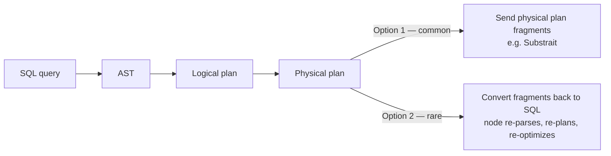

# 07 — Distributed Query Planning

## What carries over, what changes

- All the familiar optimizations still apply: **predicate push-down, projection push-down, join ordering** [`34:30`](https://www.youtube.com/watch?v=L6E75IyBgpk&t=2070).
- What changes: instead of counting **disk I/Os**, the cost model must account for **network cost** — where the data is, where it must go, whether it is partitioned or replicated [`34:30`](https://www.youtube.com/watch?v=L6E75IyBgpk&t=2070) [`35:08`](https://www.youtube.com/watch?v=L6E75IyBgpk&t=2108).
- **Two-phase planning**: some systems plan as if single-node first, then run a second pass that rewrites the plan into a distributed one. This is reportedly how **Microsoft SQL Server** does it [`35:08`](https://www.youtube.com/watch?v=L6E75IyBgpk&t=2108) [`35:30`](https://www.youtube.com/watch?v=L6E75IyBgpk&t=2130).
- **Calibrated cost models**: rather than hard-coding network transfer costs, some systems run **micro-benchmarks at boot** to measure inter-node transfer speed and feed that into cost estimates [`35:30`](https://www.youtube.com/watch?v=L6E75IyBgpk&t=2130) [`35:53`](https://www.youtube.com/watch?v=L6E75IyBgpk&t=2153).

## What gets sent between nodes: two options

### Option 1 — ship the physical plan (what almost everyone does)

- A centralized coordinator does the planning and builds a **globally optimal plan**, then ships **physical plan fragments** to compute nodes, which just execute them [`37:57`](https://www.youtube.com/watch?v=L6E75IyBgpk&t=2277) [`38:32`](https://www.youtube.com/watch?v=L6E75IyBgpk&t=2312).
- **Substrait** is named as a standardized cross-system representation of a query plan [`37:57`](https://www.youtube.com/watch?v=L6E75IyBgpk&t=2277) [`38:32`](https://www.youtube.com/watch?v=L6E75IyBgpk&t=2312).

### Option 2 — ship SQL back down (rare)

- Break the physical plan into subtasks, **convert each back into SQL**, and let each node parse, plan, and optimize it locally [`38:49`](https://www.youtube.com/watch?v=L6E75IyBgpk&t=2329).
- Rationale: the coordinator's **global view of the data is never fully up to date**, so local nodes are better placed to make local optimization decisions [`39:13`](https://www.youtube.com/watch?v=L6E75IyBgpk&t=2353).
- Named practitioners: **SingleStore** and **Vitess** (YouTube's sharding middleware for MySQL — not analytics, but it works this way) [`39:34`](https://www.youtube.com/watch?v=L6E75IyBgpk&t=2374).
- Mechanically: each fragment becomes a SQL statement with a range predicate (`WHERE id BETWEEN 1 AND 100`), so each node plans locally and may even **choose a different join algorithm** — logically the result is identical [`39:58`](https://www.youtube.com/watch?v=L6E75IyBgpk&t=2398).

## Why bother with global optimization at all?

Student question, answered [`40:38`](https://www.youtube.com/watch?v=L6E75IyBgpk&t=2438) [`41:02`](https://www.youtube.com/watch?v=L6E75IyBgpk&t=2462):

- You **must** plan globally to know which portion of the query executes where, especially across **multiple stages** rather than a single "everyone does the same thing, union at the end" pattern [`41:27`](https://www.youtube.com/watch?v=L6E75IyBgpk&t=2487).
- With three tables (R ⋈ S ⋈ T), only a global view can decide **which join happens first and which second** [`41:46`](https://www.youtube.com/watch?v=L6E75IyBgpk&t=2506).
- Caveat the instructor raises himself: in a **lakehouse system like Databricks there are barely any statistics anyway**, so the "coordinator's stats are stale" argument loses force [`42:01`](https://www.youtube.com/watch?v=L6E75IyBgpk&t=2521).
