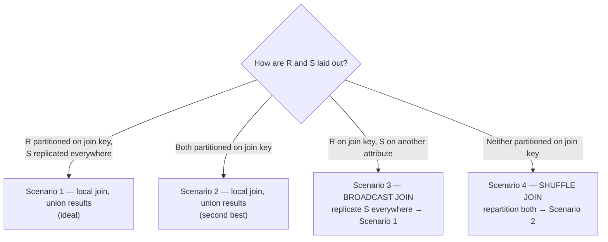

# 08 — Distributed Join Algorithms

## Why joins dominate

- On a single node the join is **usually the most expensive operator — roughly 50–60% of total query time** (unless disk is so slow that scanning dominates) [`42:01`](https://www.youtube.com/watch?v=L6E75IyBgpk&t=2521) [`42:25`](https://www.youtube.com/watch?v=L6E75IyBgpk&t=2545).
- The distributed question is what to do when **the data isn't aligned with the join key** [`42:44`](https://www.youtube.com/watch?v=L6E75IyBgpk&t=2564).
- Copying everything to one node is infeasible at petabyte scale, and **cross-data-center joins additionally cost egress fees** to your cloud provider [`42:58`](https://www.youtube.com/watch?v=L6E75IyBgpk&t=2578) [`43:17`](https://www.youtube.com/watch?v=L6E75IyBgpk&t=2597).
- Correctness bar: the result must be **logically identical** to single-node execution; sort order may differ unless there is an `ORDER BY` [`43:57`](https://www.youtube.com/watch?v=L6E75IyBgpk&t=2637).

## The four scenarios for `R ⋈ S`

### Scenario 1 — R partitioned on the join key, S replicated

- Classic shape: **R is the huge fact table** partitioned on e.g. sale ID; **S is a small dimension table** (zip codes — only ~40,000 in the US) replicated on every node [`44:17`](https://www.youtube.com/watch?v=L6E75IyBgpk&t=2657) [`44:53`](https://www.youtube.com/watch?v=L6E75IyBgpk&t=2693).
- Each node joins its slice of R against its local copy of S; results are shipped and **unioned**, which is cheap [`44:53`](https://www.youtube.com/watch?v=L6E75IyBgpk&t=2693) [`45:20`](https://www.youtube.com/watch?v=L6E75IyBgpk&t=2720).
- **The ideal case** [`45:20`](https://www.youtube.com/watch?v=L6E75IyBgpk&t=2720).

### Scenario 2 — both tables partitioned on the join key

- Everything needed for the join is **already local**; run any local join (hash, sort-merge, nested loop), then concatenate results [`45:42`](https://www.youtube.com/watch?v=L6E75IyBgpk&t=2742) [`46:04`](https://www.youtube.com/watch?v=L6E75IyBgpk&t=2764).
- **Second-best scenario**; no node has to interrogate others about missing tuples, so no false negatives [`46:22`](https://www.youtube.com/watch?v=L6E75IyBgpk&t=2782) [`46:35`](https://www.youtube.com/watch?v=L6E75IyBgpk&t=2795).
- **Why it's rare**: you dumped Parquet files in S3 without partitioning because you didn't know what queries would come, and a year later someone joins on a key you never anticipated [`46:35`](https://www.youtube.com/watch?v=L6E75IyBgpk&t=2795).

### Scenario 3 — broadcast join

- Shape: R partitioned on the join key, **S partitioned on a different attribute** — a local join would miss tuples (looking for ID 33 that lives on another node) [`47:12`](https://www.youtube.com/watch?v=L6E75IyBgpk&t=2832).
- Fix: **every node broadcasts its slice of S to every other node** until S is fully replicated — collapsing into Scenario 1 [`47:44`](https://www.youtube.com/watch?v=L6E75IyBgpk&t=2864) [`48:06`](https://www.youtube.com/watch?v=L6E75IyBgpk&t=2886).
- Naming: "broadcast join" describes only the **replication step**; the local join is still hash/sort-merge — so really a **broadcast hash join** [`48:27`](https://www.youtube.com/watch?v=L6E75IyBgpk&t=2907).
- Blocking behavior: you can **build the hash table on R while waiting**, but you cannot complete the join until all of S arrives [`48:52`](https://www.youtube.com/watch?v=L6E75IyBgpk&t=2932) [`49:03`](https://www.youtube.com/watch?v=L6E75IyBgpk&t=2943).
- Precondition: **S must be the smaller table** — otherwise you recreate the "overwhelm one node with a petabyte" problem [`49:15`](https://www.youtube.com/watch?v=L6E75IyBgpk&t=2955).

### Scenario 4 — shuffle join (worst case)

- Neither table is partitioned on the join key, neither is replicated, and both are **too big for a single node** [`49:32`](https://www.youtube.com/watch?v=L6E75IyBgpk&t=2972).
- Fix: **repartition both tables on the join key** (hash or range partitioning) and redistribute — collapsing into Scenario 2 [`49:56`](https://www.youtube.com/watch?v=L6E75IyBgpk&t=2996) [`50:19`](https://www.youtube.com/watch?v=L6E75IyBgpk&t=3019) [`50:30`](https://www.youtube.com/watch?v=L6E75IyBgpk&t=3030).
- Again really a **shuffle hash join** [`49:32`](https://www.youtube.com/watch?v=L6E75IyBgpk&t=2972).
- This directly answers the earlier "why shuffle at all?" question: shuffling lets you **redistribute data on whatever key the next pipeline stage needs** [`50:30`](https://www.youtube.com/watch?v=L6E75IyBgpk&t=3030) [`50:45`](https://www.youtube.com/watch?v=L6E75IyBgpk&t=3045).
- **Multi-attribute joins** need no new machinery: concatenate the bytes of the attributes and hash, exactly as with local multi-attribute hashing [`51:13`](https://www.youtube.com/watch?v=L6E75IyBgpk&t=3073).

## Indexes in the OLAP world

- OLAP systems **typically don't build indexes** — B+ trees serve point lookups, but analytics rips through everything [`51:50`](https://www.youtube.com/watch?v=L6E75IyBgpk&t=3110) [`52:12`](https://www.youtube.com/watch?v=L6E75IyBgpk&t=3132).
- What they use instead: **zone maps** (per-column min/max) kept centrally, enabling **early file pruning** — "I don't need to read this file" [`52:12`](https://www.youtube.com/watch?v=L6E75IyBgpk&t=3132).
- In the OLTP world indexes are **local, not global**, so a lookup on a non-partition key requires a **broadcast**. Exception: **Clustrix** (out of AOL, acquired by MariaDB, renamed MariaDB Xpand, since discontinued) supported a **synchronized global index** [`52:38`](https://www.youtube.com/watch?v=L6E75IyBgpk&t=3158) [`53:04`](https://www.youtube.com/watch?v=L6E75IyBgpk&t=3184).

## Caching intermediate results

- Repeating a query means repeating an expensive shuffle and hash-table build, so some systems **cache intermediate results**; some don't [`53:52`](https://www.youtube.com/watch?v=L6E75IyBgpk&t=3232).
- **Firebolt** builds a cache service for exactly this. Their motive is economic: they charge a flat query price but **pay Amazon per read**, so avoiding S3 traffic is pure margin [`54:14`](https://www.youtube.com/watch?v=L6E75IyBgpk&t=3254).

## Semi-joins and Bloom joins

- **Semi-join**: when you don't need every column to compute the join, send only a **compact form** over the wire — projection push-down to the bare join key, or a **Bloom filter** [`54:40`](https://www.youtube.com/watch?v=L6E75IyBgpk&t=3280) [`55:15`](https://www.youtube.com/watch?v=L6E75IyBgpk&t=3315).
- Flow: locally project/filter the small dimension table → ship the minimal form → join locally → send back only the minimum needed → the first node completes the join with its full local data [`55:36`](https://www.youtube.com/watch?v=L6E75IyBgpk&t=3336) [`56:14`](https://www.youtube.com/watch?v=L6E75IyBgpk&t=3374).
- Naming again: a "**Bloom join**" is really a **Bloom hash join** [`56:30`](https://www.youtube.com/watch?v=L6E75IyBgpk&t=3390) [`56:49`](https://www.youtube.com/watch?v=L6E75IyBgpk&t=3409).
- **Precondition**: the optimization only works if the projection is narrow. `SELECT fact.*` pulls every column from the fact table and **kills the optimization** [`56:49`](https://www.youtube.com/watch?v=L6E75IyBgpk&t=3409) [`57:11`](https://www.youtube.com/watch?v=L6E75IyBgpk&t=3431).
- The **SQL standard has no semi-join**; some systems let you declare one, but the optimizer should apply it automatically [`54:40`](https://www.youtube.com/watch?v=L6E75IyBgpk&t=3280).
