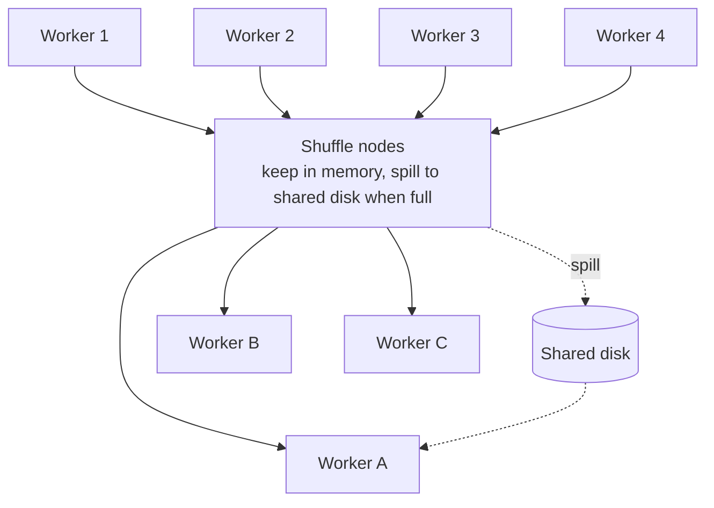

# 09 — The Shuffle Phase and Adaptive Execution

## Why an explicit shuffle stage pays for itself

- Without it, the plan generated up front **hard-codes the data path** from operator to operator across nodes [`57:11`](https://www.youtube.com/watch?v=L6E75IyBgpk&t=3431).
- That bakes in assumptions about data you may know nothing about — Parquet files dumped in S3 by an external service give you **little to no information**, so selectivity estimates can be wildly wrong and you end up with **too many or too few nodes** [`57:39`](https://www.youtube.com/watch?v=L6E75IyBgpk&t=3459).
- The shuffle acts as a **pipeline breaker where the system can reassess the actual data and re-adjust the plan and its resources mid-query** [`58:09`](https://www.youtube.com/watch?v=L6E75IyBgpk&t=3489) [`58:34`](https://www.youtube.com/watch?v=L6E75IyBgpk&t=3514).

## Who does it

- Comes from the **MapReduce world**; **Google BigQuery** and **Spark** are both implemented this way — Spark was built as a better Hadoop and added an explicit shuffle step [`58:55`](https://www.youtube.com/watch?v=L6E75IyBgpk&t=3535).
- Contrast: **SQL Server's exchange operator is optional** (the optimizer decides), whereas **BigQuery and Spark always shuffle** [`59:20`](https://www.youtube.com/watch?v=L6E75IyBgpk&t=3560).
- **BigQuery has dedicated custom hardware for in-memory shuffle** (semi-public) — because shuffle is where most of the time goes, it matters far more than how fast your sort is [`59:36`](https://www.youtube.com/watch?v=L6E75IyBgpk&t=3576).
- **Standalone shuffle services** exist: **Apache Celeborn** (out of Tencent) and **Uniffle** (another Chinese company). Spark shuffles in local memory by default; Celeborn plugs in as an external **key-value-style** shuffle service [`59:36`](https://www.youtube.com/watch?v=L6E75IyBgpk&t=3576) [`1:00:04`](https://www.youtube.com/watch?v=L6E75IyBgpk&t=3604) [`1:00:28`](https://www.youtube.com/watch?v=L6E75IyBgpk&t=3628).

## Mechanics

- Producer/consumer model: stage-1 workers emit results into shuffle nodes; the shuffle layer keeps as much in memory as possible and **spills to shared disk** — it is just another buffer manager [`1:00:28`](https://www.youtube.com/watch?v=L6E75IyBgpk&t=3628) [`1:00:55`](https://www.youtube.com/watch?v=L6E75IyBgpk&t=3655).
- Stage-2 workers pull from memory or from that shared disk [`1:00:55`](https://www.youtube.com/watch?v=L6E75IyBgpk&t=3655).

## What the pause buys you

- **Elastic worker counts between stages** — the example goes from **4 processing nodes in stage 1 to 3 in stage 2** [`1:01:09`](https://www.youtube.com/watch?v=L6E75IyBgpk&t=3669).
- **Skew handling**: if one key turns out to be very hot, apply **recursive partitioning** (as in Grace hash join) to spread it across more nodes instead of crushing one [`1:01:21`](https://www.youtube.com/watch?v=L6E75IyBgpk&t=3681).
- Generally: the ability to **pause mid-query and re-decide based on observed data** unlocks a family of optimizations [`1:01:35`](https://www.youtube.com/watch?v=L6E75IyBgpk&t=3695).

## The naming, one more time

- SQL Server's **repartition/exchange operator** and the distributed OLAP world's **shuffle** are the same thing [`1:01:47`](https://www.youtube.com/watch?v=L6E75IyBgpk&t=3707).
- Bottom line for OLAP: **the join and the shuffle are the two most expensive things**, and all the single-node material still applies [`1:02:15`](https://www.youtube.com/watch?v=L6E75IyBgpk&t=3735).
