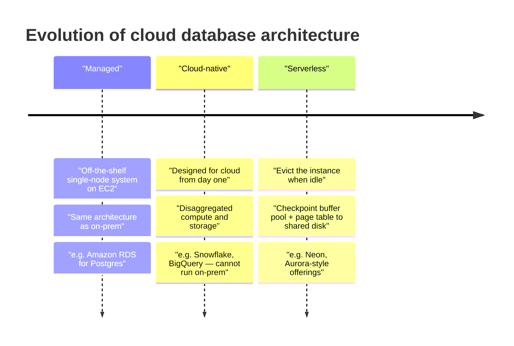

# 10 — Cloud Database Architectures: Managed, Cloud-Native, Serverless

The last ~10 minutes are a "brain dump" on what people actually mean by "cloud database" [`1:02:30`](https://www.youtube.com/watch?v=L6E75IyBgpk&t=3750).

## Database-as-a-Service (DBaaS)

- Over the last decade, cloud vendors offer **managed database systems**: instead of spinning up EC2 and installing Postgres yourself, you hand over a credit card and get a hostname and port; they run backups and recovery [`1:02:30`](https://www.youtube.com/watch?v=L6E75IyBgpk&t=3750) [`1:02:48`](https://www.youtube.com/watch?v=L6E75IyBgpk&t=3768).

## Three generations

### 1. Managed systems

- Take an off-the-shelf open-source/single-node system, drop it on an EC2 instance, manage it for the customer. **The architecture is identical to running it yourself on-prem** [`1:03:30`](https://www.youtube.com/watch?v=L6E75IyBgpk&t=3810).
- Amazon is the archetype: they took Postgres, put it in an EC2 instance, and **charge roughly double** (notably for storage) via RDS versus self-hosting — whether the management is worth 2× is "debatable" [`1:03:52`](https://www.youtube.com/watch?v=L6E75IyBgpk&t=3832) [`1:04:08`](https://www.youtube.com/watch?v=L6E75IyBgpk&t=3848).
- Early distributed systems in this space were **shared-nothing**, though S3 Select and similar have blurred that line [`1:03:14`](https://www.youtube.com/watch?v=L6E75IyBgpk&t=3794).

### 2. Cloud-native systems

- **Snowflake started this generation**: architecture designed from the outset for the cloud, with **disaggregated compute and storage** (compute layer + S3/EBS storage layer) [`1:04:08`](https://www.youtube.com/watch?v=L6E75IyBgpk&t=3848).
- They embed the control mechanisms for whichever cloud they run on (**Snowflake runs on GCP, AWS, and Azure**) and hide it from users [`1:04:38`](https://www.youtube.com/watch?v=L6E75IyBgpk&t=3878).
- Defining property: **you cannot download and run them on-prem** — Snowflake and BigQuery are cloud-only [`1:04:38`](https://www.youtube.com/watch?v=L6E75IyBgpk&t=3878).

### 3. Serverless databases

- Buzzword of the last five years. There is still a server — the point is that **your instance gets evicted from hardware when it goes idle**; thresholds and whether they kill a VM or just a sliver vary by implementation [`1:05:03`](https://www.youtube.com/watch?v=L6E75IyBgpk&t=3903) [`1:05:24`](https://www.youtube.com/watch?v=L6E75IyBgpk&t=3924).
- The waste it removes: dedicated hardware idling while nobody sends queries, still billing you for compute, storage, and memory [`1:05:52`](https://www.youtube.com/watch?v=L6E75IyBgpk&t=3952).

**Eviction sequence** [`1:06:14`](https://www.youtube.com/watch?v=L6E75IyBgpk&t=3974) [`1:06:38`](https://www.youtube.com/watch?v=L6E75IyBgpk&t=3998) [`1:07:10`](https://www.youtube.com/watch?v=L6E75IyBgpk&t=4030):

1. Application goes idle.
2. Flush the buffer pool contents to shared disk — essentially a **checkpoint of dirty pages**.
3. Also write out **ephemeral internal state, notably the page table itself** — otherwise you know the pages were flushed but not which pages you had (the BusTub page table is a pure in-memory hash table and would be lost).
4. Kill the instance (or switch off that sliver).
5. **You still pay for storage** — S3 deletes what you stop paying for.

**Resume sequence** [`1:07:30`](https://www.youtube.com/watch?v=L6E75IyBgpk&t=4050) [`1:07:54`](https://www.youtube.com/watch?v=L6E75IyBgpk&t=4074):

- New query arrives → a **slow-start pause** while state is fetched back, restoring the system to its prior state (like a finer-grained VM freeze/thaw).
- Optimization: fetch the **first page the query needs**, then repopulate the rest of the buffer pool **in the background**.

**Players and economics** [`1:08:12`](https://www.youtube.com/watch?v=L6E75IyBgpk&t=4092) [`1:08:28`](https://www.youtube.com/watch?v=L6E75IyBgpk&t=4108) [`1:08:53`](https://www.youtube.com/watch?v=L6E75IyBgpk&t=4133):

- **Neon** ripped the storage layer out of Postgres and replaced it with a distributed page server doing exactly this.
- **Fauna**, **SQL Server**, and **Amazon** have their own serverless variants.
- **Per-query it is more expensive** — but if your app sends one query a week, it is far cheaper overall.
