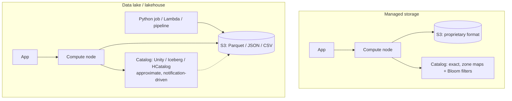

# 11 — Data Lakes, Lakehouses, and Catalogs

## Managed storage (the Snowflake model)

- Snowflake disaggregated compute and storage, but **Snowflake still managed the storage layer**: S3 held the bits, Snowflake tracked what was in them [`1:09:08`](https://www.youtube.com/watch?v=L6E75IyBgpk&t=4148) [`1:09:21`](https://www.youtube.com/watch?v=L6E75IyBgpk&t=4161).
- Data goes in through the DBMS: `CREATE TABLE` → compute node sets up a **catalog** in S3 and inserts the data in a **proprietary format** [`1:09:21`](https://www.youtube.com/watch?v=L6E75IyBgpk&t=4161) [`1:09:46`](https://www.youtube.com/watch?v=L6E75IyBgpk&t=4186).
- Proprietary formats are the norm — BusTub's page byte layout is unreadable by any other system, just as BusTub can't read SQLite, MySQL, or Postgres data [`1:09:46`](https://www.youtube.com/watch?v=L6E75IyBgpk&t=4186) [`1:10:10`](https://www.youtube.com/watch?v=L6E75IyBgpk&t=4210).
- This is called **managed storage** [`1:10:34`](https://www.youtube.com/watch?v=L6E75IyBgpk&t=4234).

## Data lakes

- Premise: **not everything wants to write through the database**. Python jobs, Lambda functions, and pipelines dump Parquet/JSON/CSV **directly into S3** [`1:10:34`](https://www.youtube.com/watch?v=L6E75IyBgpk&t=4234) [`1:11:04`](https://www.youtube.com/watch?v=L6E75IyBgpk&t=4264).
- You still need a **catalog** listing available files — but it is **no longer perfectly in sync**. With managed storage the system observed every insert and could build zone maps and Bloom filters on the way in; a lake catalog effectively says "here are some files, I don't really know what's in them" [`1:11:04`](https://www.youtube.com/watch?v=L6E75IyBgpk&t=4264) [`1:11:26`](https://www.youtube.com/watch?v=L6E75IyBgpk&t=4286) [`1:11:43`](https://www.youtube.com/watch?v=L6E75IyBgpk&t=4303).

## Lakehouse

- **Databricks branded the "lakehouse"**: anyone can dump files into your blob storage, but a Databricks-managed layer keeps track of which files map to which tables and knows how to read them and produce results [`1:11:43`](https://www.youtube.com/watch?v=L6E75IyBgpk&t=4303) [`1:12:23`](https://www.youtube.com/watch?v=L6E75IyBgpk&t=4343).
- **Snowflake** still defaults to managed storage but supports this model too; **Redshift** went shared-nothing → shared-disk → lakehouse-capable, consistently **lagging Databricks and Snowflake** [`1:12:23`](https://www.youtube.com/watch?v=L6E75IyBgpk&t=4343) [`1:12:55`](https://www.youtube.com/watch?v=L6E75IyBgpk&t=4375).

## Why not just transform data on the way in? (student question)

Three arguments [`1:12:55`](https://www.youtube.com/watch?v=L6E75IyBgpk&t=4375) [`1:13:21`](https://www.youtube.com/watch?v=L6E75IyBgpk&t=4401) [`1:13:43`](https://www.youtube.com/watch?v=L6E75IyBgpk&t=4423) [`1:13:57`](https://www.youtube.com/watch?v=L6E75IyBgpk&t=4437):

1. **You may not control the producer** — a data scientist without DB permissions is just dropping files in S3.
2. **Same problem as partitioning**: you'd be guessing what future queries need; a year or two later the application's demands change and every transformation assumption is wrong. "That's very common."
3. **S3 storage is cheap** relative to EBS/direct-attached, so you let people dump and clean up later. It **lowers the barrier to storing data at all** — force people to transform first and they'll just keep the dataset on their laptop.
- The instructor doesn't take a side: it depends on organizational protocols and application demands. The failure mode has a name — a **data swamp** [`1:13:57`](https://www.youtube.com/watch?v=L6E75IyBgpk&t=4437).

## Concurrency control over data you don't own (student question)

- **S3 is append-only**: you can append and delete, but you **cannot overwrite** an existing file — so at the physical/file level there is no concurrency control problem [`1:15:10`](https://www.youtube.com/watch?v=L6E75IyBgpk&t=4510).
- The problem lives at the **logical level**: a table is a bag of files and you want updates and deletes over it. **That is what Iceberg does** — a CRUD interface over logical datasets that maps down to S3 files [`1:15:41`](https://www.youtube.com/watch?v=L6E75IyBgpk&t=4541).

## Composable building blocks

- The big trend (and the theme of the semester's seminar series): **no more monolithic vendors** building storage + engine + optimizer + UI. Instead, **reusable components** you assemble into a distributed OLAP system quickly [`1:16:15`](https://www.youtube.com/watch?v=L6E75IyBgpk&t=4575).
- Reality check: it isn't easy. One semester speaker started with **DataFusion**, found it didn't fit, and is now rewriting everything from scratch [`1:16:51`](https://www.youtube.com/watch?v=L6E75IyBgpk&t=4611).

### Catalogs

- Seems unsexy (metadata about metadata) but is **intensely active because everyone needs it** [`1:17:07`](https://www.youtube.com/watch?v=L6E75IyBgpk&t=4627).
- **HCatalog** came out of Hive (which compiled SQL into MapReduce jobs and needed to track HDFS files); cloud vendors and Databricks each have their own [`1:17:32`](https://www.youtube.com/watch?v=L6E75IyBgpk&t=4652).
- **Apache Iceberg is the hottest**: **Databricks paid $1 billion for ~40 people this year**, outbidding an unnamed cloud vendor that was already trying to buy them [`1:17:52`](https://www.youtube.com/watch?v=L6E75IyBgpk&t=4672).
- Iceberg does more than cataloging: an **insert/update/delete interface** over S3 files — writes land as JSON, then **background compaction converts them to Parquet** [`1:18:15`](https://www.youtube.com/watch?v=L6E75IyBgpk&t=4695).

### Query optimizers

- **Little activity, because it is extremely hard**; CMU is attempting it and it's "going okay" [`1:18:34`](https://www.youtube.com/watch?v=L6E75IyBgpk&t=4714).
- **Apache Calcite** is the most famous — a standalone, **extensible** transformation-and-optimization service that doesn't force one SQL dialect [`1:18:34`](https://www.youtube.com/watch?v=L6E75IyBgpk&t=4714) [`1:19:03`](https://www.youtube.com/watch?v=L6E75IyBgpk&t=4743).

### File formats

- Goal: an open binary format many engines can read, so the query engine doesn't care which library produced the data [`1:19:03`](https://www.youtube.com/watch?v=L6E75IyBgpk&t=4743).
- **Parquet and ORC** dominate — but a recent paper by the instructor with a former student (now at Tsinghua) and the creator of **pandas / Apache Arrow** showed **Parquet and ORC are 10-year-old designs that make no sense for modern hardware**; they are working on a **new file format** [`1:19:32`](https://www.youtube.com/watch?v=L6E75IyBgpk&t=4772).

### Execution engines

- **Velox** and **DataFusion** are the main ones; **Intel's own attempt did not pan out** [`1:19:55`](https://www.youtube.com/watch?v=L6E75IyBgpk&t=4795).
