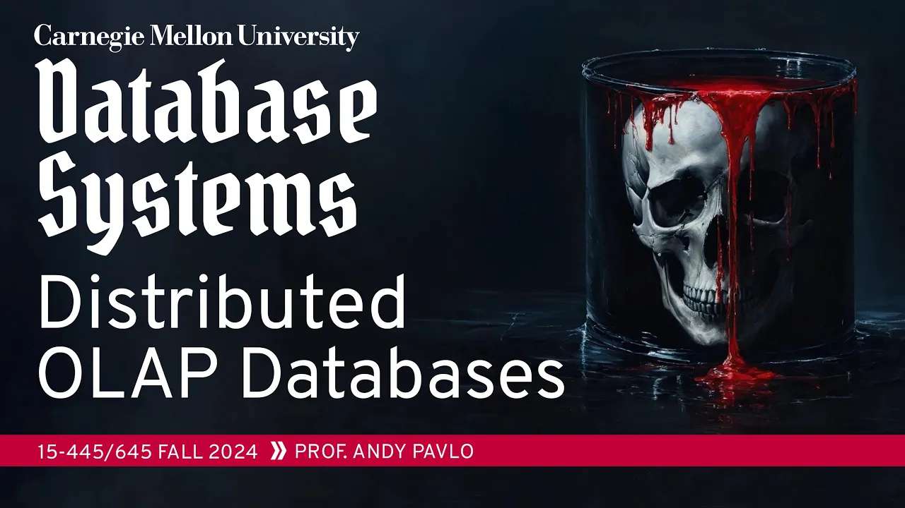
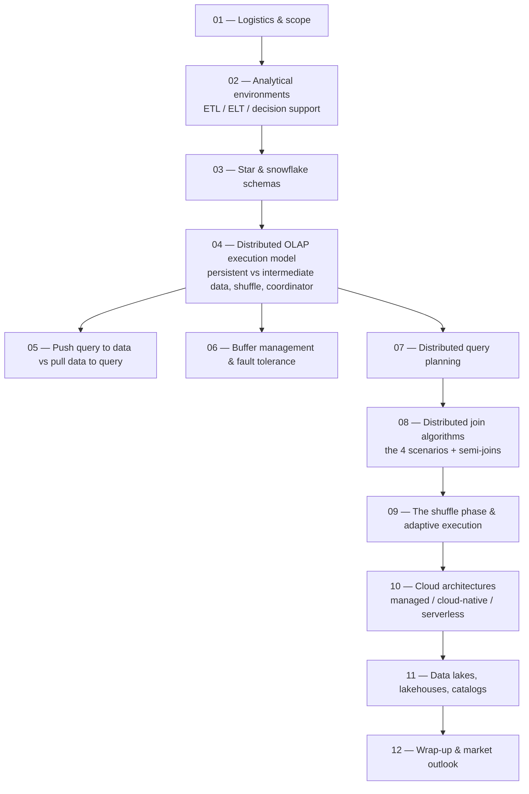

# #24 - Distributed Analytical Databases (CMU Intro to Database Systems)

*CMU Database Group · 1:22:55 · [Watch on YouTube](https://www.youtube.com/watch?v=L6E75IyBgpk)*

## Summary

The final lecture of CMU 15-445/645 (Fall 2024) covers how an OLAP database system changes when it must run across many nodes. It starts with the environment analytics lives in — OLTP silos feeding a warehouse via ETL/ELT, and the star/snowflake schemas warehouses use — then walks through the distributed execution model: persistent vs. intermediate data, the shuffle layer, the coordinator, and pushing the query to the data vs. pulling the data to the query. The bulk of the time goes to the four data-layout scenarios for a distributed join (local, co-partitioned, broadcast, shuffle) plus semi-join/Bloom-filter optimizations, followed by fault tolerance for intermediate results and distributed query planning. The last fifteen minutes are a rapid tour of cloud database architecture — managed, cloud-native, and serverless — and of data lakes, lakehouses, catalogs (Iceberg), and the composable-building-blocks trend that next class's system survey will build on.

## Topic breakdown

1. [Lecture Logistics and Scope](./01-lecture-logistics-and-scope.md) — where this fits in the course, exam admin, and the four-part roadmap.
2. [Analytical Data Environments](./02-analytical-data-environments.md) — OLTP silos → warehouse, ETL vs ELT, CDC, and decision support systems.
3. [Star and Snowflake Schemas](./03-star-and-snowflake-schemas.md) — fact and dimension tables, the storage/query trade-off, and normalization in one slide.
4. [The Distributed OLAP Execution Model](./04-distributed-olap-execution-model.md) — persistent vs. intermediate data, shuffle layer, coordinator, and the MapReduce history.
5. [Push the Query to the Data vs. Pull the Data to the Query](./05-push-query-vs-pull-data.md) — the two movement strategies, S3 Select, and shared-nothing vs. shared-disk execution.
6. [Buffer Management and Fault Tolerance](./06-buffer-management-and-fault-tolerance.md) — spilling, writing intermediate results to shared storage, straggler and noisy-neighbor handling.
7. [Distributed Query Planning](./07-distributed-query-planning.md) — network-aware cost models, shipping physical plans vs. shipping SQL back down.
8. [Distributed Join Algorithms](./08-distributed-join-algorithms.md) — the four data-layout scenarios, broadcast and shuffle joins, indexes/zone maps, semi-joins and Bloom joins.
9. [The Shuffle Phase and Adaptive Execution](./09-the-shuffle-phase.md) — why the extra hop pays, elastic stages, skew handling, BigQuery's shuffle hardware.
10. [Cloud Database Architectures](./10-cloud-database-architectures.md) — managed, cloud-native, and serverless generations and their eviction/resume mechanics.
11. [Data Lakes, Lakehouses, and Catalogs](./11-data-lakes-lakehouses-and-catalogs.md) — managed storage vs. data lakes, Iceberg, composable building blocks.
12. [Wrap-Up and Market Outlook](./12-wrap-up-and-market-outlook.md) — the main takeaway and why the analytics market churns more than OLTP.

Full source: [transcript.md](./transcript.md)

## Key takeaways

- **Distributed analytical execution is the same as single-node execution plus one concern**: an intermediate step deciding where data is, what form it's in, and where it goes next — the join and the shuffle are the two most expensive operations [`1:19:55`](https://www.youtube.com/watch?v=L6E75IyBgpk&t=4795) [`1:02:15`](https://www.youtube.com/watch?v=L6E75IyBgpk&t=3735).
- **Joins are ~50–60% of single-node query time**, which is why the distributed join layout question dominates the lecture [`42:25`](https://www.youtube.com/watch?v=L6E75IyBgpk&t=2545).
- **There are exactly four join layouts**, ordered best to worst: R partitioned on the join key with S replicated; both co-partitioned on the join key; **broadcast join** (replicate the smaller table to collapse into case 1); **shuffle join** (repartition both to collapse into case 2). Broadcast requires S to be the smaller table [`44:17`](https://www.youtube.com/watch?v=L6E75IyBgpk&t=2657) [`45:42`](https://www.youtube.com/watch?v=L6E75IyBgpk&t=2742) [`47:44`](https://www.youtube.com/watch?v=L6E75IyBgpk&t=2864) [`49:32`](https://www.youtube.com/watch?v=L6E75IyBgpk&t=2972) [`49:15`](https://www.youtube.com/watch?v=L6E75IyBgpk&t=2955).
- **Shuffle is the exchange operator renamed** — SQL Server makes it optional, BigQuery and Spark always do it. The apparent extra hop buys **adaptive re-planning mid-query**: elastic worker counts between stages (4 → 3 in the example) and recursive repartitioning of hot keys [`1:01:47`](https://www.youtube.com/watch?v=L6E75IyBgpk&t=3707) [`59:20`](https://www.youtube.com/watch?v=L6E75IyBgpk&t=3560) [`1:01:09`](https://www.youtube.com/watch?v=L6E75IyBgpk&t=3669) [`1:01:21`](https://www.youtube.com/watch?v=L6E75IyBgpk&t=3681).
- **Shuffle is where the time goes, and vendors build hardware for it**: BigQuery has dedicated custom hardware for in-memory shuffle, and Snowflake — which doesn't shuffle — has a co-founder who told the instructor he'd add one if he started over [`59:36`](https://www.youtube.com/watch?v=L6E75IyBgpk&t=3576) [`23:51`](https://www.youtube.com/watch?v=L6E75IyBgpk&t=1431) [`23:33`](https://www.youtube.com/watch?v=L6E75IyBgpk&t=1413).
- **Fault tolerance for intermediate results is MapReduce's one real contribution**: write intermediate output to storage decoupled from compute (S3), so a dead node means resuming from its output rather than restarting the query — earlier distributed databases just killed and restarted [`33:28`](https://www.youtube.com/watch?v=L6E75IyBgpk&t=2008) [`34:30`](https://www.youtube.com/watch?v=L6E75IyBgpk&t=2070) [`31:22`](https://www.youtube.com/watch?v=L6E75IyBgpk&t=1882).
- **MapReduce was measurably inferior**: a 2009 paper the instructor co-authored showed it was much slower than a distributed OLAP system like Vertica; Snowflake's win came from ignoring the hype and keeping SQL and the relational model on shared-disk cloud storage [`22:12`](https://www.youtube.com/watch?v=L6E75IyBgpk&t=1332) [`23:09`](https://www.youtube.com/watch?v=L6E75IyBgpk&t=1389).
- **Almost every system ships physical plan fragments** (e.g. via Substrait); only SingleStore and Vitess convert fragments back to SQL for local re-optimization, betting that local nodes have fresher statistics [`37:57`](https://www.youtube.com/watch?v=L6E75IyBgpk&t=2277) [`39:34`](https://www.youtube.com/watch?v=L6E75IyBgpk&t=2374) [`39:13`](https://www.youtube.com/watch?v=L6E75IyBgpk&t=2353).
- **OLAP systems don't build indexes** — they use zone maps (per-column min/max) in a central location for early file pruning [`51:50`](https://www.youtube.com/watch?v=L6E75IyBgpk&t=3110) [`52:12`](https://www.youtube.com/watch?v=L6E75IyBgpk&t=3132).
- **Cloud databases come in three generations**: managed (off-the-shelf on EC2 — Amazon charges roughly double for RDS Postgres), cloud-native (Snowflake/BigQuery, disaggregated storage and compute, cannot run on-prem), and serverless (evict the instance when idle by checkpointing both the buffer pool *and* the page table to shared disk; more expensive per query, far cheaper if you query once a week) [`1:03:30`](https://www.youtube.com/watch?v=L6E75IyBgpk&t=3810) [`1:03:52`](https://www.youtube.com/watch?v=L6E75IyBgpk&t=3832) [`1:04:08`](https://www.youtube.com/watch?v=L6E75IyBgpk&t=3848) [`1:06:38`](https://www.youtube.com/watch?v=L6E75IyBgpk&t=3998) [`1:08:53`](https://www.youtube.com/watch?v=L6E75IyBgpk&t=4133).
- **Catalogs are the hottest unsexy layer**: Databricks paid **$1 billion for Apache Iceberg's ~40 people**, outbidding another cloud vendor — Iceberg also provides insert/update/delete over append-only S3 files, writing JSON and compacting to Parquet in the background [`1:17:52`](https://www.youtube.com/watch?v=L6E75IyBgpk&t=4672) [`1:18:15`](https://www.youtube.com/watch?v=L6E75IyBgpk&t=4695) [`1:15:41`](https://www.youtube.com/watch?v=L6E75IyBgpk&t=4541).
- **Parquet and ORC are obsolete for modern hardware**, per a recent paper by the instructor with a Tsinghua collaborator and the creator of pandas/Apache Arrow; a replacement format is in development [`1:19:32`](https://www.youtube.com/watch?v=L6E75IyBgpk&t=4772).
- **Amazon closed S3 Select to new customers** (announced a week or two before the lecture) because it performs substantial compute — predicate and projection push-down over Parquet/CSV — without charging for it [`27:32`](https://www.youtube.com/watch?v=L6E75IyBgpk&t=1652) [`27:54`](https://www.youtube.com/watch?v=L6E75IyBgpk&t=1674).
- **The analytics market churns while OLTP doesn't**: replacing a transactional system risks halting orders, so incumbents like Oracle hold; trying a new analytical engine is safe because the old Teradata system stays running as a fallback [`1:20:50`](https://www.youtube.com/watch?v=L6E75IyBgpk&t=4850) [`1:21:21`](https://www.youtube.com/watch?v=L6E75IyBgpk&t=4881).
