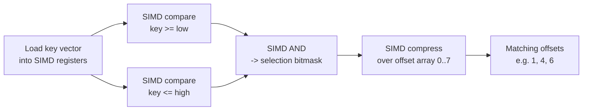

# 03 — Branchless Code and SIMD

The lecture proper starts here: what makes modern OLAP engines fast on modern CPUs ([`15:48`](https://www.youtube.com/watch?v=fr5lIchF6pw&t=948)).

## Framing

- Sequential scans cannot be avoided; the known optimizations are encoding/compression, prefetching, scan sharing, zone maps, late materialization, materialized views, and result caching ([`16:20`](https://www.youtube.com/watch?v=fr5lIchF6pw&t=980)).
- Materialized views (especially incremental maintenance) and result caching are skipped as too complex / too simple respectively ([`16:20`](https://www.youtube.com/watch?v=fr5lIchF6pw&t=980), [`16:59`](https://www.youtube.com/watch?v=fr5lIchF6pw&t=1019)).
- The thing that actually separates modern analytical systems from 10–15 years ago is **code specialization and compilation** ([`16:59`](https://www.youtube.com/watch?v=fr5lIchF6pw&t=1019)).

## Branch prediction is the enemy

For `SELECT * FROM table WHERE key > low AND key < high`:

- The natural implementation — loop, `if (predicate) copy tuple` — is the **wrong** code on a superscalar CPU. Interleaved matching/non-matching data defeats the branch predictor, and every mispredict flushes the pipeline and rolls back speculative work ([`17:48`](https://www.youtube.com/watch?v=fr5lIchF6pw&t=1068), [`18:15`](https://www.youtube.com/watch?v=fr5lIchF6pw&t=1095)).
- The branchless version: **always copy the tuple into the output buffer first**, then compute the predicate as 0/1, AND the two conditions, and advance the output offset by that delta. A non-match simply gets overwritten on the next iteration ([`18:42`](https://www.youtube.com/watch?v=fr5lIchF6pw&t=1122), [`19:03`](https://www.youtube.com/watch?v=fr5lIchF6pw&t=1143), [`19:29`](https://www.youtube.com/watch?v=fr5lIchF6pw&t=1169)).
- It looks wasteful to a human, but it removes all indirection and yields a tight kernel that rips through data ([`19:55`](https://www.youtube.com/watch?v=fr5lIchF6pw&t=1195)).

### The experiment (VectorWise / CWI, ~10 years earlier)

- X axis = predicate selectivity, from 0% (no tuples match) to 100% (all match) ([`20:17`](https://www.youtube.com/watch?v=fr5lIchF6pw&t=1217)).
- **Branching version (blue)**: fast at 0% selectivity (predictor always right), degrades to a peak cost around **50% selectivity**, where the predictor is wrong constantly ([`20:43`](https://www.youtube.com/watch?v=fr5lIchF6pw&t=1243)).
- **Branchless version (red)**: essentially flat across all selectivities, because it always copies every tuple regardless ([`21:12`](https://www.youtube.com/watch?v=fr5lIchF6pw&t=1272)).
- Doing more work is better for the modern CPU — and this is exactly the kernel tuning that Postgres and MySQL lack for analytics ([`21:12`](https://www.youtube.com/watch?v=fr5lIchF6pw&t=1272), [`21:36`](https://www.youtube.com/watch?v=fr5lIchF6pw&t=1296)).

## SIMD

- **SIMD = single instruction, multiple data**: the same operation applied in parallel across multiple data items ([`21:54`](https://www.youtube.com/watch?v=fr5lIchF6pw&t=1314), [`22:43`](https://www.youtube.com/watch?v=fr5lIchF6pw&t=1363)).
- Example: adding two 8-element arrays of 32-bit integers. Scalar (SISD) = 8 add instructions. With 128-bit SIMD registers holding 4 elements each, the same work is **2 instructions** ([`22:43`](https://www.youtube.com/watch?v=fr5lIchF6pw&t=1363), [`23:08`](https://www.youtube.com/watch?v=fr5lIchF6pw&t=1388), [`23:37`](https://www.youtube.com/watch?v=fr5lIchF6pw&t=1417)). Registers go up to 512 or 1024 bits ([`23:08`](https://www.youtube.com/watch?v=fr5lIchF6pw&t=1388)).
- Naming caveat: "vectorized query execution" (batching tuples between operators) is often conflated with SIMD — but the batch model is precisely what gives you a vector to feed SIMD ([`23:37`](https://www.youtube.com/watch?v=fr5lIchF6pw&t=1417), [`24:15`](https://www.youtube.com/watch?v=fr5lIchF6pw&t=1455)).

### SIMD selection scan, step by step

- Each comparison produces a **bit vector / selection vector** of 0s and 1s per SIMD lane ([`25:21`](https://www.youtube.com/watch?v=fr5lIchF6pw&t=1521)).
- The two masks are combined with a bitwise SIMD AND ([`26:03`](https://www.youtube.com/watch?v=fr5lIchF6pw&t=1563)).
- A SIMD **compress** against an offset array `0..7` packs the surviving offsets into the output lanes ([`26:27`](https://www.youtube.com/watch?v=fr5lIchF6pw&t=1587), [`26:50`](https://www.youtube.com/watch?v=fr5lIchF6pw&t=1610)).
- The same treatment applies to most operators; this is what Snowflake and ClickHouse do. ClickHouse goes further and ships multiple register-width variants (AVX-512 etc.) because faster is not always the wider one; most systems target **AVX2 / AVX-256** and hand-write intrinsics ([`26:50`](https://www.youtube.com/watch?v=fr5lIchF6pw&t=1610), [`27:22`](https://www.youtube.com/watch?v=fr5lIchF6pw&t=1642)).
