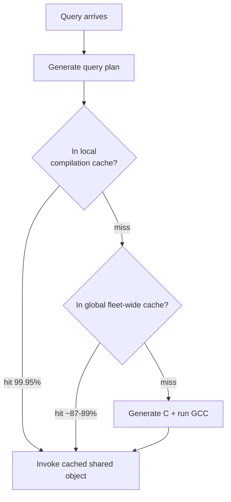

# 07 — Amazon Redshift

## Origin story

- Amazon's flagship OLAP system. Amazon is characterized as notorious for rebranding other systems — e.g. **Athena is PrestoDB renamed** — and only investing once something makes money ([`46:05`](https://www.youtube.com/watch?v=fr5lIchF6pw&t=2765)).
- Redshift is based on **ParAccel**, itself a distributed fork of Postgres. Amazon bought a **source-code license for $20 million**; ParAccel later sold for less and died. Redshift now makes **billions of dollars a year** ([`46:05`](https://www.youtube.com/watch?v=fr5lIchF6pw&t=2765), [`46:26`](https://www.youtube.com/watch?v=fr5lIchF6pw&t=2786), [`46:52`](https://www.youtube.com/watch?v=fr5lIchF6pw&t=2812)).
- The name: **shifting away from red — Oracle's color** ([`47:06`](https://www.youtube.com/watch?v=fr5lIchF6pw&t=2826)).
- Started shared-nothing on Postgres; later added a serverless piece and **Spectrum** for lakehouse-style reads from S3 ([`47:06`](https://www.youtube.com/watch?v=fr5lIchF6pw&t=2826)).
- Stated goal was removing administration and configuration choices from users; the lecturer's opinion is that **Snowflake hides that better than Redshift does** ([`47:06`](https://www.youtube.com/watch?v=fr5lIchF6pw&t=2826), [`47:33`](https://www.youtube.com/watch?v=fr5lIchF6pw&t=2853)).

## Execution

- Shared-disk disaggregated storage, push-based vectorized query processing ([`47:54`](https://www.youtube.com/watch?v=fr5lIchF6pw&t=2874)).
- **Uses both compilation strategies**: holistic query compilation (generate C code from the plan, compile it) *and* pre-compiled primitives for the common reusable parts ([`47:54`](https://www.youtube.com/watch?v=fr5lIchF6pw&t=2874)).

## The compilation cache — the standout result

- Generating C and invoking GCC is expensive: config parsing plus all compilation stages, costly even for a tiny program ([`48:45`](https://www.youtube.com/watch?v=fr5lIchF6pw&t=2925)).
- A recent Amazon paper reports **~96% of Redshift queries are literally identical** — not just the same SQL shape with different parameters, but the same SQL with the same parameters. Cause: dashboards re-running the same query while the data changes ([`49:10`](https://www.youtube.com/watch?v=fr5lIchF6pw&t=2950), [`49:35`](https://www.youtube.com/watch?v=fr5lIchF6pw&t=2975)).

- Cache hit rates cited as public: **99.95% local**, and of the misses roughly **87–89% hit the global cache** ([`50:48`](https://www.youtube.com/watch?v=fr5lIchF6pw&t=3048), [`51:12`](https://www.youtube.com/watch?v=fr5lIchF6pw&t=3072), [`51:34`](https://www.youtube.com/watch?v=fr5lIchF6pw&t=3094)).
- The **global cache spans all Redshift customers** — described as insane but safe, because a compiled query plan contains no customer data, only plan structure. `WHERE id = 4` and `WHERE id = 6` share the same compiled artifact ([`49:55`](https://www.youtube.com/watch?v=fr5lIchF6pw&t=2995), [`50:26`](https://www.youtube.com/watch?v=fr5lIchF6pw&t=3026)).
- At Amazon's billions-of-queries-per-day scale this saves **millions of dollars a year** in CPU, while making customer queries faster ([`50:26`](https://www.youtube.com/watch?v=fr5lIchF6pw&t=3026), [`52:01`](https://www.youtube.com/watch?v=fr5lIchF6pw&t=3121)).
- A CMU student intern built the job that **recompiles all cached plans on every new Redshift release**, since data alignment can change between versions ([`50:48`](https://www.youtube.com/watch?v=fr5lIchF6pw&t=3048)).

## Hardware acceleration: AQUA, then Nitro

- **AQUA** (2021): an FPGA layer sitting above S3 doing **predicate pushdown** — fetch the needed blocks, evaluate the WHERE clause in hardware, return filtered results upward ([`52:01`](https://www.youtube.com/watch?v=fr5lIchF6pw&t=3121), [`52:29`](https://www.youtube.com/watch?v=fr5lIchF6pw&t=3149)).
- Not a new idea: **Netezza** (circa 1989) ran FPGAs inside Postgres and was bought by IBM; **Oracle Exadata** does predicate pushdown to storage without FPGAs ([`52:29`](https://www.youtube.com/watch?v=fr5lIchF6pw&t=3149), [`53:01`](https://www.youtube.com/watch?v=fr5lIchF6pw&t=3181)).
- AQUA was **quietly killed** a year or two ago. The replacement pushes predicates onto the **NICs of the storage nodes themselves**, via Amazon's **Nitro** hypervisor/card hardware ([`53:01`](https://www.youtube.com/watch?v=fr5lIchF6pw&t=3181), [`53:30`](https://www.youtube.com/watch?v=fr5lIchF6pw&t=3210)).
- Economics: **$150 million of R&D to fab custom hardware is a drop in the bucket** at that scale ([`53:30`](https://www.youtube.com/watch?v=fr5lIchF6pw&t=3210)).
- Prediction: hardware gets wild over the next decade, and the big cloud vendors who control and fab the whole stack will be very hard to match on performance ([`54:00`](https://www.youtube.com/watch?v=fr5lIchF6pw&t=3240)).
