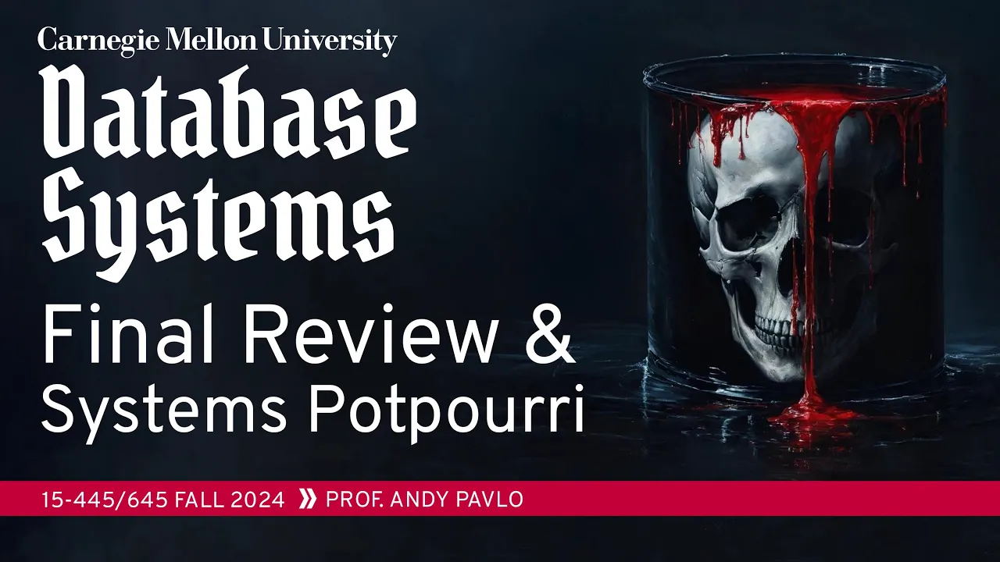
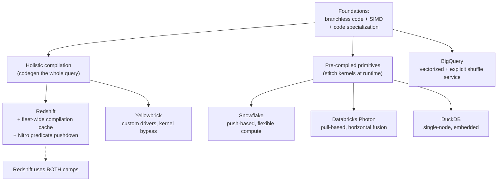

# #25 - BigQuery + Snowflake + Redshift + Databricks + DuckDB (CMU Intro to Database Systems)

*CMU Database Group · 1:25:57 · [Watch on YouTube](https://www.youtube.com/watch?v=fr5lIchF6pw)*

## Summary

The final lecture of CMU 15-445/645 (Fall 2024) opens with course logistics and a rapid review of every exam topic since the midterm, then spends the bulk of its time on how modern analytical (OLAP) database systems actually get their speed. Andy Pavlo first establishes the two foundational techniques — writing **branchless code** that beats the CPU's branch predictor, using **SIMD** to process many values per instruction, and **specializing code** either by compiling each query to machine code or by stitching together pre-compiled primitives — and then walks through six real systems (BigQuery, Snowflake, Redshift, Yellowbrick, Databricks/Photon, and DuckDB) showing which combination of those techniques each one picked and why. The lecture closes with a live demo of TabDB, a SQLite-in-the-browser database that stores its rows in browser tab titles, and the practical advice to reach for Postgres and then DuckDB long before any cloud data warehouse.

## Topic breakdown

1. [Course Logistics and Final Exam](./01-course-logistics-and-final-exam.md) — deadlines, exam mechanics, what to bring ([`0:30`](https://www.youtube.com/watch?v=fr5lIchF6pw&t=30))
2. [Final Exam Topic Review](./02-final-exam-topic-review.md) — optimization, transactions, recovery, distributed DBs ([`7:24`](https://www.youtube.com/watch?v=fr5lIchF6pw&t=444))
3. [Branchless Code and SIMD](./03-branchless-code-and-simd.md) — why the "wasteful" scan wins on modern CPUs ([`15:48`](https://www.youtube.com/watch?v=fr5lIchF6pw&t=948))
4. [Query Compilation vs Pre-Compiled Primitives](./04-query-compilation-vs-precompiled-primitives.md) — the two code-specialization camps ([`27:22`](https://www.youtube.com/watch?v=fr5lIchF6pw&t=1642))
5. [Google BigQuery (Dremel)](./05-google-bigquery.md) — the shuffle service and its dynamic optimizations ([`32:45`](https://www.youtube.com/watch?v=fr5lIchF6pw&t=1965))
6. [Snowflake](./06-snowflake.md) — built from scratch, adaptive aggregation, borrowed idle nodes ([`39:27`](https://www.youtube.com/watch?v=fr5lIchF6pw&t=2367))
7. [Amazon Redshift](./07-amazon-redshift.md) — the fleet-wide compilation cache and hardware pushdown ([`46:05`](https://www.youtube.com/watch?v=fr5lIchF6pw&t=2765))
8. [Yellowbrick](./08-yellowbrick.md) — custom drivers, kernel bypass, no syscalls after boot ([`54:26`](https://www.youtube.com/watch?v=fr5lIchF6pw&t=3266))
9. [Databricks and Photon](./09-databricks-photon.md) — escaping the JVM, horizontal expression fusion ([`1:02:02`](https://www.youtube.com/watch?v=fr5lIchF6pw&t=3722))
10. [DuckDB](./10-duckdb.md) — single-node, embedded, and the "most data isn't big" argument ([`1:09:06`](https://www.youtube.com/watch?v=fr5lIchF6pw&t=4146))
11. [TabDB (Live Demo)](./11-tabdb-demo.md) — SQLite storing rows in browser tab titles ([`1:15:43`](https://www.youtube.com/watch?v=fr5lIchF6pw&t=4543))
12. [Closing Advice and Q&A](./12-closing-advice-and-qa.md) — Postgres first, backups, managed services, MotherDuck ([`1:18:55`](https://www.youtube.com/watch?v=fr5lIchF6pw&t=4735))

## How the systems compare

## Key takeaways

- A branchless selection scan performs **identically at every predicate selectivity**, while the branching version peaks in cost near 50% selectivity where branch prediction fails most — doing more work is faster on a modern CPU ([`20:43`](https://www.youtube.com/watch?v=fr5lIchF6pw&t=1243), [`21:12`](https://www.youtube.com/watch?v=fr5lIchF6pw&t=1272)).
- SIMD collapses the same work into far fewer instructions: adding two 8-element 32-bit arrays goes from **8 scalar adds to 2 SIMD instructions** with 128-bit registers; most engines target AVX2/AVX-256 with hand-written intrinsics ([`23:37`](https://www.youtube.com/watch?v=fr5lIchF6pw&t=1417), [`27:22`](https://www.youtube.com/watch?v=fr5lIchF6pw&t=1642)).
- Compiling a query with GCC costs roughly **500 ms to 1 second**, which is why pre-compiled primitives exist — the space of query/type patterns is theoretically infinite but practically small ([`29:51`](https://www.youtube.com/watch?v=fr5lIchF6pw&t=1791), [`30:48`](https://www.youtube.com/watch?v=fr5lIchF6pw&t=1848)).
- An Amazon paper reports **~96% of Redshift queries are literally identical** (same SQL, same parameters), and Redshift's compilation cache hits **99.95% locally** with **~87–89%** of the remainder served by a **cache shared across all customers** — safe because a compiled plan carries no customer data ([`49:10`](https://www.youtube.com/watch?v=fr5lIchF6pw&t=2950), [`50:26`](https://www.youtube.com/watch?v=fr5lIchF6pw&t=3026), [`51:12`](https://www.youtube.com/watch?v=fr5lIchF6pw&t=3072), [`51:34`](https://www.youtube.com/watch?v=fr5lIchF6pw&t=3094)).
- Amazon acquired the ParAccel source license for **$20 million** and turned it into Redshift, a **billion-dollar-a-year** product ([`46:26`](https://www.youtube.com/watch?v=fr5lIchF6pw&t=2786), [`46:52`](https://www.youtube.com/watch?v=fr5lIchF6pw&t=2812)).
- Yellowbrick's extreme approach — never calling a syscall after boot, custom UDP/NVMe/S3 drivers, kernel bypass, an allocator claimed **100× faster than malloc** — produces results that are **better but not 10× better**, and the explicit verdict is that a new database company should not start there ([`57:04`](https://www.youtube.com/watch?v=fr5lIchF6pw&t=3424), [`59:36`](https://www.youtube.com/watch?v=fr5lIchF6pw&t=3576), [`1:01:37`](https://www.youtube.com/watch?v=fr5lIchF6pw&t=3697)).
- Databricks' first C++ Photon prototype was **slower than the Scala codegen engine it replaced**, but won on hiring pool and iteration speed — engineers who know C++ and databases vastly outnumber those who know JVM internals ([`1:06:08`](https://www.youtube.com/watch?v=fr5lIchF6pw&t=3968), [`1:06:52`](https://www.youtube.com/watch?v=fr5lIchF6pw&t=4012)).
- Analysis of published Redshift and Snowflake query data found **most queries touch under ~1 GB**, which is the whole basis for DuckDB's single-node bet — and the lecturer's advice is **Postgres first, then DuckDB**, good enough for nine out of ten people ([`1:11:09`](https://www.youtube.com/watch?v=fr5lIchF6pw&t=4269), [`1:11:38`](https://www.youtube.com/watch?v=fr5lIchF6pw&t=4298), [`1:19:57`](https://www.youtube.com/watch?v=fr5lIchF6pw&t=4797)).
