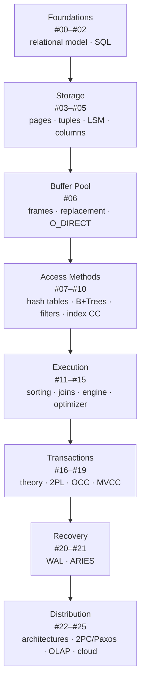

# CMU Intro to Database Systems (15-445/645 - Fall 2024)

<https://www.youtube.com/playlist?list=PLSE8ODhjZXjYDBpQnSymaectKjxCy6BYq>

## What this library covers

This is the full Fall 2024 run of Andy Pavlo's CMU 15-445/645 — a course about **building** a database management system, not using or administering one. The throughline is a single, deliberate ascent through the layers of a DBMS: it starts above the engine with the relational model and modern SQL (the only application-facing lecture of the semester), then drops into the storage layer and never leaves the internals again. Files and pages, tuple encoding, LSM trees, row vs. column layout and compression, the buffer pool, hash tables and B+Trees, index concurrency, the operator algorithms (sorting, aggregation, joins), the execution engine, the query optimizer, transactions and concurrency control, logging and ARIES recovery, and finally distribution — replication, consensus, distributed joins, and the cloud warehouses built on all of it.

What makes the series unusually valuable is that every mechanism is checked against reality. Each design decision is followed by what PostgreSQL, MySQL, SQLite, Oracle, SQL Server, DuckDB and RocksDB actually did — including the ugly parts: the `mmap` argument, fsyncgate, PostgreSQL's MVCC as the worst production implementation, the seven-engine SQL compliance exposé, `nbtree` meaning *non-balanced*. Roughly half the lectures also close with a 10–20 minute flash talk from a working database company (Neon, StarTree, RelationalAI, TiDB, dbt, ClickHouse, Firebolt, Weaviate, Confluent, DataStax), so the theory always lands next to a shipped system.

Read end to end, you come out able to reason about *why* a database is slow or wrong at the level of pages, latches, plans and log records — and, per the last lecture's own advice, able to tell when you should just use Postgres and then DuckDB.

## Videos

1. [#00 - Course Overview & Logistics (CMU Intro to Database Systems)](./01-00-course-overview-logistics-cmu-intro-to-database-systems/README.md) — Andy Pavlo's pre-semester logistics lecture, recorded ahead of time so the first real class can begin directly on the relational model. It defines the course as building the internals of a DBMS rather than using or administering one, then walks through every policy: platforms, the 15/45/20/20 grade split, six homeworks, the BusTub C++ projects gated by a mandatory Project 0, late days, and plagiarism enforcement. It closes with the semester's extras — weekly industry flash talks, a recruiting event, and an optional seminar series.
2. [#01 - Relational Model & Algebra (CMU Intro to Database Systems)](./02-01-relational-model-algebra-cmu-intro-to-database-systems/README.md) — The opening technical lecture separates a *database* from a *DBMS*, then uses a deliberately bad flat-CSV music store to enumerate every problem the rest of the semester exists to solve. It traces the relational model from Codd's 1970 paper through the CODASYL debates, covering data independence, relations, keys, constraints, and Codd's seven relational-algebra primitives alongside their SQL equivalents. It closes by arguing declarative SQL beats hand-written algebra, and surveys document and vector databases as features the relational model absorbs rather than replacements.
3. [#02 - Modern SQL (CMU Intro to Database Systems)](./03-02-modern-sql-cmu-intro-to-database-systems/README.md) — The only lecture of the semester that looks at databases from the application side, covering the features beyond SQL-92 that let you push complex computation into a single query. After a short history of the language it works through aggregations, string and date/time handling, window functions, nested queries, lateral joins, and CTEs. Every feature is demonstrated live against seven engines simultaneously, turning the lecture into a running exposé of how far real systems diverge from the standard and from each other.
4. [#03 - Database Storage: Files & Pages ✸ Neon Database Talk (CMU Intro to Database Systems)](./04-03-database-storage-files-pages-neon-database-talk-cmu/README.md) — The first lecture to go inside the engine, building the storage stack from hardware upward: disk-oriented architecture, the storage hierarchy, and the sequential-vs-random access gap that drives every design choice. It covers databases as files of fixed-size pages, heap files and page directories, and the slotted-page tuple layout, with a live Postgres demo of on-disk files, the free space map and `VACUUM`. It closes with a flash talk by Neon co-founder Heikki on serverless Postgres, separating compute from a Rust storage system driven by the WAL.
5. [#04 - Database Storage: Log-Structured Merge Trees & Tuples (CMU Intro to Database Systems)](./05-04-database-storage-log-structured-merge-trees-tuples-cmu/README.md) — Finishes the tuple-oriented storage model and then presents its two main alternatives. The first half completes slotted pages and record IDs with live demos across four engines, then enumerates the problems of tuple-oriented storage — fragmentation, useless I/O, random I/O, and the fact that append-only stores cannot update in place — motivating log-structured storage (MemTable → SSTable → compaction) and index-organized storage. The second half zooms into the bytes of a single tuple: alignment, padding, numeric representation, NULL encoding, and overflow pages.
6. [#05 - Row vs. Column Storage + Compression ✸ StarTree Database Talk (CMU Intro to Database Systems)](./06-05-row-vs-column-storage-compression-startree-database-talk/README.md) — The final storage lecture contrasts how a DBMS physically lays out tuples, separating OLTP from OLAP and walking one analytical query through the N-ary Storage Model, the Decomposition Storage Model, and the PAX hybrid used by Parquet, ORC and Arrow. The second half covers compression: why block-level compression is opaque to the query engine, and how RLE, bit packing, bitmap, delta and order-preserving dictionary encoding let queries execute directly on compressed data. It closes with a StarTree talk on Apache Pinot, the real-time OLAP engine behind LinkedIn and Uber Eats.
7. [#06 - Memory & Disk I/O Management (CMU Intro to Database Systems)](./07-06-memory-disk-i-o-management-cmu-intro-to-database-systems/README.md) — Builds the buffer pool manager from the ground up — frames, page table, pins, dirty flags, and the latch-vs-lock distinction — as the component that moves pages between disk and memory. It then argues extensively against delegating that job to the OS, covering why `mmap` breaks databases, comparing replacement policies (LRU, CLOCK, LRU-K and the real variants in PostgreSQL, MySQL and SQL Server), and handling dirty pages with a background writer. The last third covers DBMS-owned I/O scheduling, `O_DIRECT`, the 2018 fsync scandal, four optimizations, and Project 1.
8. [#07 - Hash Tables ✸ RelationalAI Database Talk (CMU Intro to Database Systems)](./08-07-hash-tables-relationalai-database-talk-cmu-intro-to/README.md) — Opens the access-methods stretch of the course, moving from disk and buffer management up to the data structures the execution engine uses, starting with the unordered one. It decomposes a hash table into two independent decisions — hash function and collision resolution — then works through five schemes: linear probing and cuckoo hashing for static tables, and chained, extendible and linear hashing for dynamic ones, each with worked examples, failure modes and real-system sightings. The final minutes are a RelationalAI talk on data-centric architectures where the system derives implications by reasoning.
9. [#08 - Tree Indexes: B+Trees (CMU Intro to Database Systems)](./09-08-tree-indexes-b-trees-cmu-intro-to-database-systems/README.md) — A full treatment of the B+Tree, the structure behind virtually every `CREATE INDEX` in a real DBMS: it separates indexes from filters, traces the B-Tree family's history, and builds the structure from first principles with worked insert/delete examples. The second half covers what real systems do differently from the textbook — composite indexes, duplicate-key strategies, clustered indexes, node size, merge thresholds and intra-node search. It closes with the optimization catalogue (prefix compression, deduplication, suffix truncation, pointer swizzling, bulk loading) and the write-optimized Bε/fractal tree variant.
10. [#09 - Vector Indexes, Inverted Indexes, Filters, Tries ✸ TiDB Talk (CMU Intro to Database Systems)](./10-09-vector-indexes-inverted-indexes-filters-tries-tidb-talk/README.md) — A deliberate brain dump of the index and filter structures that live beyond the B+Tree, framed by the distinction between a filter (does this key exist?) and an index (and where is it?). It covers Bloom filters and their counting/cuckoo/SuRF variants, skip lists, tries and radix trees, inverted indexes for full-text search, and vector indexes for semantic similarity search. The final stretch is a talk by Sunny Bains (20 years on MySQL/InnoDB, now at TiDB) on how TiDB scales through raft-replicated 96 MB regions.
11. [#10 - Index Concurrency Control (CMU Intro to Database Systems)](./11-10-index-concurrency-control-cmu-intro-to-database-systems/README.md) — Drops the single-threaded assumption from all previous index lectures and shows how to make index structures safe under concurrent access. It builds from first principles — locks vs. latches, latch modes, and latch implementation over test-and-set, futexes and reader-writer locks — then applies them to hash tables (the easy, deadlock-free case) and to B+Trees via latch crabbing/coupling and its optimistic variant. The last third covers deadlocks from leaf sibling scans, argues a blocked thread should abort itself and retry, and closes with the Project 2 requirements.
12. [#11 - Sorting & Aggregation Algorithms ✸ dbt Database Talk (CMU Intro to Database Systems)](./12-11-sorting-aggregation-algorithms-dbt-database-talk-cmu/README.md) — Moves up the stack from storage and indexes into query execution, covering the operator algorithms a DBMS needs when intermediate results are too large to fit in memory. It works through top-N heap sort, external merge sort (cost model, double buffering, comparison specialization), when a B+Tree index replaces sorting entirely, and then applies the same divide-and-conquer thinking to aggregations, contrasting sorting-based against external hash aggregation. It closes with a talk from dbt Labs co-founder Drew on bringing software-engineering practice to data teams.
13. [#12 - Join Algorithms: Hash, Sort-Merge, Nested Loop Joins (CMU Intro to Database Systems)](./13-12-join-algorithms-hash-sort-merge-nested-loop-joins-cmu/README.md) — Explains how a DBMS physically executes a join, restricted to inner equi-joins between two tables and measured with a single cost metric: number of disk I/Os. It builds up from the naive nested loop join through block and index variants, then sort-merge join, then the hash-join family — simple, Bloom-filter-accelerated, partitioned (Grace) with recursive partitioning for skew, and hybrid. A fixed running example lets every algorithm be compared on identical numbers.
14. [#13 - Query Execution Part 1 (CMU Intro to Database Systems)](./14-13-query-execution-part-1-cmu-intro-to-database-systems/README.md) — Having covered the individual operators in earlier lectures, this class assembles them into a working execution engine, walking through the three processing models — iterator/Volcano, materialization, and vectorized — plus the orthogonal pull-vs-push choice. It then covers the three access methods (sequential, index, multi-index scans) and the optimizations that make them fast, notably zone maps and data skipping. It closes with how insert/update/delete operators compose with scans — including the Halloween problem — and contrasts interpreted expression trees against JIT compilation with a live PostgreSQL demo.
15. [#14 - Query Execution Part 2 ✸ ClickHouse Database Talk (CMU Intro to Database Systems)](./15-14-query-execution-part-2-clickhouse-database-talk-cmu/README.md) — The first half covers parallel query execution: how a DBMS organizes workers (process per worker, thread per worker, embedded), how a query is split via intra-operator, inter-operator/pipeline and bushy parallelism, and how the exchange operator reassembles partitioned streams. It then covers I/O parallelism — striping vs. mirroring, RAID, cloud object storage, partitioning. The second half is a ClickHouse talk on the MergeTree engine, granule-level data pruning, merge-time transformations and lane-based vectorized SIMD execution, closing with a ClickBench comparison against Umbra.
16. [#15 - Query Planning & Optimization (CMU Intro to Database Systems)](./16-15-query-planning-optimization-cmu-intro-to-database-systems/README.md) — How a database turns a declarative SQL string into an executable physical plan, opening with a worked example that drives one query from ~2,000,000 I/Os down to 37. It covers the parser → binder → optimizer pipeline, logical vs. physical plans, rule-based heuristics, and the two classic cost-based architectures — IBM System R's bottom-up dynamic programming and Graefe's top-down Cascades branch-and-bound — plus subquery decorrelation and expression rewriting. The final third covers cost models and where their numbers come from: catalog statistics, histograms, sketches, sampling, and why those estimates are fragile.
17. [#16 - Concurrency Control Theory ✸ Firebolt Database Talk (CMU Intro to Database Systems)](./17-16-concurrency-control-theory-firebolt-database-talk-cmu/README.md) — Opens the transactions block, motivating concurrency control with a bank-account example where both a mid-transaction crash and two concurrent withdrawals corrupt the database, then rejecting the naive fixes. It walks through ACID one letter at a time — logging vs. shadow paging for atomicity, integrity constraints and consistency, and above all isolation: schedules, interleaving, the three classic anomalies, and the dependency-graph test for conflict serializability. It closes with view serializability, the NoSQL movement's reversal on transactions, and a Firebolt talk on sub-result caching.
18. [#17 - Two-Phase Locking Concurrency Control (CMU Intro to Database Systems)](./18-17-two-phase-locking-concurrency-control-cmu-intro-to/README.md) — Moves from static schedules, where every read and write is known ahead of time, to dynamic schedules where the DBMS must decide on the fly which transaction may touch which object, and presents two-phase locking as the answer. It shows that plain locking is insufficient for serializability, that 2PL fixes that but permits cascading aborts, and that strong strict 2PL eliminates them. It then covers deadlock detection via a waits-for graph versus prevention via Wait-Die and Wound-Wait, and closes with hierarchical locking, intention locks, escalation, and the `FOR UPDATE` / `SKIP LOCKED` hints.
19. [#18 - Optimistic Concurrency Control ✸ Weaviate Database Talk (CMU Intro to Database Systems)](./19-18-optimistic-concurrency-control-weaviate-database-talk/README.md) — Presents Optimistic Concurrency Control as the counterpart to two-phase locking, building up timestamp ordering, OCC's three phases (read into a private workspace, validate, write), forward-validation conditions with worked examples, and the workloads where OCC beats or loses to 2PL. The second half covers phantom reads — the anomaly neither protocol handles once the database is no longer fixed-size — along with the four defenses, then surveys weaker isolation levels and what real systems and DBAs actually run. It closes with a Weaviate talk on vector-database internals.
20. [#19 - Multi-Version Concurrency Control (CMU Intro to Database Systems)](./20-19-multi-version-concurrency-control-cmu-intro-to-database/README.md) — Explains MVCC — keeping multiple physical versions of a single logical tuple so writers never block readers and readers never block writers — covering visibility mechanics via BEGIN/END timestamps plus a transaction status table. It shows why the resulting snapshot isolation is not serializable using Jim Gray's write-skew example, then works through the four design decisions any MVCC implementation must make: concurrency control protocol, version storage, garbage collection, and index management. It closes with live PostgreSQL demos exposing `xmin`, `xmax` and `ctid` to prove the theory matches the real engine.
21. [#20 - Database Logging ✸ Confluent Database Talk (CMU Intro to Database Systems)](./21-20-database-logging-confluent-database-talk-cmu-intro-to/README.md) — Covers the first half of database recovery: everything a DBMS must do *while* transactions run so it can survive a crash later. It derives the STEAL/FORCE buffer pool policies that determine whether UNDO and REDO are needed, then compares shadow paging against write-ahead logging, showing why WAL's STEAL + NO-FORCE quadrant wins by converting random writes into sequential appends. It closes with log-record formats, a change-data-capture detour, naive blocking checkpoints, and a Confluent talk on rebuilding Kafka's cloud metadata store as a replicated database over a shared log.
22. [#21 - Database Recovery with ARIES (CMU Intro to Database Systems)](./22-21-database-recovery-with-aries-cmu-intro-to-database/README.md) — Covers ARIES, the canonical crash-recovery protocol for disk-oriented database systems. Building on the previous lecture's write-ahead log, it explains how a DBMS running under STEAL + NO-FORCE restarts after an unclean shutdown: log sequence numbers and the page/flush/rec/last LSN bookkeeping, commit and abort with compensation log records, non-blocking fuzzy checkpoints backed by the Active Transaction Table and Dirty Page Table, and the three-phase recovery algorithm (analysis, redo, undo). It closes with the property that distinguished ARIES: it recovers correctly even when the system crashes during recovery.
23. [#22 - Distributed Database Architectures ✸ DataStax Database Talk (CMU Intro to Database Systems)](./23-22-distributed-database-architectures-datastax-database/README.md) — Moves from the single-node DBMS students built all semester to distributed database systems, framing every new difficulty as a coordination problem. It covers the four-way architecture classification (shared everything / nothing / disk / memory), why shared-nothing dominated the 1980s–2000s and shared-disk took over with the public cloud, then partitioning schemes, consistent hashing, and the three transaction-coordination models. It closes with a preview of distributed concurrency control and a DataStax talk by Jonathan Ellis on the JVector index behind Cassandra and Astra.
24. [#23 - Distributed Transactional Databases (CMU Intro to Database Systems)](./24-23-distributed-transactional-databases-cmu-intro-to/README.md) — Covers how an OLTP database preserves ACID guarantees once its data spans multiple nodes. It walks the full replication design space — primary-replica vs. multi-primary, K-safety, synchronous/quorum/eventual propagation, continuous vs. on-commit timing, active-passive vs. active-active execution — then the atomic commit protocols that make nodes agree: two-phase commit with its recovery paths and optimizations, followed by Paxos, Multi-Paxos and Raft. It closes with the CAP theorem, split brain, PACELC, and Google's reversal from transaction-free BigTable to transactional Spanner.
25. [#24 - Distributed Analytical Databases (CMU Intro to Database Systems)](./25-24-distributed-analytical-databases-cmu-intro-to-database/README.md) — Covers how an OLAP database changes when it must run across many nodes, starting from the environment analytics lives in: OLTP silos feeding a warehouse via ETL/ELT, and star vs. snowflake schemas. It then walks the distributed execution model — persistent vs. intermediate data, the shuffle layer, the coordinator, push-query-to-data vs. pull-data-to-query — devoting most of its time to the four data-layout scenarios for distributed joins plus semi-join/Bloom optimizations, fault tolerance and distributed planning. The last stretch tours cloud database architecture (managed, cloud-native, serverless), data lakes, lakehouses and catalogs.
26. [#25 - BigQuery + Snowflake + Redshift + Databricks + DuckDB (CMU Intro to Database Systems)](./26-25-bigquery-snowflake-redshift-databricks-duckdb-cmu-intro/README.md) — The final lecture opens with a rapid review of every exam topic since the midterm, then devotes most of its time to how modern analytical systems actually get their speed. It establishes the foundational techniques — branchless code, SIMD, and code specialization either by compiling each query to machine code or by stitching pre-compiled primitives — then walks through six real systems (BigQuery, Snowflake, Redshift, Yellowbrick, Databricks/Photon, DuckDB) showing which combination each chose and why. It closes with a browser-tab database demo and the advice to reach for Postgres and then DuckDB long before any cloud warehouse.

## Suggested reading path

**Playlist order matters here, and more than in most series.** This is a real university course: each lecture assumes the machinery built in the previous ones. The buffer pool lecture assumes pages, the B+Tree lecture assumes the buffer pool, the join lecture assumes both, the optimizer lecture assumes the join costs, ARIES assumes the WAL, and the distributed lectures assume all of it. Deviate at your own risk.

**Start here.** #00 is pure course logistics — skip it unless you plan to actually do the BusTub projects, in which case its Project 0 gate and grading rules matter. The real entry point is **#01**, and it is non-negotiable: the value/pointer distinction and the declarative-beats-procedural argument are the premises every later lecture builds on. **#02** is the one lecture aimed at people who *use* databases; if you already write serious SQL you can treat it as optional, but the seven-engine compliance comparison is worth it on its own.

**The themes, and how tightly they bind:**

| Theme | Videos | Dependency |
|---|---|---|
| Foundations | #01–#02 | Start here |
| Storage layer | #03–#05 | #03 → #04 are one continuous argument; #05 (columnar) branches off it |
| Buffer pool | #06 | Needs #03 (pages); everything after needs this |
| Access methods | #07–#09 | #08 (B+Trees) is the load-bearing one; #07 and #09 are independently readable |
| Index concurrency | #10 | Needs #08; also the natural prerequisite for the transactions block |
| Execution | #11–#15 | #11 → #12 → #13 → #14 in strict order; #15 (optimizer) needs #12's join costs |
| Transactions | #16–#19 | #16 is theory and is required; #17 (2PL), #18 (OCC), #19 (MVCC) are three answers to the same question |
| Recovery | #20–#21 | #21 (ARIES) is unreadable without #20 (WAL) |
| Distribution | #22–#25 | #22 sets up #23; #24 needs the join material from #12 and #14 |

**Shortcuts that actually work.** If you came for one topic, these clusters stand reasonably well on their own once you have #01 and #03 behind you: **{#07, #08, #09}** for index data structures, **{#16, #17, #18, #19}** for concurrency control, **{#20, #21}** for crash recovery, and **{#22, #23}** for distributed systems fundamentals. What does *not* work standalone: the optimizer lecture (#15) without the execution block, and ARIES (#21) without logging (#20).

**Guest talks are optional and detachable.** The industry flash talks that close roughly half the lectures — Neon, StarTree, RelationalAI, TiDB, dbt, ClickHouse, Firebolt, Weaviate, Confluent, DataStax — are self-contained and sit in their own topic file in each folder. Skip them on a first pass if you are optimizing for the core material; come back for them when you want to see how a shipped system resolved the trade-off the lecture just described.

**If you only watch three:** #01 (why relational won), #06 (the buffer pool, and why the OS can't do your job), and #19 (MVCC, the model behind the database you are almost certainly running).
