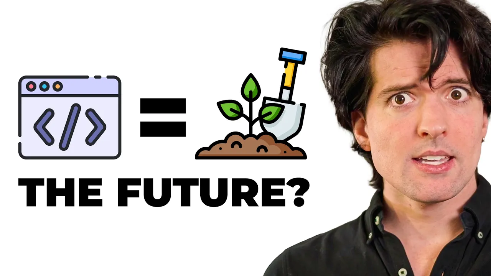
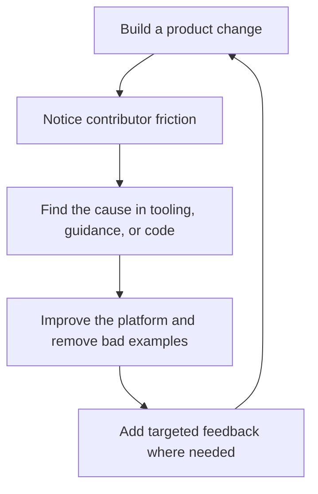

# Coding Isn't About Code Anymore

Theo argues that engineers increasingly act as gardeners, maintaining the codebase and tooling that let humans and agents contribute effectively. This opinion talk draws on Twitch's product and platform teams, the T3 Stack, T3 Chat's Convex migration, and practical T3 Code maintenance. Its examples show how misleading guidance, slow checks, unnecessary tests, and unnoticed performance regressions obstruct delivery. [`1:17`](https://www.youtube.com/watch?v=GtJKFhztgdM&t=77) [`13:01`](https://www.youtube.com/watch?v=GtJKFhztgdM&t=781) [`28:39`](https://www.youtube.com/watch?v=GtJKFhztgdM&t=1719) [`36:42`](https://www.youtube.com/watch?v=GtJKFhztgdM&t=2202) [`38:27`](https://www.youtube.com/watch?v=GtJKFhztgdM&t=2307) [`40:20`](https://www.youtube.com/watch?v=GtJKFhztgdM&t=2420)

## Topic breakdown

1. [The gardener thesis and the changing work](./01-the-gardener-thesis.md)
2. [Twitch and the product-platform relationship](./02-twitch-and-platform-ownership.md)
3. [Fixing the source of bad contributions](./03-fix-the-source-of-bad-contributions.md)
4. [Solo development and the T3 Stack](./04-solo-development-and-t3-stack.md)
5. [Removing assumed organizational constraints](./05-remove-assumed-organizational-constraints.md)
6. [The Convex migration and specialized code](./06-convex-and-the-cost-of-specialized-code.md)
7. [The changing economics of platform work](./07-the-economics-of-platform-work.md)
8. [How development friction blocks agents](./08-how-friction-blocks-agents.md)
9. [Pruning tests and tracing recurrence](./09-pruning-tests-and-preventing-recurrence.md)
10. [Measuring wire-protocol regressions in PRs](./10-measuring-wire-protocol-regressions.md)
11. [Reported results and limits of the argument](./11-reported-results-and-limits.md)

## Overview

The recurring product-platform feedback loop connects the career stories to Theo's agent workflow. [`22:04`](https://www.youtube.com/watch?v=GtJKFhztgdM&t=1324) [`42:25`](https://www.youtube.com/watch?v=GtJKFhztgdM&t=2545)

## Key takeaways

- Correct the examples that produce mistakes. At Twitch, Derek responded to one poor PR with two fixes to misleading documentation and existing code, opened within about 30 minutes. [`13:01`](https://www.youtube.com/watch?v=GtJKFhztgdM&t=781)
- Platform investment can remove dependence on one person. T3 Chat's month-long Convex migration involved a 25,000-plus-line PR and let the team keep shipping while Theo could not code during his hand recovery. [`27:08`](https://www.youtube.com/watch?v=GtJKFhztgdM&t=1628) [`28:20`](https://www.youtube.com/watch?v=GtJKFhztgdM&t=1700) [`28:39`](https://www.youtube.com/watch?v=GtJKFhztgdM&t=1719)
- Slow startup, validation, and release systems constrain agents; CPU and RAM costs also limit parallel work. Theo argues that removing these delays has become more valuable as agents take on implementation. [`36:42`](https://www.youtube.com/watch?v=GtJKFhztgdM&t=2202) [`37:11`](https://www.youtube.com/watch?v=GtJKFhztgdM&t=2231)
- More tests did not mean more useful protection in Theo's T3 Code example. He reports deleting about 250,000 lines, restoring only four of roughly 11,000 removed tests, and seeing no regressions those deleted tests would have caught. [`38:57`](https://www.youtube.com/watch?v=GtJKFhztgdM&t=2337)
- A focused PR check can communicate an engineering priority to agents. The thread transfer action simulates real thread data, flags transfer-size regressions, and reportedly runs in under 45 seconds. [`40:20`](https://www.youtube.com/watch?v=GtJKFhztgdM&t=2420) [`40:55`](https://www.youtube.com/watch?v=GtJKFhztgdM&t=2455) [`41:25`](https://www.youtube.com/watch?v=GtJKFhztgdM&t=2485)
- Theo reports daily merges rising from about 2–20 to roughly 60 on busy weekend days and over 400 on active days. He attributes this to codebase maintenance; the talk does not isolate its causal contribution. [`43:31`](https://www.youtube.com/watch?v=GtJKFhztgdM&t=2611)
