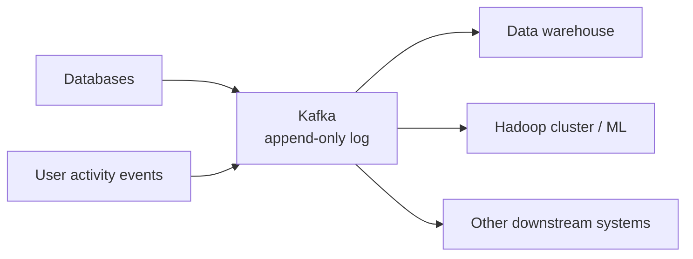

# 03 — Working at LinkedIn

Covers `10:47`–`14:09`. Rapportive's stack, why LinkedIn built Kafka, and what working at scale taught Martin.

## Rapportive's tech stack

- Deliberately unexciting: a Rails app on Postgres, with some Redis mixed in. The only technical curiosity was that they essentially built a graph database on top of Postgres. [`10:47`](https://www.youtube.com/watch?v=SVOrURyOu_U&t=647)

## Data infrastructure at LinkedIn

- After the Intro team disbanded, Martin joined the stream processing team. Kafka had just been open-sourced by LinkedIn, and he worked on **Samza**, a stream processing framework built on top of Kafka. [`11:14`](https://www.youtube.com/watch?v=SVOrURyOu_U&t=674)

## Why did LinkedIn build Kafka?

- Jay Kreps' blog post "The Log" explains the motivation: **data integration**, not messaging. [`11:57`](https://www.youtube.com/watch?v=SVOrURyOu_U&t=717)
- Many systems (databases, user activity event streams) generated data in stream shape; many downstream systems (data warehouse, the Hadoop cluster for machine learning) needed to consume it. The problem was physically getting data out of one system and into another. [`11:57`](https://www.youtube.com/watch?v=SVOrURyOu_U&t=717) [`12:25`](https://www.youtube.com/watch?v=SVOrURyOu_U&t=745)
- Kafka was designed as the integration point: an append-only log as a "lowest common denominator" but still general-purpose abstraction connecting sources to sinks. [`12:47`](https://www.youtube.com/watch?v=SVOrURyOu_U&t=767)

## Learning at scale

- LinkedIn was Martin's first hands-on experience with a really large system — before that, the biggest company he'd worked at was Rapportive with 5 people and a single-instance database. [`13:11`](https://www.youtube.com/watch?v=SVOrURyOu_U&t=791)
- He hand-coded MapReduce jobs in Java on the Hadoop cluster, and Jay Kreps' evangelizing of stream processing was "a revelation": it made clear how the various data systems fit together and what their fundamental principles are — the experience that fed directly into writing the book. [`13:34`](https://www.youtube.com/watch?v=SVOrURyOu_U&t=814) [`13:55`](https://www.youtube.com/watch?v=SVOrURyOu_U&t=835)
