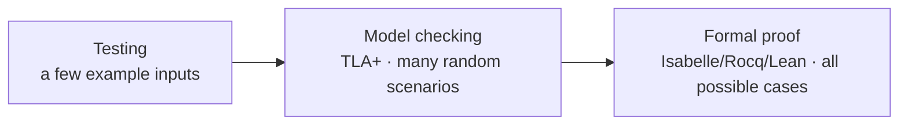

# 11 — Formal verification

Covers `52:45`–`1:00:12`. What formal methods are, why they're hard, and why Kleppmann believes AI makes them more important.

## The spectrum of formal methods

- **Intro level — model checking**: describe expected behavior in a specification language (TLA+ and similar) and run a model checker — essentially a randomized test-case generator — through many scenarios to check the desired behaviors hold. [`53:07`](https://www.youtube.com/watch?v=SVOrURyOu_U&t=3187) [`53:28`](https://www.youtube.com/watch?v=SVOrURyOu_U&t=3208)
- **Advanced level — formal proof**: write a mathematical specification and prove an algorithm/implementation always satisfies it. Unlike testing (a few example inputs), a proof reasons over potentially infinite state spaces — "every possible thing that could possibly happen". [`53:28`](https://www.youtube.com/watch?v=SVOrURyOu_U&t=3208) [`53:59`](https://www.youtube.com/watch?v=SVOrURyOu_U&t=3239)

## Cost and when it's worth it

- Martin never used formal verification in industry — too time-consuming. Only in academia could he afford months proving an algorithm correct. [`54:23`](https://www.youtube.com/watch?v=SVOrURyOu_U&t=3263)
- Worth it for **subtle, high-stakes algorithms**: where a mistake corrupts data or creates a security vulnerability. He has written proofs with the Isabelle proof assistant (others: Rocq, Lean). The proof languages take long to learn and the proof steps are laborious even after that. [`54:23`](https://www.youtube.com/watch?v=SVOrURyOu_U&t=3263) [`54:54`](https://www.youtube.com/watch?v=SVOrURyOu_U&t=3294) [`55:08`](https://www.youtube.com/watch?v=SVOrURyOu_U&t=3308)
- Worked example of what proving feels like: proving `len(concat(A, B)) == len(A) + len(B)` by induction — versus unit tests that check only J=0, 1, 5. Trivial code can be eyeballed; complex algorithms exceed what brains can grok, and that's where proofs pay off. [`56:03`](https://www.youtube.com/watch?v=SVOrURyOu_U&t=3363) [`56:39`](https://www.youtube.com/watch?v=SVOrURyOu_U&t=3399) [`57:10`](https://www.youtube.com/watch?v=SVOrURyOu_U&t=3430)

## Getting started

- Recommendation: start with **model checking** (TLA+), much friendlier than proof assistants. Learning resources for formal proofs are poor — no really great books; Martin learned by pairing with experienced colleagues in his lab. [`57:34`](https://www.youtube.com/watch?v=SVOrURyOu_U&t=3454) [`58:01`](https://www.youtube.com/watch?v=SVOrURyOu_U&t=3481)

## Why AI makes formal verification more important

Two reinforcing arguments (from his December post): [`58:35`](https://www.youtube.com/watch?v=SVOrURyOu_U&t=3515)

1. **LLMs lower the cost**: they're getting increasingly good at writing proofs, making verification feasible where it was previously uneconomical. [`58:35`](https://www.youtube.com/watch?v=SVOrURyOu_U&t=3515)
2. **LLMs raise the need**: with AI generating lots of code, human review of all of it becomes the bottleneck — so automated correctness checking is required. Tests are a good start, but only proofs consider *everything* that could happen, which matters in security where one little bug destroys the whole system's security. [`58:58`](https://www.youtube.com/watch?v=SVOrURyOu_U&t=3538) [`59:25`](https://www.youtube.com/watch?v=SVOrURyOu_U&t=3565)

- Hope: LLMs make formal verification accessible to people who previously found it too hard and too expensive, especially in domains demanding complete absence of bugs. [`59:55`](https://www.youtube.com/watch?v=SVOrURyOu_U&t=3595)
