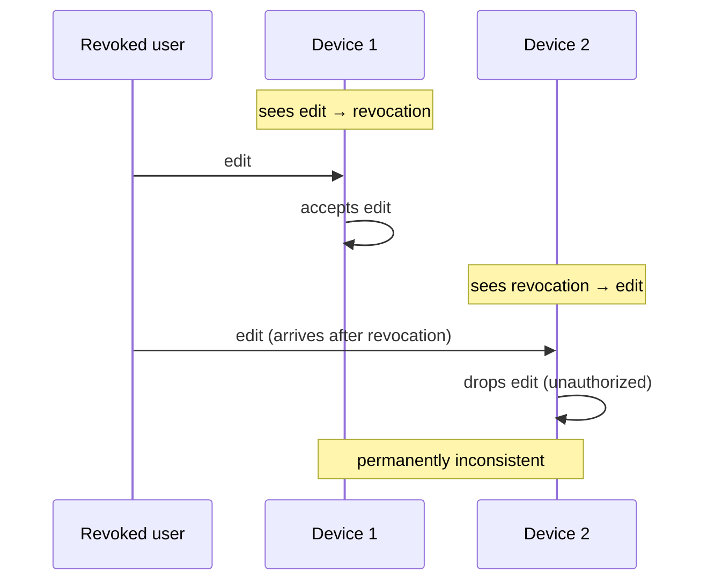

# 13 — Local-first software

Covers `1:03:50`–`1:09:50`. The engineering challenges of removing centralized cloud dependency, illustrated by the decentralized access control problem.

## The vision

- Get away from dependency on centralized cloud services. Cloud services may still be involved (e.g. syncing between phone and laptop) but no single service should be a required trust anchor: run multiple cloud services on multiple providers side by side, sync with whichever responds first — if one disappears, the others remain. [`1:04:02`](https://www.youtube.com/watch?v=SVOrURyOu_U&t=3842) [`1:04:27`](https://www.youtube.com/watch?v=SVOrURyOu_U&t=3867)

## Case study: access control without a central server

- The problem sounds trivial — grant and revoke collaborator access to a document — and *is* trivial in a centralized model (roles checked by one server). [`1:04:50`](https://www.youtube.com/watch?v=SVOrURyOu_U&t=3890)
- In a multi-provider or peer-to-peer setting: a user's edit permission is revoked **concurrently** with that user making an edit. Some devices see edit-then-revocation and accept the edit; others see revocation-then-edit and drop it → devices become **permanently inconsistent**. [`1:05:18`](https://www.youtube.com/watch?v=SVOrURyOu_U&t=3918) [`1:05:43`](https://www.youtube.com/watch?v=SVOrURyOu_U&t=3943)

- A consensus protocol could decide the order, but consensus is messy: quorum votes, nodes must be online. The team is solving it **without consensus**, while preserving high availability, offline work, and serverless peer-to-peer sync — solvable, and close to solved in **Automerge**, the CRDT library Martin works on. [`1:06:08`](https://www.youtube.com/watch?v=SVOrURyOu_U&t=3968) [`1:06:44`](https://www.youtube.com/watch?v=SVOrURyOu_U&t=4004)
- Clocks don't help: a revoked user who wants to vandalize a document can **backdate their edits** with forged timestamps, undermining clock-based ordering. Actions from end-user devices must be treated as potentially malicious. [`1:07:17`](https://www.youtube.com/watch?v=SVOrURyOu_U&t=4037) [`1:07:39`](https://www.youtube.com/watch?v=SVOrURyOu_U&t=4059)

## Why research takes the hard road

- Startups rightly take the easy pragmatic route (centralized server — it makes business sense). Research can afford the idealistic stance of solving the harder decentralized problem; solving it creates a building block and **optionality** for anyone who later wants decentralized tech without inventing it from scratch. [`1:08:11`](https://www.youtube.com/watch?v=SVOrURyOu_U&t=4091) [`1:08:37`](https://www.youtube.com/watch?v=SVOrURyOu_U&t=4117) [`1:09:09`](https://www.youtube.com/watch?v=SVOrURyOu_U&t=4149)
