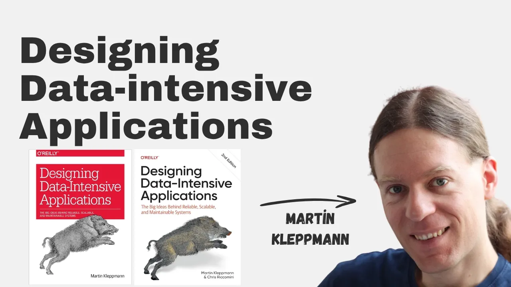
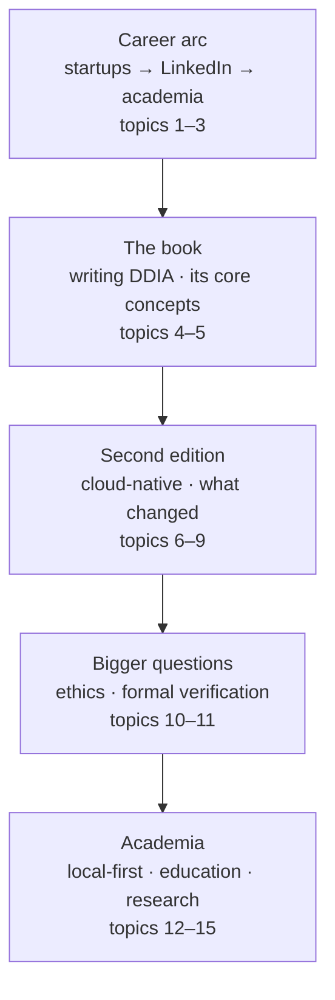

# Designing Data-intensive Applications with Martin Kleppmann

*The Pragmatic Engineer · 1:25:49 · [Watch on YouTube](https://www.youtube.com/watch?v=SVOrURyOu_U)*

## Summary

An interview with Martin Kleppmann, author of *Designing Data-Intensive Applications* (DDIA), on the occasion of the book's second edition — 9 years after the first. The conversation traces his path from two UK startups (GoTest.it, Rapportive) through the LinkedIn acquisition and his work on Kafka/Samza-era data infrastructure, which directly shaped the book. It then digs into what changed in the second edition (cloud-native architecture on object stores, MapReduce removed, vector indexes and data frames added), the trade-offs of building on managed cloud services, why formal verification may matter more in the age of AI-generated code, and his academic research on local-first software and supply-chain cryptography.

## Topics

1. [Early career](01-early-career.md)
2. [Building Rapportive](02-building-rapportive.md)
3. [Working at LinkedIn](03-working-at-linkedin.md)
4. [Writing Designing Data-Intensive Applications](04-writing-ddia.md)
5. [Reliability, scalability, and maintainability](05-reliability-scalability-maintainability.md)
6. [DDIA: the second edition](06-ddia-second-edition.md)
7. [Tradeoffs of using cloud services](07-tradeoffs-of-cloud-services.md)
8. [How the cloud changed scaling](08-how-the-cloud-changed-scaling.md)
9. [The trouble with distributed systems](09-trouble-with-distributed-systems.md)
10. [Ethics for software engineers](10-ethics-for-software-engineers.md)
11. [Formal verification](11-formal-verification.md)
12. [Academia vs. industry](12-academia-vs-industry.md)
13. [Local-first software](13-local-first-software.md)
14. [Computer science education](14-computer-science-education.md)
15. [Martin's current research and advice](15-current-research-and-advice.md)

## Key takeaways

- Kafka was built at LinkedIn for **data integration**, not messaging: an append-only log as a general-purpose "lowest common denominator" connecting many data sources to many downstream consumers (data warehouse, Hadoop/ML). [`12:47`](https://www.youtube.com/watch?v=SVOrURyOu_U&t=767)
- The first edition of DDIA took ~4 years to write (~2.5 years full-time equivalent), missing the publisher's deadline by about 2.5 years. [`21:55`](https://www.youtube.com/watch?v=SVOrURyOu_U&t=1315)
- LinkedIn gave Kleppmann 50% of his work time to write the book — and even that failed due to context switching with on-call duty; the book required going full-time. [`14:52`](https://www.youtube.com/watch?v=SVOrURyOu_U&t=892) [`15:29`](https://www.youtube.com/watch?v=SVOrURyOu_U&t=929)
- The defining shift for the second edition: the first edition assumed machines with local disks and database-level replication; today databases are built **on top of object stores**, a genuinely new abstraction where replication happens at the object-store level — an idea integrated throughout the whole book. [`29:03`](https://www.youtube.com/watch?v=SVOrURyOu_U&t=1743) [`29:33`](https://www.youtube.com/watch?v=SVOrURyOu_U&t=1773)
- "MapReduce is dead. Nobody uses it anymore" — its detailed coverage was cut in the second edition (successors Spark and Flink are what's used), while **vector indexes** and **data frames** were added to support AI workloads. [`47:11`](https://www.youtube.com/watch?v=SVOrURyOu_U&t=2831) [`47:55`](https://www.youtube.com/watch?v=SVOrURyOu_U&t=2875)
- Scalability now includes **scaling down**: cost should be proportional to load at both ends, and serverless is the innovation that made near-zero-load services viable — the cloud helped more at the low end than at the high end, where sharding still requires real engineering. [`25:37`](https://www.youtube.com/watch?v=SVOrURyOu_U&t=1537) [`39:59`](https://www.youtube.com/watch?v=SVOrURyOu_U&t=2399) [`40:21`](https://www.youtube.com/watch?v=SVOrURyOu_U&t=2421)
- Cross-machine sharding is less pressing mostly because **hardware got more powerful**, not because of the cloud; replication remains relevant at every scale since it serves fault tolerance, not scalability. [`41:43`](https://www.youtube.com/watch?v=SVOrURyOu_U&t=2503) [`42:22`](https://www.youtube.com/watch?v=SVOrURyOu_U&t=2542)
- European dependence on US cloud providers is now a named business risk — "fairly unlikely, but no longer unthinkable" — and multi-cloud setups are worth serious consideration for critical workloads. [`37:16`](https://www.youtube.com/watch?v=SVOrURyOu_U&t=2236) [`38:16`](https://www.youtube.com/watch?v=SVOrURyOu_U&t=2296)
- Kleppmann's AI-era case for formal verification is two-sided: LLMs make proofs cheaper to write, and AI-generated code makes automated correctness checking necessary because human review becomes the bottleneck; only proofs cover every possible case, which matters when one bug breaks the security of the whole system. [`58:35`](https://www.youtube.com/watch?v=SVOrURyOu_U&t=3515) [`58:58`](https://www.youtube.com/watch?v=SVOrURyOu_U&t=3538) [`59:25`](https://www.youtube.com/watch?v=SVOrURyOu_U&t=3565)
- Getting-started advice for formal methods: begin with model checking (TLA+), which is much friendlier than proof assistants like Isabelle, Rocq, or Lean. [`57:34`](https://www.youtube.com/watch?v=SVOrURyOu_U&t=3454)
- Decentralized access control is nearly solved **without consensus** in Automerge (the CRDT library Kleppmann works on), preserving offline work and peer-to-peer sync; clocks can't be trusted for ordering because revoked users can backdate edits. [`1:06:44`](https://www.youtube.com/watch?v=SVOrURyOu_U&t=4004) [`1:07:39`](https://www.youtube.com/watch?v=SVOrURyOu_U&t=4059)
- On AI and learning, he endorses the principle behind a recent Anthropic study: juniors who leaned on AI showed little to no learning versus those who didn't — "to learn something you just have to struggle with it a bit". [`1:16:21`](https://www.youtube.com/watch?v=SVOrURyOu_U&t=4581) [`1:16:42`](https://www.youtube.com/watch?v=SVOrURyOu_U&t=4602)
- Career advice: industry and academia aren't mutually exclusive — the best PhD students often have industry experience, and weaving between the two builds both breadth and first-principles rigor. [`1:22:36`](https://www.youtube.com/watch?v=SVOrURyOu_U&t=4956) [`1:24:09`](https://www.youtube.com/watch?v=SVOrURyOu_U&t=5049)
