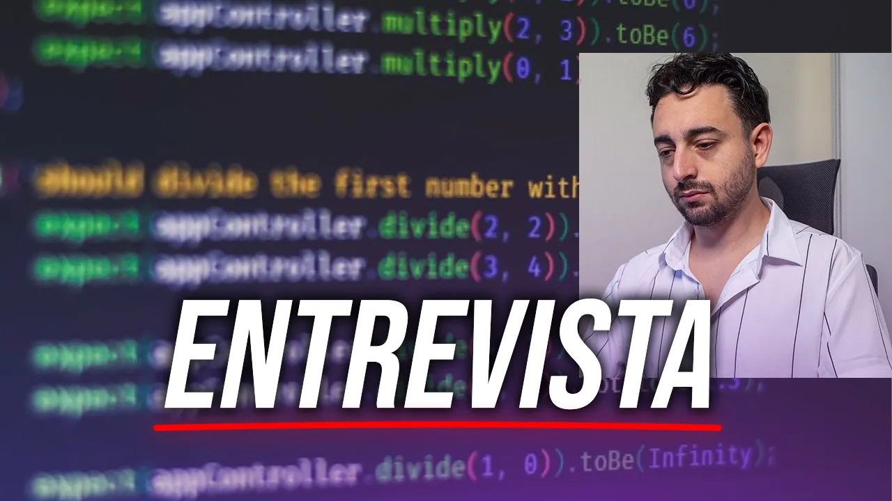
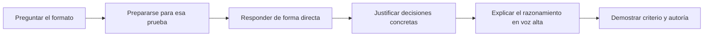

# EL ERROR que TE DESCARTA en una Entrevista Técnica

Yari Taft explica cómo prepararse para cinco formatos de entrevista técnica y sostiene que el mayor motivo de descarte suele estar fuera del código: responder otra cosa, justificar decisiones con frases vacías o no comunicar el alcance real del propio trabajo. La recomendación que atraviesa el video es hacer visible el razonamiento, antes y durante la resolución, para que el entrevistador pueda evaluar conocimientos, criterio y honestidad. [`10:16`](https://www.youtube.com/watch?v=rkm5mAymtg4&t=616) [`18:07`](https://www.youtube.com/watch?v=rkm5mAymtg4&t=1087)

Video: [YouTube](https://www.youtube.com/watch?v=rkm5mAymtg4) · Duración: 20:10 · Canal: Yari Taft

## Temas

1. [El error que te puede dejar fuera aunque seas buen programador](01-el-error-que-te-puede-dejar-fuera.md)  
   Presentar un perfil desalineado con el puesto, improvisar respuestas y ocultar el razonamiento.
2. [Los cinco tipos de entrevistas técnicas](02-los-cinco-tipos-de-entrevistas-tecnicas.md)  
   Cómo reconocer cada formato y qué busca medir.
3. [Live coding, teoría y pruebas de plataforma](03-live-coding-teoria-y-plataformas.md)  
   Por qué estos formatos generan fricción y cómo prepararlos.
4. [Take-home challenge y preparación según el puesto](04-take-home-challenge-y-preparacion.md)  
   Qué demuestra una entrega completa y cómo cambia la exigencia según seniority y empresa.
5. [Comunicación, uso de IA y razonamiento en voz alta](05-comunicacion-ia-y-razonamiento.md)  
   Los tres fallos de comunicación más frecuentes, cómo detectan la trampa y qué conducta conviene practicar.

## Key takeaways

- Hay cinco formatos principales y no se preparan igual: diseño de arquitectura, live coding o algoritmia, entrevista teórico-técnica, prueba de plataforma y take-home challenge. Conviene averiguar cuál se usará desde la entrevista de recursos humanos. [`2:38`](https://www.youtube.com/watch?v=rkm5mAymtg4&t=158) [`4:09`](https://www.youtube.com/watch?v=rkm5mAymtg4&t=249) [`8:21`](https://www.youtube.com/watch?v=rkm5mAymtg4&t=501)
- La entrevista de arquitectura deja ver el seniority porque obliga a conectar backend, frontend, datos, despliegue y adaptación a nuevos requisitos. [`4:23`](https://www.youtube.com/watch?v=rkm5mAymtg4&t=263) [`5:09`](https://www.youtube.com/watch?v=rkm5mAymtg4&t=309)
- Un take-home no se evalúa solo por cumplir la consigna funcional. También cuenta el uso de Git, la estructura del proyecto, el despliegue, las prácticas, la documentación y las pruebas. [`8:21`](https://www.youtube.com/watch?v=rkm5mAymtg4&t=501)
- Las respuestas eficaces contestan primero lo preguntado, justifican las decisiones con restricciones concretas y hacen visible todo el trabajo relevante realizado. [`11:14`](https://www.youtube.com/watch?v=rkm5mAymtg4&t=674) [`12:34`](https://www.youtube.com/watch?v=rkm5mAymtg4&t=754) [`14:07`](https://www.youtube.com/watch?v=rkm5mAymtg4&t=847)
- Pensar en voz alta permite evaluar el camino, incluso cuando el candidato corrige una hipótesis. También diferencia una solución comprendida de una respuesta copiada. [`18:38`](https://www.youtube.com/watch?v=rkm5mAymtg4&t=1118) [`19:27`](https://www.youtube.com/watch?v=rkm5mAymtg4&t=1167)
