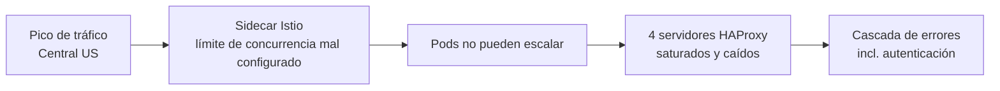

# 02 · Causa raíz: el sidecar de Istio y los límites de concurrencia

## Disparador

- Un pico de tráfico llegó a los balanceadores de carga de la región **Central US** y generó una cascada de errores [`2:34`](https://www.youtube.com/watch?v=h5of8RrGLeE&t=154)
- La cascada se debió a una mala configuración del **sidecar de Istio**; el autor deduce por la terminología que GitHub usa Kubernetes o algo similar [`3:09`](https://www.youtube.com/watch?v=h5of8RrGLeE&t=189)

## Conceptos que explica el vídeo

- **Kubernetes**: orquestador de contenedores; permite definir escalado (p. ej. de 1 a 10 réplicas) según métricas como CPU o RAM [`3:09`](https://www.youtube.com/watch?v=h5of8RrGLeE&t=189)
- **Pod**: cada unidad de ejecución/contenedor que recibe tráfico dentro de Kubernetes [`3:45`](https://www.youtube.com/watch?v=h5of8RrGLeE&t=225)
- **Istio**: una *service mesh* que extiende las capacidades de Kubernetes para gestionar y programar la escalabilidad de la red [`3:45`](https://www.youtube.com/watch?v=h5of8RrGLeE&t=225)
  - Ejemplo: escalar en función de peticiones por segundo en vez de solo CPU/RAM [`4:20`](https://www.youtube.com/watch?v=h5of8RrGLeE&t=260)
- **Sidecar**: pequeño ejecutable que se coloca junto a cada réplica del servidor para que Istio monitorice tráfico entrante y saliente; otras herramientas usan el mismo modelo [`4:48`](https://www.youtube.com/watch?v=h5of8RrGLeE&t=288)

## El fallo concreto

- El sidecar de Istio **no tenía bien configurados los límites de concurrencia**: al llegar el pico, los pods no podían crecer más allá de cierto número [`5:15`](https://www.youtube.com/watch?v=h5of8RrGLeE&t=315)
- Ejemplo ilustrativo del autor (no está en el documento): límite 100 cuando se necesitaban 150 → incapaz de escalar → la infraestructura, al límite, empezó a caerse [`5:47`](https://www.youtube.com/watch?v=h5of8RrGLeE&t=347)
- Resultado directo: **cuatro servidores de HAProxy** se cayeron al alcanzar su límite de flujo/ancho de banda (analogía: una cañería que no puede ampliar su diámetro se rompe) [`5:47`](https://www.youtube.com/watch?v=h5of8RrGLeE&t=347)

