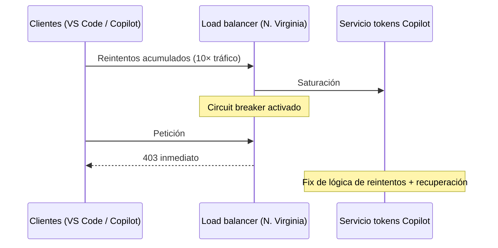

# 05 · Segundo golpe: reintentos de Copilot y el circuit breaker

## El error persigue a la nueva región

- Al mover el tráfico a North Virginia, los clientes siguieron reintentando **todo el tráfico pendiente de las 3 horas anteriores** [`9:48`](https://www.youtube.com/watch?v=h5of8RrGLeE&t=588)
- Analogía: desconectaste la tubería y la conectaste a otro destino, pero el grifo (los clientes) seguía enviando agua con más presión → ahora North Virginia es la región con problemas [`10:23`](https://www.youtube.com/watch?v=h5of8RrGLeE&t=623)
- **North Virginia recibió 10× más tráfico del esperable** por el error de reintentos [`10:23`](https://www.youtube.com/watch?v=h5of8RrGLeE&t=623)
- Origen concreto: el **servicio de tokens de Copilot**, que autentica a los agentes de IA usados en VS Code y otras plataformas de Microsoft; la afectación en Copilot/VS Code fue enorme [`10:55`](https://www.youtube.com/watch?v=h5of8RrGLeE&t=655)
- Fix: limitar el número de reintentos / la lógica de reintentos en ese servicio [`10:55`](https://www.youtube.com/watch?v=h5of8RrGLeE&t=655)

## Circuit breaker

- Técnica muy usada en sistemas distribuidos: bloquear una parte de la infraestructura afectada para que no reciba tráfico [`11:27`](https://www.youtube.com/watch?v=h5of8RrGLeE&t=687)
- Aplicación en GitHub: el servicio de tokens de Copilot deja de llamar hacia abajo y **devuelve directamente un 403**, conteniendo el error en esa parte del sistema [`11:50`](https://www.youtube.com/watch?v=h5of8RrGLeE&t=710)
- Se hace en la capa de **load balancer**, que es muy barata: responde 403 a todo y da tiempo a arreglar lo de detrás. Analogía: los plomos de casa saltando ante una subida de tensión [`12:20`](https://www.youtube.com/watch?v=h5of8RrGLeE&t=740)

## Resultado

- Circuit breaker + nueva lógica de reintentos en el gateway redujeron drásticamente el ratio de errores; hacia las 21 UTC el sistema se recuperó y volvieron todas las regiones a tráfico normal [`12:46`](https://www.youtube.com/watch?v=h5of8RrGLeE&t=766)
- Moraleja: mantener sistemas distribuidos es complejo, más aún con alta carga de lectura **y** escritura como GitHub [`12:46`](https://www.youtube.com/watch?v=h5of8RrGLeE&t=766)

