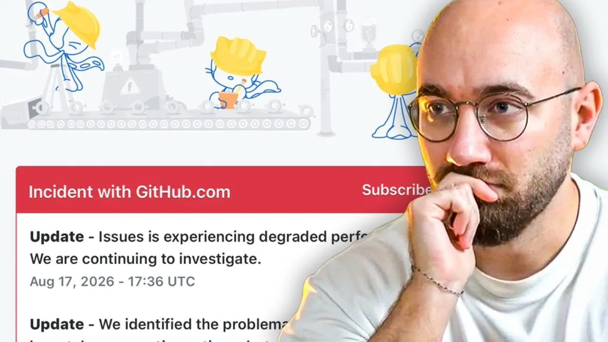

# El error que tumbó a GitHub, explicado



*BettaTech · 17:28 · https://www.youtube.com/watch?v=h5of8RrGLeE*

## Resumen

Análisis del postmortem técnico de la caída de GitHub del 17 de agosto de 2026 (más de 8 horas, 20% de peticiones web/API y 50% de descargas fallando). El vídeo explica la causa raíz (un sidecar de Istio con límites de concurrencia mal configurados que impidió escalar ante un pico de tráfico en Central US y tumbó cuatro HAProxy), cómo se propagó (autenticación, *retry storm*, bug de reintentos en VS Code/Copilot), las mitigaciones aplicadas (cambio de región, PR de configuración, circuit breaker con 403) y cierra con una reflexión sobre sistemas de alta lectura vs alta escritura, la competencia (Cursor Origin) y los planes de GitHub.

## Temas

1. [Contexto del incidente](01-contexto-del-incidente.md)
2. [Causa raíz: el sidecar de Istio y los límites de concurrencia](02-causa-raiz-istio-sidecar.md)
3. [Propagación: HAProxy, autenticación y la tormenta de reintentos](03-propagacion-haproxy-y-retry-storm.md)
4. [Mitigación: redirigir tráfico y arreglar la configuración](04-mitigacion-cambio-de-region.md)
5. [Segundo golpe: reintentos de Copilot y el circuit breaker](05-segundo-golpe-copilot-y-circuit-breaker.md)
6. [YouTube vs GitHub: lectura vs escritura](06-youtube-vs-github-lectura-vs-escritura.md)
7. [Competencia, planes de futuro y cierre](07-competencia-y-planes-de-futuro.md)

## Línea temporal del incidente

```mermaid
timeline
  title Caída de GitHub · 17 ago 2026 (UTC)
  13:40 : Pico de tráfico en Central US
        : Sidecar Istio no escala → 4 HAProxy caen
        : Errores de auth + retry storm
  16:36 : Causa identificada
        : Tráfico redirigido a North Virginia
        : HAProxy pausados + PR de concurrencia
  ~17-20 : North Virginia recibe 10× tráfico (tokens Copilot)
         : Fix de reintentos + circuit breaker (403)
  21:15 : Recuperación completa
```

## Key takeaways

- La caída duró más de 8 horas, con el 20% de peticiones web/API y el 50% de descargas fallando, sobre una base de 180M+ usuarios activos [`0:00`](https://www.youtube.com/watch?v=h5of8RrGLeE&t=0) [`1:04`](https://www.youtube.com/watch?v=h5of8RrGLeE&t=64)
- Causa raíz: el sidecar de Istio tenía mal configurados los límites de concurrencia; ante un pico en Central US los pods no pudieron escalar y cuatro servidores HAProxy cayeron [`5:15`](https://www.youtube.com/watch?v=h5of8RrGLeE&t=315) [`5:47`](https://www.youtube.com/watch?v=h5of8RrGLeE&t=347)
- La caída de HAProxy (reverse proxy / punto de entrada) arrastró a la autenticación, y los clientes reintentando cada 1-3 s generaron una *retry storm* que destapó un bug de reintentos en VS Code [`6:21`](https://www.youtube.com/watch?v=h5of8RrGLeE&t=381) [`7:29`](https://www.youtube.com/watch?v=h5of8RrGLeE&t=449)
- Timeline: problemas desde 13:40 UTC, causa identificada 16:36, recuperación completa 21:15 [`7:29`](https://www.youtube.com/watch?v=h5of8RrGLeE&t=449) [`8:02`](https://www.youtube.com/watch?v=h5of8RrGLeE&t=482)
- Mitigación: redirigir tráfico a North Virginia, pausar HAProxy y abrir una PR cambiando la concurrencia del sidecar [`8:37`](https://www.youtube.com/watch?v=h5of8RrGLeE&t=517) [`9:04`](https://www.youtube.com/watch?v=h5of8RrGLeE&t=544)
- North Virginia recibió 10× el tráfico esperado por los reintentos del servicio de tokens de Copilot; se resolvió limitando reintentos y con un circuit breaker en el load balancer que devolvía 403 [`10:23`](https://www.youtube.com/watch?v=h5of8RrGLeE&t=623) [`11:50`](https://www.youtube.com/watch?v=h5of8RrGLeE&t=710) [`12:20`](https://www.youtube.com/watch?v=h5of8RrGLeE&t=740)
- GitHub no es comparable con YouTube: YouTube es alta lectura con ingestión y distribución separadas (CDN); GitHub sufre escritura masiva de código más lecturas constantes de agentes de IA [`13:55`](https://www.youtube.com/watch?v=h5of8RrGLeE&t=835)
- Cursor lanzó Origin durante la caída; GitHub planea más redundancia, monitorización, conmutación entre regiones y más capacidad en los balanceadores [`15:07`](https://www.youtube.com/watch?v=h5of8RrGLeE&t=907) [`16:20`](https://www.youtube.com/watch?v=h5of8RrGLeE&t=980)
