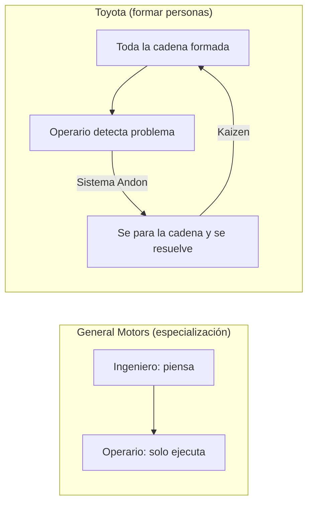

# Cómo Toyota superó a General Motors

El caso histórico del método Toyota: cómo una empresa sin capital ni materias primas venció al gigante mundial apostando por formar personas.

## Contexto

- Finales de los años 40: Japón pierde la Segunda Guerra Mundial, con la industria destruida, sin capital y sin materias primas (carencia que históricamente alimentó su afán expansionista) [`31:09`](https://www.youtube.com/watch?v=t5_M1iFwXbY&t=1869), [`31:55`](https://www.youtube.com/watch?v=t5_M1iFwXbY&t=1915), [`32:22`](https://www.youtube.com/watch?v=t5_M1iFwXbY&t=1942)
- General Motors era probablemente la empresa más grande del mundo y dominaba la industria automovilística [`31:55`](https://www.youtube.com/watch?v=t5_M1iFwXbY&t=1915)
- Toyota concluyó que **copiar a GM no funcionaría** porque sus circunstancias eran opuestas: tocaba innovar [`32:22`](https://www.youtube.com/watch?v=t5_M1iFwXbY&t=1942)

## Dos modelos de fábrica

- GM: industria muy jerarquizada — el ingeniero piensa, el operario ejecuta y su voz no se escucha [`32:54`](https://www.youtube.com/watch?v=t5_M1iFwXbY&t=1974)
- Toyota: "en lugar de fabricar coches, vamos a fabricar super-trabajadores" — formación continua y profunda para **toda** la cadena, no solo directivos e ingenieros; los coches eficientes son la consecuencia [`33:19`](https://www.youtube.com/watch?v=t5_M1iFwXbY&t=1999), [`33:46`](https://www.youtube.com/watch?v=t5_M1iFwXbY&t=2026)
- **Kaizen** (mejora continua): pequeños cambios repetidos infinitas veces generan una ventaja enorme [`34:27`](https://www.youtube.com/watch?v=t5_M1iFwXbY&t=2067)
- **Sistema Andon**: cualquier operario, de cualquier rango o antigüedad, puede levantar la mano y parar toda la cadena de producción para plantear un problema [`35:16`](https://www.youtube.com/watch?v=t5_M1iFwXbY&t=2116)
- El operario ve detalles que el ingeniero no ve desde arriba; incluirlo en la "cadena de pensar" mejora los resultados [`34:53`](https://www.youtube.com/watch?v=t5_M1iFwXbY&t=2093)

## El matiz cultural

- Debate: ¿funcionaría en España? Riesgo de no distinguir buen criterio de ruido, y cultura del "no es mi problema"; Japón es más colectivista y con sentimiento de pertenencia (carreras enteras en la misma empresa) [`35:41`](https://www.youtube.com/watch?v=t5_M1iFwXbY&t=2141), [`36:39`](https://www.youtube.com/watch?v=t5_M1iFwXbY&t=2199), [`37:18`](https://www.youtube.com/watch?v=t5_M1iFwXbY&t=2238)
- Clave psicológica: hay que poder levantar la mano sin ser ridiculizado; si penalizas una mala idea, la próxima buena idea no se dirá por miedo [`36:04`](https://www.youtube.com/watch?v=t5_M1iFwXbY&t=2164), [`36:22`](https://www.youtube.com/watch?v=t5_M1iFwXbY&t=2182)
- Si cuidas a tus trabajadores, es más probable que te cuiden (no siempre recíproco, pero es la estrategia ganadora) [`36:55`](https://www.youtube.com/watch?v=t5_M1iFwXbY&t=2215), [`37:41`](https://www.youtube.com/watch?v=t5_M1iFwXbY&t=2261)

## Resultado

- **60 años después, Toyota adelantó a General Motors** (hacia 2007-2008) y a día de hoy sigue por delante: una estrategia de largo plazo basada en personas y formación venció al que partía con más capital y recursos [`38:20`](https://www.youtube.com/watch?v=t5_M1iFwXbY&t=2300), [`38:54`](https://www.youtube.com/watch?v=t5_M1iFwXbY&t=2334)
- La lección aplica aún más a negocios pequeños de puro capital humano (servicios profesionales) [`38:54`](https://www.youtube.com/watch?v=t5_M1iFwXbY&t=2334), [`39:12`](https://www.youtube.com/watch?v=t5_M1iFwXbY&t=2352)
