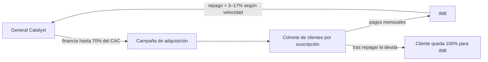

# El nuevo negocio de David Beckham (IM8)

> Capítulo `29:15` – `42:55` · Cómo IM8 levantó 1.000 millones sin ceder equity: financiación del coste de adquisición de clientes (CAC).

## La empresa y los números

- David Beckham se asoció con una empresa para lanzar IM8, suplemento diario en polvo "todo en uno", estilo Athletic Greens [`29:15`](https://www.youtube.com/watch?v=JmPxIbLrb5c&t=1755) [`29:51`](https://www.youtube.com/watch?v=JmPxIbLrb5c&t=1791).
- Cifras citadas: 60 millones de facturación en 2024, on track para ~204 millones este año, y 1.000 millones de financiación levantados **sin ceder acciones** [`30:18`](https://www.youtube.com/watch?v=JmPxIbLrb5c&t=1818).
- Beckham no cobra solo por la línea: negoció un 3 % de la matriz [`37:19`](https://www.youtube.com/watch?v=JmPxIbLrb5c&t=2239).

## Cómo funciona la financiación

- El financiador es General Catalyst, un fondo especializado en financiar el coste de adquisición de clientes (CAC); ya había financiado empresas de software como Grammarly [`31:09`](https://www.youtube.com/watch?v=JmPxIbLrb5c&t=1869) [`31:41`](https://www.youtube.com/watch?v=JmPxIbLrb5c&t=1901).
- La clave: con revenue recurrente (suscripción), las propias métricas del negocio sirven de colateral — "un cliente me dura 2 años y medio pagando 100 €/mes; adelántame ese flujo" [`31:41`](https://www.youtube.com/watch?v=JmPxIbLrb5c&t=1901) [`32:38`](https://www.youtube.com/watch?v=JmPxIbLrb5c&t=1958).
- IM8 encaja porque es **producto físico vendido por suscripción**; sin suscripción este modelo casi no se financia [`33:35`](https://www.youtube.com/watch?v=JmPxIbLrb5c&t=2015) [`35:42`](https://www.youtube.com/watch?v=JmPxIbLrb5c&t=2142).
- Condiciones: financian hasta el 70 % del CAC por cohortes mensuales; la devolución sale de cada cohorte, con un coste de entre el 3 % y el 17 % según la velocidad de repago; los 1.000M se desbloquean por hitos, no de golpe [`33:35`](https://www.youtube.com/watch?v=JmPxIbLrb5c&t=2015) [`34:08`](https://www.youtube.com/watch?v=JmPxIbLrb5c&t=2048).
- El fondo tiene preferencia sobre el cohorte financiado: no financia a la compañía entera sino a la "campaña"; una vez repagada la deuda, el cliente queda para la empresa [`34:48`](https://www.youtube.com/watch?v=JmPxIbLrb5c&t=2088) [`35:14`](https://www.youtube.com/watch?v=JmPxIbLrb5c&t=2114).
- Riesgo: si el lifetime value real se desploma (churn masivo), la empresa tiene un problema — exige métricas muy fiables [`35:42`](https://www.youtube.com/watch?v=JmPxIbLrb5c&t=2142) [`36:03`](https://www.youtube.com/watch?v=JmPxIbLrb5c&t=2163).

## Por qué un banco no haría esto

- Un banco español no entendería la operación: colateral basado en clientes **futuros**, no en activos existentes; sí aceptan carteras de clientes ya existentes (ej. José Elías con Audax) [`37:54`](https://www.youtube.com/watch?v=JmPxIbLrb5c&t=2274) [`39:55`](https://www.youtube.com/watch?v=JmPxIbLrb5c&t=2395).
- Razones estructurales: no es su negocio (no hablan "el idioma"), son entes burocráticos, y la regulación bancaria (MiFID) les impide ciertas operativas; por eso nacen fondos que detectan colaterales nuevos (mismo patrón que el crédito promotor post-2008) [`38:12`](https://www.youtube.com/watch?v=JmPxIbLrb5c&t=2292) [`38:46`](https://www.youtube.com/watch?v=JmPxIbLrb5c&t=2326) [`39:06`](https://www.youtube.com/watch?v=JmPxIbLrb5c&t=2346).
- En España lo habitual es que el banco pida aval personal ("si te crees tus métricas, avala tú") — riesgo de responder con todo el patrimonio presente y futuro; estos fondos no lo piden [`41:09`](https://www.youtube.com/watch?v=JmPxIbLrb5c&t=2469) [`41:29`](https://www.youtube.com/watch?v=JmPxIbLrb5c&t=2489) [`42:20`](https://www.youtube.com/watch?v=JmPxIbLrb5c&t=2540).

## Lecciones del bloque

- El producto (vitaminas, software) se está comoditizando; el valor real está en la **distribución**: "esta empresa sin Beckham no tiene sentido" [`36:58`](https://www.youtube.com/watch?v=JmPxIbLrb5c&t=2218) [`37:19`](https://www.youtube.com/watch?v=JmPxIbLrb5c&t=2239).
- Cita de Keynes para cerrar: "Si le debes un millón al banco, tienes un problema; si le debes 1.000 millones, el problema lo tiene el banco" [`42:55`](https://www.youtube.com/watch?v=JmPxIbLrb5c&t=2575).
