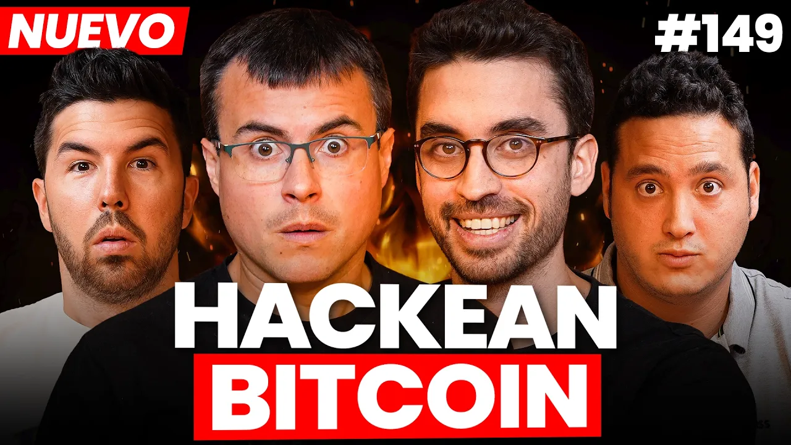
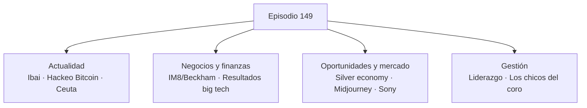

# "Hackean" BITCOIN, ESPAÑA es un ESTADO FALLIDO y el NEGOCIO de la TERCERA EDAD #149

*spicy4tuna · 2:01:42 · [Ver en YouTube](https://www.youtube.com/watch?v=JmPxIbLrb5c)*

## Resumen

Episodio 149 del podcast **Spicy4tuna**: tertulia de actualidad, negocios e inversión entre cuatro presentadores (empresarios/creadores). El episodio repasa el hackeo masivo a billeteras frías de Bitcoin y sus derivadas legales, la crisis migratoria de Ceuta como síntoma de un Estado que falla cuando más se lo necesita, el modelo de financiación sin equity de la marca de suplementos de David Beckham (IM8), los resultados trimestrales de Google, Microsoft, Meta y Amazon y su apuesta total por la IA, la oportunidad de negocio de la "silver economy" (tercera edad), la compra de una app de astrología por parte de Midjourney, el fin de los juegos físicos anunciado por Sony, y un cierre sobre estilos de liderazgo ilustrado con la película *Los chicos del coro*.

**Clasificación**: podcast de opinión y actualidad (formato tertulia), con bloques de análisis de negocio y finanzas. Las notas capturan posiciones, argumentos y datos concretos por bloque; los tramos publicitarios (Trade Republic, Executive Lab) no se documentan.

## Temas

1. [¿Cuánto vale realmente el esfuerzo de Ibai?](01-cuanto-vale-el-esfuerzo-de-ibai.md)
2. [Hackeo masivo a wallets frías de Bitcoin](02-hackeo-wallets-frias-bitcoin.md)
3. [Crisis de Ceuta: ¿España es un Estado fallido?](03-crisis-de-ceuta-estado-fallido.md)
4. [El nuevo negocio de David Beckham (IM8)](04-negocio-david-beckham-im8.md)
5. [Las grandes tecnológicas se lo juegan todo a la IA: resultados de Google, Microsoft, Meta y Amazon](05-resultados-big-tech-ia.md)
6. [El gran negocio de la tercera edad (silver economy)](06-el-gran-negocio-de-la-tercera-edad.md)
7. [Midjourney compra una aplicación de astrología](07-midjourney-compra-app-astrologia.md)
8. [Sony pone fin a los juegos físicos](08-sony-fin-de-los-juegos-fisicos.md)
9. [Cómo gestionar equipos y las lecciones de *Los chicos del coro*](09-liderazgo-y-los-chicos-del-coro.md)

## Key takeaways

- El hackeo a las wallets frías de Bitcoin no fue magia: un fallo de software desde 2021 reducía el espacio de aleatoriedad de la frase semilla ("baraja de 5 cartas"), lo que permitió romperlas por fuerza bruta; afectó incluso a usuarios que siguieron todas las buenas prácticas de autocustodia [`13:39`](https://www.youtube.com/watch?v=JmPxIbLrb5c&t=819) [`11:34`](https://www.youtube.com/watch?v=JmPxIbLrb5c&t=694), y abre la puerta a una reclamación civil masiva contra el fabricante del hardware [`8:31`](https://www.youtube.com/watch?v=JmPxIbLrb5c&t=511).
- El mercado no paga esfuerzo sino valor aportado: las marcas que pusieron 1 € en publicidad con Ibai sacaron 10 € y quieren renovar pagando más [`5:49`](https://www.youtube.com/watch?v=JmPxIbLrb5c&t=349).
- IM8 (Beckham) levantó 1.000 millones sin ceder equity con General Catalyst, un fondo que financia hasta el 70 % del coste de adquisición de clientes usando las cohortes de suscripción como colateral, con repago del 3–17 % según velocidad; facturó 60M en 2024 y va camino de ~204M [`30:18`](https://www.youtube.com/watch?v=JmPxIbLrb5c&t=1818) [`33:35`](https://www.youtube.com/watch?v=JmPxIbLrb5c&t=2015).
- Google: beneficio por acción 5x el consenso, pero inflado por la revalorización contable de SpaceX; Cloud crece 82 % y ya es el 20 % de ingresos; primer trimestre con flujo de caja negativo en ~20 años y backlog de 500.000M sin plazo — la acción cayó ~5 % [`48:18`](https://www.youtube.com/watch?v=JmPxIbLrb5c&t=2898) [`50:48`](https://www.youtube.com/watch?v=JmPxIbLrb5c&t=3048) [`53:34`](https://www.youtube.com/watch?v=JmPxIbLrb5c&t=3214) [`52:10`](https://www.youtube.com/watch?v=JmPxIbLrb5c&t=3130).
- Microsoft: Azure superó 100.000M de ingresos en 12 meses, la nube crece ~43 % y mantiene el capex en 200.000M; la acción subió +15 %, la mayor subida en meses [`54:28`](https://www.youtube.com/watch?v=JmPxIbLrb5c&t=3268) [`55:41`](https://www.youtube.com/watch?v=JmPxIbLrb5c&t=3341) [`56:04`](https://www.youtube.com/watch?v=JmPxIbLrb5c&t=3364).
- Meta tuvo su mejor trimestre publicitario (>30.000M de margen operativo) pero se quedó con solo ~700M de caja libre: todo va a servidores propios sin producto de IA que los monetice; ya negocia alquilar cómputo a Anthropic en acuerdos de ~10.000M [`58:57`](https://www.youtube.com/watch?v=JmPxIbLrb5c&t=3537) [`59:32`](https://www.youtube.com/watch?v=JmPxIbLrb5c&t=3572).
- Amazon presentó el backlog más sólido (diversificado en miles de clientes y a plazo más corto, frente a Microsoft que depende de OpenAI); la acción pasó de ~240 a ~280 $, y Bezos anunció la venta de 4.000M en acciones [`1:05:34`](https://www.youtube.com/watch?v=JmPxIbLrb5c&t=3934) [`1:05:45`](https://www.youtube.com/watch?v=JmPxIbLrb5c&t=3945) [`1:06:07`](https://www.youtube.com/watch?v=JmPxIbLrb5c&t=3967).
- La silver economy crecerá más del 8 % anual durante los próximos 20 años: los boomers llegan a la jubilación con piso, pensión y ahorros, y demandan turismo, formación, deporte, gaming cognitivo y —sobre todo— soluciones a la soledad [`1:14:42`](https://www.youtube.com/watch?v=JmPxIbLrb5c&t=4482) [`1:21:38`](https://www.youtube.com/watch?v=JmPxIbLrb5c&t=4898).
- Midjourney (bootstrapped, ~40 empleados) compró una app de astrología de 4,2M de usuarios activos: en realidad compra al equipo de 27 personas y su know-how de retención con IA; la CEO de la app pasa a dirigir diseño de producto y sacarán por fin la app de Midjourney en la App Store [`1:24:54`](https://www.youtube.com/watch?v=JmPxIbLrb5c&t=5094) [`1:27:38`](https://www.youtube.com/watch?v=JmPxIbLrb5c&t=5258) [`1:28:02`](https://www.youtube.com/watch?v=JmPxIbLrb5c&t=5282).
- Sony eliminará los juegos físicos a partir de 2028 apoyándose en que ~80 % de las compras ya son digitales; el consumidor pierde propiedad real (licencia revocable, sin reventa ni préstamo) — el precedente: 551 películas compradas desaparecerán de las bibliotecas de PlayStation el 1-9-2026 sin reembolso [`1:36:16`](https://www.youtube.com/watch?v=JmPxIbLrb5c&t=5776) [`1:38:37`](https://www.youtube.com/watch?v=JmPxIbLrb5c&t=5917) [`1:45:09`](https://www.youtube.com/watch?v=JmPxIbLrb5c&t=6309).
- Liderazgo: el estilo autoritario rinde mucho a corto plazo pero quema a la gente; el equilibrio ganador es exigencia + acompañamiento, y el rol del líder es hacer brillar el talento oculto (lección de *Los chicos del coro*) [`1:58:36`](https://www.youtube.com/watch?v=JmPxIbLrb5c&t=7116) [`1:59:07`](https://www.youtube.com/watch?v=JmPxIbLrb5c&t=7147) [`2:00:05`](https://www.youtube.com/watch?v=JmPxIbLrb5c&t=7205).
