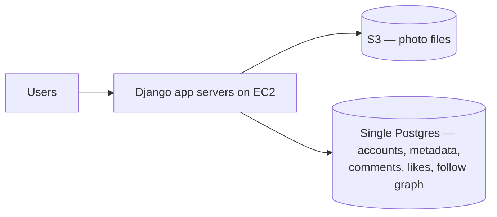

# 2. The 2010–2012 architecture

## The original stack (2010)

Instagram launched with **three engineers** and a setup the author calls "almost embarrassing in how simple it is" ([`0:33`](https://www.youtube.com/watch?v=YLoYcwnqVzM&t=33)):

- **EC2** — rented Amazon virtual machines for the application servers ([`0:58`](https://www.youtube.com/watch?v=YLoYcwnqVzM&t=58)).
- **S3** — photo blobs ([`0:58`](https://www.youtube.com/watch?v=YLoYcwnqVzM&t=58)).
- **One single Postgres database** — user accounts, photo metadata, comments, likes and the follow graph, all of it ([`0:58`](https://www.youtube.com/watch?v=YLoYcwnqVzM&t=58)).
- No microservices, no Kafka, no fancy infrastructure of any kind ([`0:58`](https://www.youtube.com/watch?v=YLoYcwnqVzM&t=58)).

## The growth timeline

| Year | Scale | Infra state |
|---|---|---|
| 2010 | Launch, 3 engineers | Single Postgres ([`0:33`](https://www.youtube.com/watch?v=YLoYcwnqVzM&t=33)) |
| 2011 | 10 million users | Infra still simple ([`0:58`](https://www.youtube.com/watch?v=YLoYcwnqVzM&t=58)) |
| 2012 | 27 million users, **2 TB** Postgres, Facebook acquisition for $1B | Still only a few engineers ([`0:58`](https://www.youtube.com/watch?v=YLoYcwnqVzM&t=58)) |

## Where it cracked

By 2012 the single-database setup is starting to break ([`1:33`](https://www.youtube.com/watch?v=YLoYcwnqVzM&t=93)):

- 2 TB was approaching the **memory limit of the biggest EC2 instance rentable at the time**.
- **Disk I/O was saturated.**
- They had vertically scaled to the absolute maximum — nowhere left to go on a single machine ([`1:33`](https://www.youtube.com/watch?v=YLoYcwnqVzM&t=93)).

Notably, the *first* wall they hit had nothing to do with data size, disk space, or photo upload volume — it was connections ([`1:59`](https://www.youtube.com/watch?v=YLoYcwnqVzM&t=119), [`2:23`](https://www.youtube.com/watch?v=YLoYcwnqVzM&t=143)). See [03-bottleneck-connections-and-pgbouncer.md](03-bottleneck-connections-and-pgbouncer.md).
