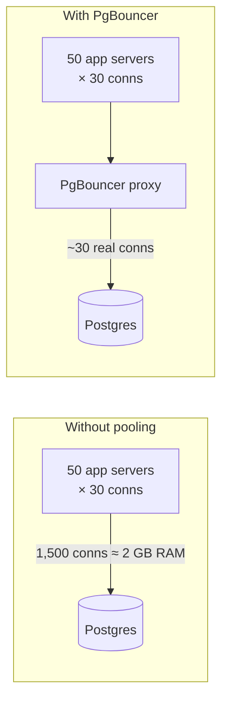

# 3. Bottleneck #1 — connections and PgBouncer

## The problem: connections eat RAM before any work happens

- A Postgres connection costs roughly **1.3 MB of memory** ([`2:23`](https://www.youtube.com/watch?v=YLoYcwnqVzM&t=143)).
- Instagram's Django servers created new connections constantly — **every Django process kept its own pool** to the database ([`2:23`](https://www.youtube.com/watch?v=YLoYcwnqVzM&t=143)).
- The arithmetic that makes it concrete ([`2:23`](https://www.youtube.com/watch?v=YLoYcwnqVzM&t=143)):

| Quantity | Value |
|---|---|
| Application servers | 50 |
| Connections each | 30 |
| Total connections | **1,500** |
| Memory per connection | 1.3 MB |
| RAM consumed | **≈ 2 GB** |

- That 2 GB is spent **before the database does a single useful thing** — it just sits there holding connections and eating RAM ([`2:52`](https://www.youtube.com/watch?v=YLoYcwnqVzM&t=172)).

## The fix: PgBouncer

- **PgBouncer** is a lightweight proxy that sits between the application and Postgres ([`2:52`](https://www.youtube.com/watch?v=YLoYcwnqVzM&t=172)).
- The app thinks it's talking to a database; it's actually talking to PgBouncer ([`2:52`](https://www.youtube.com/watch?v=YLoYcwnqVzM&t=172)).
- PgBouncer **multiplexes** many incoming app connections onto a much smaller pool of real Postgres connections ([`2:52`](https://www.youtube.com/watch?v=YLoYcwnqVzM&t=172)).

## The result

- 1,500 connections eating 2 GB become **~30 real connections** handling all the traffic ([`3:16`](https://www.youtube.com/watch?v=YLoYcwnqVzM&t=196)).
- The freed memory goes back to what the database should be doing: **caching pages, sorting query results, planning queries** ([`3:16`](https://www.youtube.com/watch?v=YLoYcwnqVzM&t=196)).

## Why this matters generally

- This is the **first invisible bottleneck almost every Postgres deployment hits**, and most teams don't add a pooler until they're already in pain ([`3:16`](https://www.youtube.com/watch?v=YLoYcwnqVzM&t=196)).
- Actionable rule stated twice in the video: if you run Postgres at meaningful scale **without** PgBouncer or an equivalent, that is **the single highest-leverage thing you can fix this week** ([`3:42`](https://www.youtube.com/watch?v=YLoYcwnqVzM&t=222), repeated at [`21:23`](https://www.youtube.com/watch?v=YLoYcwnqVzM&t=1283)).
