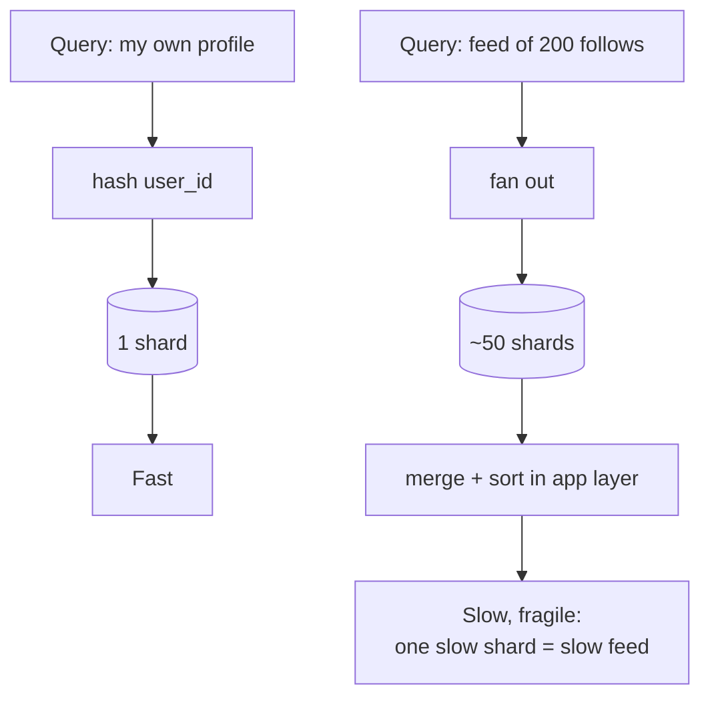

# 5. Sharding by user — and the shard-key trade-off

## The first decision in any sharding scheme

- The very first question is **what you shard by** ([`6:45`](https://www.youtube.com/watch?v=YLoYcwnqVzM&t=405)).
- The column you pick — the **shard key** — shapes **every query your application will ever make**. You get one shot at it ([`6:45`](https://www.youtube.com/watch?v=YLoYcwnqVzM&t=405)).

## Instagram's choice: user ID

- Each user owns their photos, likes and profile data, so partitioning by user is natural: **everything belonging to user X lives on the same shard** ([`7:08`](https://www.youtube.com/watch?v=YLoYcwnqVzM&t=428)).
- Single-user queries ("show me my own profile") become trivial: hash the user ID → know the shard → query that one shard → done ([`7:08`](https://www.youtube.com/watch?v=YLoYcwnqVzM&t=428)).

## Where it hurts: the feed query

- Instagram is a social network, so the **defining query is not "show me my photos" — it's "show me photos from the people I follow"** ([`7:33`](https://www.youtube.com/watch?v=YLoYcwnqVzM&t=453)).
- Worked example from the video: you follow **200 people**, scattered across **50 different shards** (they will be, because shards are randomly distributed) ([`7:33`](https://www.youtube.com/watch?v=YLoYcwnqVzM&t=453)).
- Fetching that feed means hitting **50 databases**, getting partial results, then **merging and sorting in the application layer** ([`7:33`](https://www.youtube.com/watch?v=YLoYcwnqVzM&t=453)).
- Costs: slow, complex, and a whole **new class of failure modes** — if one of the 50 shards is slow, the entire feed is slow ([`8:01`](https://www.youtube.com/watch?v=YLoYcwnqVzM&t=481)).

## The fundamental trade

- Sharding by user makes **single-user queries fast** and **cross-user queries expensive**. There is **no clever way around it** — every sharded system in the world makes some version of this trade ([`8:01`](https://www.youtube.com/watch?v=YLoYcwnqVzM&t=481)).
- Instagram **accepted** the trade, betting they could solve cross-user queries in the application layer with **caching, smart fanout and precomputed feeds** — and they were right ([`8:21`](https://www.youtube.com/watch?v=YLoYcwnqVzM&t=501)).

## The permanence warning

- **The shard-key decision is permanent.** Once a few hundred terabytes are partitioned by user, you don't get to change your mind — resharding would mean **rewriting every single row** ([`8:21`](https://www.youtube.com/watch?v=YLoYcwnqVzM&t=501)).
