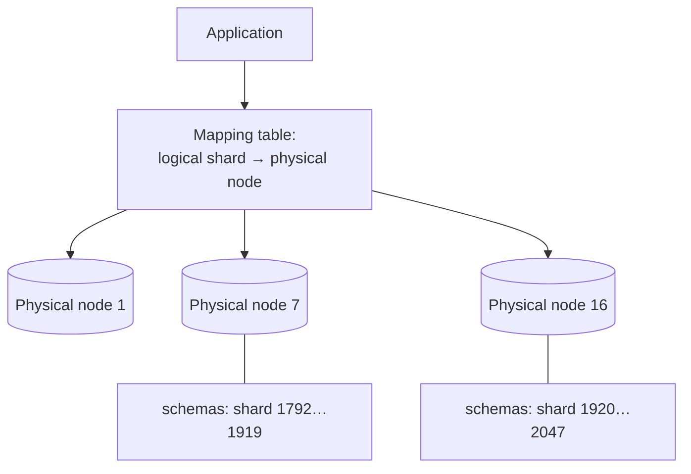

# 6. Logical vs physical shards — the mapping layer

> The single idea the video says to remember if you remember nothing else ([`11:15`](https://www.youtube.com/watch?v=YLoYcwnqVzM&t=675)).

## What most teams did in 2010

- Engineers conflate sharding with **physical machines**: spread users across 16 database servers, each holding 1/16 of the data; to grow, add servers and **reshuffle the data** ([`8:44`](https://www.youtube.com/watch?v=YLoYcwnqVzM&t=524)).

## What Instagram did instead

They inserted a layer **between the data and the hardware** ([`8:44`](https://www.youtube.com/watch?v=YLoYcwnqVzM&t=524)):

- Created **several thousand logical shards**, independent of the physical servers hosting them ([`9:10`](https://www.youtube.com/watch?v=YLoYcwnqVzM&t=550)).
- In Postgres terms, **each logical shard is a schema** — a namespaced collection of tables (shard 0, shard 1, … up to several thousand) ([`9:10`](https://www.youtube.com/watch?v=YLoYcwnqVzM&t=550)).
- Every schema has the **same tables** (users, photos, likes, …), each holding a **different slice of the data** ([`9:10`](https://www.youtube.com/watch?v=YLoYcwnqVzM&t=550)).
- **At the start, all thousands of logical shards lived on a single physical machine** — sharing the same hardware. The application neither knew nor cared: it looked up which logical shard owned the user and queried that schema ([`9:37`](https://www.youtube.com/watch?v=YLoYcwnqVzM&t=577)).

## The decoupling

Two things most engineers conflate are separated ([`9:37`](https://www.youtube.com/watch?v=YLoYcwnqVzM&t=577), [`10:02`](https://www.youtube.com/watch?v=YLoYcwnqVzM&t=602)):

| Concern | Property |
|---|---|
| **How the data is partitioned** (thousands of logical pieces) | Fixed **forever** |
| **Where the data lives** (which physical node hosts which logical shard) | A **separate, changeable mapping** |

## The payoff: growing without resharding

The rebalancing procedure, exactly as walked through in the video ([`10:02`](https://www.youtube.com/watch?v=YLoYcwnqVzM&t=602), [`10:27`](https://www.youtube.com/watch?v=YLoYcwnqVzM&t=627), [`10:52`](https://www.youtube.com/watch?v=YLoYcwnqVzM&t=652)):

1. Physical **node 7 reaches 95% capacity**.
2. Bring up a new machine, **node 16**.
3. Replicate **half of node 7's logical shards** to node 16 using **Postgres built-in streaming replication**.
4. Once in sync, **update the mapping table** — e.g. shards **1920–2047** now live on node 16 instead of node 7.
5. Cutover is fast. Result: **node 7 at 50%, node 16 at 50%**.

What did *not* change ([`10:52`](https://www.youtube.com/watch?v=YLoYcwnqVzM&t=652)):

- ❌ The data
- ❌ The schemas
- ❌ The application code
- ✅ Only the **mapping**

## The lesson

- **The mapping is the architecture** ([`11:15`](https://www.youtube.com/watch?v=YLoYcwnqVzM&t=675)).
- Hardcode *"we have 16 shards"* into the application → growing is painful. Hardcode *"we have 4,000 logical shards mapped onto some number of physical nodes"* → growing is **just a config change** ([`11:15`](https://www.youtube.com/watch?v=YLoYcwnqVzM&t=675)).
- **Separate how your data is partitioned from where it physically lives.** This is the pattern that lets you scale **without rewriting** ([`11:15`](https://www.youtube.com/watch?v=YLoYcwnqVzM&t=675), [`11:39`](https://www.youtube.com/watch?v=YLoYcwnqVzM&t=699)).
