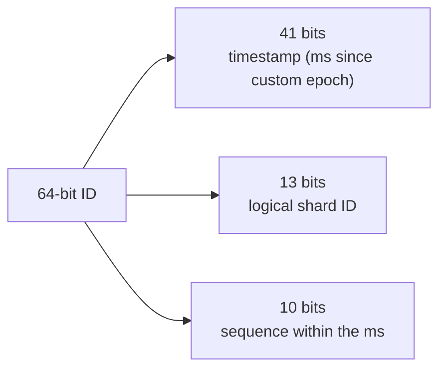

# 7. Snowflake-style IDs built into Postgres

## The new problem sharding created

- In a single database, **auto-increment IDs** work: Postgres hands out 1, 2, 3, 4 — unique because only one database issues them ([`11:39`](https://www.youtube.com/watch?v=YLoYcwnqVzM&t=699)).
- In a sharded setup they **break immediately**: shard 0 generates 1, 2, 3, 4 and shard 1 also generates 1, 2, 3, 4 → **instant collisions**, two different photos with the same ID, and the application cannot tell them apart ([`12:02`](https://www.youtube.com/watch?v=YLoYcwnqVzM&t=722)).
- The question: **how do you generate unique IDs across thousands of independent shards with zero coordination?** ([`12:27`](https://www.youtube.com/watch?v=YLoYcwnqVzM&t=747))

## Options evaluated and rejected

| Option | How it works | Why rejected |
|---|---|---|
| **UUIDs** | 128-bit random strings, effectively never collide ([`12:27`](https://www.youtube.com/watch?v=YLoYcwnqVzM&t=747)) | Huge, and **random → no inherent ordering**; you can't use the ID as a proxy for time, and random IDs make the database work harder ([`12:27`](https://www.youtube.com/watch?v=YLoYcwnqVzM&t=747), [`12:57`](https://www.youtube.com/watch?v=YLoYcwnqVzM&t=777)) |
| **Ticket server** (Flickr's approach) | A dedicated service whose only job is handing out unique IDs; every insert asks it first ([`12:57`](https://www.youtube.com/watch?v=YLoYcwnqVzM&t=777)) | **Single point of failure** — if it goes down, nothing anywhere can insert ([`13:22`](https://www.youtube.com/watch?v=YLoYcwnqVzM&t=802)) |
| **Twitter Snowflake** | Distributed service generating time-ordered IDs; closest to what they wanted ([`13:22`](https://www.youtube.com/watch?v=YLoYcwnqVzM&t=802)) | Requires **a whole separate service** alongside Postgres: more moving parts, more to monitor, more to break ([`13:22`](https://www.youtube.com/watch?v=YLoYcwnqVzM&t=802)) |

## Their solution: Snowflake-style IDs *inside* Postgres

Instagram built Snowflake-style IDs **directly into Postgres itself** ([`13:47`](https://www.youtube.com/watch?v=YLoYcwnqVzM&t=827)).

Every ID is a **64-bit number** split into three pieces:

| Bits | Field | Meaning / capacity |
|---|---|---|
| **41** (high-order) | Timestamp | Milliseconds since a **custom Instagram epoch** → **41 years** of millisecond timestamps ([`13:47`](https://www.youtube.com/watch?v=YLoYcwnqVzM&t=827)) |
| **13** | Shard ID | Which logical shard generated it → up to **8,192 shards**, far more than needed ([`14:16`](https://www.youtube.com/watch?v=YLoYcwnqVzM&t=856)) |
| **10** | Sequence number | Up to **1,024 IDs per shard per millisecond** ≈ **1 million IDs/sec per shard** ([`14:16`](https://www.youtube.com/watch?v=YLoYcwnqVzM&t=856)) |

## Why the implementation is the clever part

- Implemented **entirely as a Postgres function** — no external service ([`14:44`](https://www.youtube.com/watch?v=YLoYcwnqVzM&t=884)).
- Each shard has a small in-database function that, when called: reads the current time → reads the shard's hardcoded ID → increments the sequence counter → combines the three into one 64-bit number ([`14:44`](https://www.youtube.com/watch?v=YLoYcwnqVzM&t=884)).
- Consequences ([`14:44`](https://www.youtube.com/watch?v=YLoYcwnqVzM&t=884)):
  - **No coordination** with any other shard
  - **No external dependency**
  - **No single point of failure**
- Because the timestamp sits in the **high-order bits**, IDs are **roughly time-sortable**: *"show me the latest photos"* becomes `ORDER BY id DESC LIMIT 20` ([`14:44`](https://www.youtube.com/watch?v=YLoYcwnqVzM&t=884)).
- **No separate timestamp index needed — the ID is itself the timestamp** ([`15:21`](https://www.youtube.com/watch?v=YLoYcwnqVzM&t=921)).

## Industry impact

- The pattern is now copied across the industry — **Discord, Slack** and many large-scale applications use it — but it started here ([`15:21`](https://www.youtube.com/watch?v=YLoYcwnqVzM&t=921)).
- Practical advice: adopt Snowflake-style IDs **from day one**, even if you're not sharded and don't plan to be. Migrating from auto-increment after you have billions of rows is very painful ([`20:59`](https://www.youtube.com/watch?v=YLoYcwnqVzM&t=1259)).
