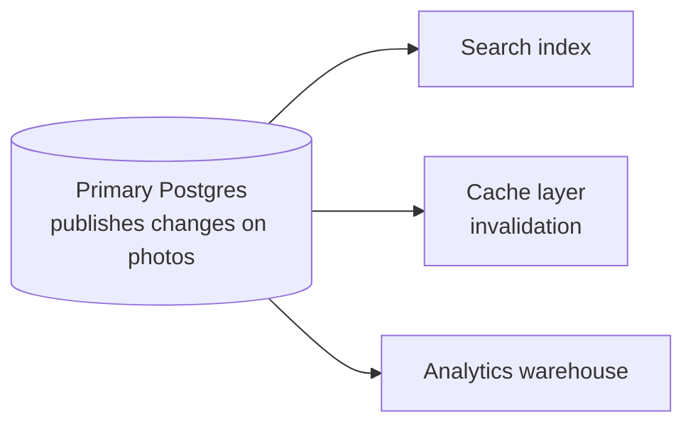

# 9. Three underused Postgres features

Three features Instagram leaned on heavily that most engineers either don't know exist or don't use — even though they're already sitting in the database, already running. Each is small, but each is incredibly powerful ([`17:35`](https://www.youtube.com/watch?v=YLoYcwnqVzM&t=1055), [`17:55`](https://www.youtube.com/watch?v=YLoYcwnqVzM&t=1075)).

## 1. Partial indexes

- A normal index keeps **one entry per row**: a billion rows → a billion index entries ([`17:55`](https://www.youtube.com/watch?v=YLoYcwnqVzM&t=1075)).
- A **partial index** only indexes rows matching a condition ([`18:17`](https://www.youtube.com/watch?v=YLoYcwnqVzM&t=1097)).
- Worked example: a billion photos, but you only query the **last 30 days** → index just the recent ones ([`18:17`](https://www.youtube.com/watch?v=YLoYcwnqVzM&t=1097)):
  - **100 million entries instead of 1 billion — 10× smaller, 10× faster to scan**
  - It **naturally stays small as old data ages out**

## 2. Functional indexes

- A normal index indexes the **value in a column**; a functional index indexes the **result of a function applied to that value** ([`18:39`](https://www.youtube.com/watch?v=YLoYcwnqVzM&t=1119)).
- Instagram's concrete case: columns holding **64-character random tokens**. Indexing the whole string wastes space — all 64 characters get duplicated inside the index ([`18:39`](https://www.youtube.com/watch?v=YLoYcwnqVzM&t=1119)).
- Their fix: a functional index over only the **first 8 characters** of each token ([`18:39`](https://www.youtube.com/watch?v=YLoYcwnqVzM&t=1119)).
- Result: lookups stay fast because **most 8-character prefixes are unique enough**, and the index is roughly **a tenth of the size** ([`19:08`](https://www.youtube.com/watch?v=YLoYcwnqVzM&t=1148)).
- Scale note: irrelevant at 10,000 rows, decisive at 10 billion rows ([`19:08`](https://www.youtube.com/watch?v=YLoYcwnqVzM&t=1148)).

## 3. Logical replication

Called **the most underrated Postgres feature** ([`19:08`](https://www.youtube.com/watch?v=YLoYcwnqVzM&t=1148)).

- It streams **every insert, update and delete** on a given table out to downstream systems **in real time as they happen** ([`19:08`](https://www.youtube.com/watch?v=YLoYcwnqVzM&t=1148)).
- Pattern: the primary publishes all changes on the `photos` table, and subscribers react ([`19:36`](https://www.youtube.com/watch?v=YLoYcwnqVzM&t=1176)):
  - A **search index** updates itself automatically
  - A **cache layer** invalidates entries as they change
  - An **analytics warehouse** keeps a real-time copy for reporting
- The primary database goes back to being **just the source of truth**, and downstream systems stay in sync ([`19:36`](https://www.youtube.com/watch?v=YLoYcwnqVzM&t=1176)).

- The critique: many teams build this by hand with **application-level event publishing, Kafka and dual writes** — while **Postgres has it built in and nobody knows about it** ([`19:36`](https://www.youtube.com/watch?v=YLoYcwnqVzM&t=1176), [`20:06`](https://www.youtube.com/watch?v=YLoYcwnqVzM&t=1206)).
