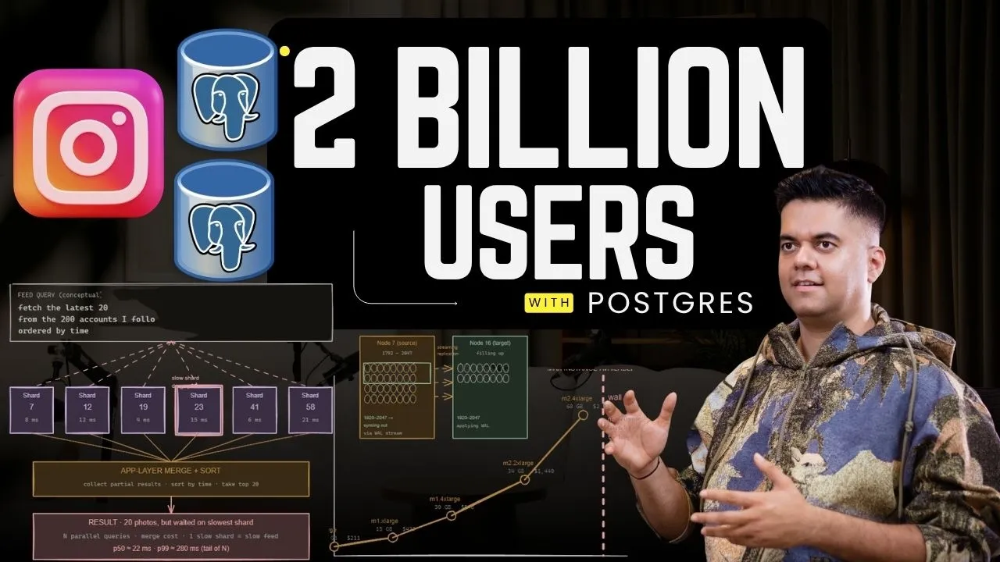
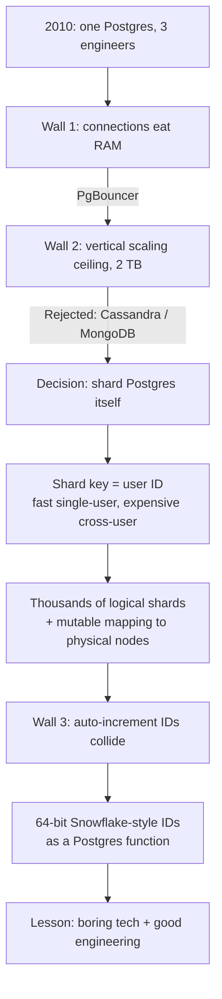

# How Instagram Scaled Postgres to 2 Billion Users

*Akhil Sharma · 22:37 · [Watch on YouTube](https://www.youtube.com/watch?v=YLoYcwnqVzM)*

## Summary

A visual case study of how Instagram scaled a single Postgres database — three engineers, EC2, S3 and one relational database in 2010 — into a sharded architecture that carried the product to planet scale, and why the team rejected the standard "move to NoSQL" advice along the way. The video walks the walls they hit in the order they hit them: connection memory exhaustion, the vertical scaling ceiling at 2 TB, the shard-key trade-off, and unique ID generation across thousands of independent shards. It then extracts the architectural patterns that outlived the specific implementation — decoupling logical shards from physical machines, Snowflake-style IDs implemented as a plain Postgres function — plus three underused Postgres features and an honest caveat about what Instagram actually runs today.

## Topics

1. [The premise: Postgres at planet scale](01-the-premise-postgres-at-planet-scale.md)
2. [The 2010–2012 architecture](02-the-2010-2012-architecture.md)
3. [Bottleneck #1 — connections and PgBouncer](03-bottleneck-connections-and-pgbouncer.md)
4. [The vertical scaling wall and the NoSQL decision](04-the-vertical-scaling-wall-and-the-nosql-decision.md)
5. [Sharding by user — and the shard-key trade-off](05-sharding-by-user-and-the-shard-key-tradeoff.md)
6. [Logical vs physical shards — the mapping layer](06-logical-vs-physical-shards.md)
7. [Snowflake-style IDs built into Postgres](07-snowflake-style-ids-inside-postgres.md)
8. [Boring technology as a superpower](08-boring-technology-as-a-superpower.md)
9. [Three underused Postgres features](09-three-underused-postgres-features.md)
10. [What Instagram actually runs today](10-what-instagram-actually-runs-today.md)
11. [The five rules and the closing argument](11-the-five-rules-and-closing-argument.md)

## Key takeaways

- Instagram reached **27 million users on a 2 TB single Postgres database** with only a few engineers before sharding — the ceiling was the biggest rentable EC2 instance's RAM plus saturated disk I/O, not Postgres itself ([`0:58`](https://www.youtube.com/watch?v=YLoYcwnqVzM&t=58), [`1:33`](https://www.youtube.com/watch?v=YLoYcwnqVzM&t=93)).
- **Connections, not data volume, were the first wall.** At ~1.3 MB per connection, 50 app servers × 30 connections = 1,500 connections ≈ 2 GB of RAM burned before any query runs; PgBouncer collapsed that to ~30 real connections ([`2:23`](https://www.youtube.com/watch?v=YLoYcwnqVzM&t=143), [`3:16`](https://www.youtube.com/watch?v=YLoYcwnqVzM&t=196)).
- They **evaluated Cassandra and MongoDB seriously and still chose Postgres**, on the reasoning that switching doesn't eliminate horizontal partitioning — it hides it behind another abstraction, and the migration is one-way ([`4:32`](https://www.youtube.com/watch?v=YLoYcwnqVzM&t=272), [`4:51`](https://www.youtube.com/watch?v=YLoYcwnqVzM&t=291)).
- **Sharding by user ID is a permanent trade**: single-user queries hit one shard, but a 200-follow feed fans out to ~50 shards and merges in the application layer, where one slow shard slows the whole feed. Instagram accepted it and paid it back with caching, fanout and precomputed feeds ([`7:33`](https://www.youtube.com/watch?v=YLoYcwnqVzM&t=453), [`8:01`](https://www.youtube.com/watch?v=YLoYcwnqVzM&t=481), [`8:21`](https://www.youtube.com/watch?v=YLoYcwnqVzM&t=501)).
- The central pattern: **thousands of logical shards (Postgres schemas) mapped onto a changeable set of physical nodes** — initially all on one machine. Rebalancing a node at 95% capacity means streaming-replicating half its logical shards to a new node and updating the mapping table; data, schemas and application code never change ([`9:10`](https://www.youtube.com/watch?v=YLoYcwnqVzM&t=550), [`10:27`](https://www.youtube.com/watch?v=YLoYcwnqVzM&t=627), [`10:52`](https://www.youtube.com/watch?v=YLoYcwnqVzM&t=652)).
- **Snowflake-style IDs were implemented as a Postgres function, not a service**: 41 bits timestamp (41 years of ms), 13 bits shard ID (8,192 shards), 10 bits sequence (1,024 IDs/ms/shard ≈ 1M/sec). No coordination, no external dependency, no single point of failure — and `ORDER BY id DESC` replaces a timestamp index ([`13:47`](https://www.youtube.com/watch?v=YLoYcwnqVzM&t=827), [`14:16`](https://www.youtube.com/watch?v=YLoYcwnqVzM&t=856), [`14:44`](https://www.youtube.com/watch?v=YLoYcwnqVzM&t=884)).
- UUIDs were rejected for being large and unordered; Flickr-style ticket servers for being a single point of failure; Twitter's Snowflake for requiring a separate service to run and monitor ([`12:27`](https://www.youtube.com/watch?v=YLoYcwnqVzM&t=747), [`13:22`](https://www.youtube.com/watch?v=YLoYcwnqVzM&t=802)).
- That ID pattern is now **used by Discord, Slack and many large-scale applications** ([`15:21`](https://www.youtube.com/watch?v=YLoYcwnqVzM&t=921)).
- Three Postgres features carry real weight at scale: **partial indexes** (indexing only the last 30 days cuts 1B entries to 100M — 10× smaller and faster), **functional indexes** (indexing an 8-character prefix of 64-char tokens gives ~1/10 the index size with fast lookups), and **logical replication** (streams every insert/update/delete to search indexes, caches and warehouses — replacing hand-rolled Kafka and dual-write pipelines) ([`18:17`](https://www.youtube.com/watch?v=YLoYcwnqVzM&t=1097), [`19:08`](https://www.youtube.com/watch?v=YLoYcwnqVzM&t=1148), [`19:36`](https://www.youtube.com/watch?v=YLoYcwnqVzM&t=1176)).
- **Caveat: this is history, not the current stack.** The story covers 2010–2015; after the acquisition Meta absorbed Instagram into its own infrastructure, and the social graph is now served by **TAO**, Meta's distributed graph system ([`20:06`](https://www.youtube.com/watch?v=YLoYcwnqVzM&t=1206), [`20:33`](https://www.youtube.com/watch?v=YLoYcwnqVzM&t=1233)).
- The diagnosis offered for the industry: **the common mistake isn't picking the wrong database, it's switching too early**, when the real fix was understanding the existing one better — "a lot of users" is not a new problem, unlike vector search, real-time time-series or planet-scale graph traversal ([`16:13`](https://www.youtube.com/watch?v=YLoYcwnqVzM&t=973), [`16:45`](https://www.youtube.com/watch?v=YLoYcwnqVzM&t=1005)).
