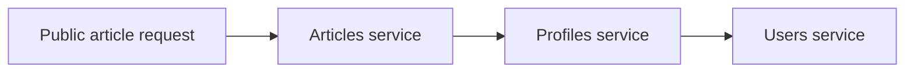

# Same-server HTTP microservices and CPU overhead

- Four separate service processes first run on the same eight-vCPU machine, using HTTP/JSON internally. Holding the application hardware constant helps separate service-splitting costs from machine-placement costs. [`5:39`](https://www.youtube.com/watch?v=bhklFv_VRq8&t=339)
- Capacity falls from the monolith's 60,000 users to 25,000 users. [`5:39`](https://www.youtube.com/watch?v=bhklFv_VRq8&t=339)

## Why a request does more work

An article request needs article data, author information, and the current user's follow status. Articles calls profiles, which calls users; batching reduces request count but preserves this dependency chain. [`6:00`](https://www.youtube.com/watch?v=bhklFv_VRq8&t=360)

- Every internal step requires client and server request handling, encoding, decoding, and scheduling. The complete response waits for the chain to finish. [`6:00`](https://www.youtube.com/watch?v=bhklFv_VRq8&t=360)
- Same-machine placement avoids inter-machine travel but preserves service-request machinery. These requests do not become ordinary function calls. [`6:20`](https://www.youtube.com/watch?v=bhklFv_VRq8&t=380)
- Application-tier CPU work rises from approximately 0.47 ms per public request for the monolith to 1.2 ms for HTTP microservices, a little over 2.5 times as much. [`6:20`](https://www.youtube.com/watch?v=bhklFv_VRq8&t=380)
- CPU work sums processing consumed by the application tier. End-to-end response time also includes waiting on services or the database, so these CPU values are not request latency. [`6:20`](https://www.youtube.com/watch?v=bhklFv_VRq8&t=380) [`6:42`](https://www.youtube.com/watch?v=bhklFv_VRq8&t=402)
