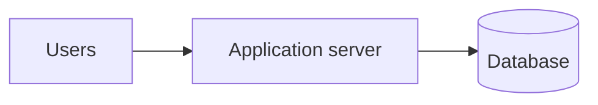

# Starting system

## Baseline

- Begin with one application server and one database. This setup is enough for thousands of users and remains the final architecture for many applications. [`1:40`](https://www.youtube.com/watch?v=EaXHfuHRWwg&t=100)
- Staying with this design is not architectural failure. Scale only after a specific constraint appears. [`1:40`](https://www.youtube.com/watch?v=EaXHfuHRWwg&t=100)

## Decision rule

- Keep the baseline while it meets capacity, latency, and reliability needs. Every added component creates another system to operate and another way to fail. This incremental approach frames the rest of the course. [`0:59`](https://www.youtube.com/watch?v=EaXHfuHRWwg&t=59) [`1:40`](https://www.youtube.com/watch?v=EaXHfuHRWwg&t=100)
