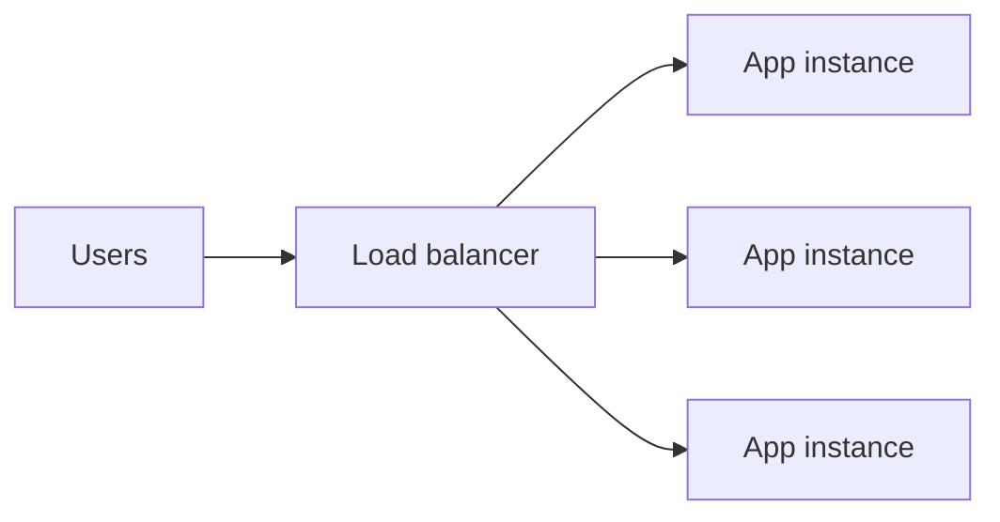

# Load balancing

## Failure

- A traffic spike can overwhelm a healthy single server. Requests queue until some time out, even when the code and database queries are sound. [`2:21`](https://www.youtube.com/watch?v=EaXHfuHRWwg&t=141) [`2:53`](https://www.youtube.com/watch?v=EaXHfuHRWwg&t=173)

## Two scaling choices

1. Vertical scaling gives the same server more CPU and memory. It requires no code change and is usually the right first move. [`3:29`](https://www.youtube.com/watch?v=EaXHfuHRWwg&t=209) [`4:06`](https://www.youtube.com/watch?v=EaXHfuHRWwg&t=246)
2. Horizontal scaling runs identical copies of the whole application. Each instance can handle any request, and the platform can add more instances as traffic grows. [`4:35`](https://www.youtube.com/watch?v=EaXHfuHRWwg&t=275) [`5:10`](https://www.youtube.com/watch?v=EaXHfuHRWwg&t=310) [`5:44`](https://www.youtube.com/watch?v=EaXHfuHRWwg&t=344)

## Practical numbers and limits

- A typical application can handle hundreds of requests per second, or millions per day, on a $20-per-month server. [`4:06`](https://www.youtube.com/watch?v=EaXHfuHRWwg&t=246)
- Vertical scaling eventually hits the largest available machine and becomes expensive before that point. Horizontal scaling removes that particular ceiling by distributing work across machines. [`4:35`](https://www.youtube.com/watch?v=EaXHfuHRWwg&t=275) [`5:44`](https://www.youtube.com/watch?v=EaXHfuHRWwg&t=344)

## Load balancer

- A load balancer sits in front of app instances and chooses a healthy destination for every incoming request. Users do not need to know how many instances exist or which one handled them. [`6:07`](https://www.youtube.com/watch?v=EaXHfuHRWwg&t=367) [`6:41`](https://www.youtube.com/watch?v=EaXHfuHRWwg&t=401)
- Platforms such as Vercel and Railway commonly provide this layer. NGINX is a common self-managed option. [`6:41`](https://www.youtube.com/watch?v=EaXHfuHRWwg&t=401)

## Cost

- The load balancer becomes a single point of failure, so production systems need redundancy for it. [`6:41`](https://www.youtube.com/watch?v=EaXHfuHRWwg&t=401) [`7:09`](https://www.youtube.com/watch?v=EaXHfuHRWwg&t=429)
- Horizontal scaling also requires interchangeable servers. A request cannot depend on private state stored by whichever instance handled the previous request. [`7:09`](https://www.youtube.com/watch?v=EaXHfuHRWwg&t=429)
