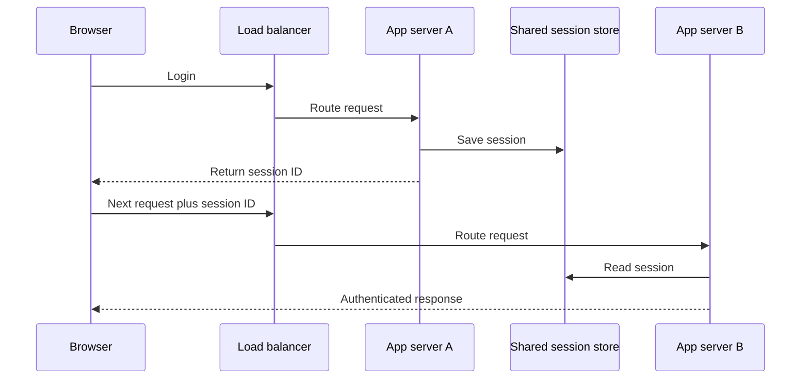

# Stateless servers

## Failure

- With in-memory sessions, login state exists only on the server that processed the login. If the load balancer sends the next request elsewhere, that server treats the user as logged out. [`7:54`](https://www.youtube.com/watch?v=EaXHfuHRWwg&t=474) [`8:56`](https://www.youtube.com/watch?v=EaXHfuHRWwg&t=536) [`9:29`](https://www.youtube.com/watch?v=EaXHfuHRWwg&t=569)
- With three servers and state stored on only one, roughly two out of three later requests can reach a server that does not know the user. [`9:29`](https://www.youtube.com/watch?v=EaXHfuHRWwg&t=569)

## Session mechanics

- After checking credentials, the server creates a session record and gives the browser a random session ID. The browser sends that ID with later requests so the server can identify the user. [`8:25`](https://www.youtube.com/watch?v=EaXHfuHRWwg&t=505)

## Fix

- Move session records out of app memory and into a shared store that every server can read and write. Any instance can then handle any request. [`10:00`](https://www.youtube.com/watch?v=EaXHfuHRWwg&t=600) [`10:36`](https://www.youtube.com/watch?v=EaXHfuHRWwg&t=636)
- A server is stateless when it keeps no user-specific information between requests. Redis is a common shared in-memory store for sessions because session lookup happens on every authenticated request. [`10:36`](https://www.youtube.com/watch?v=EaXHfuHRWwg&t=636) [`11:12`](https://www.youtube.com/watch?v=EaXHfuHRWwg&t=672)

## Cost

- Every authenticated request gains a network lookup. The shared store is also a dependency whose outage can prevent all users from being recognized as logged in. [`11:39`](https://www.youtube.com/watch?v=EaXHfuHRWwg&t=699)
