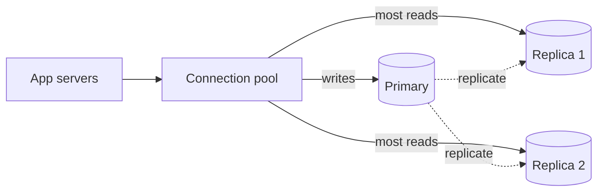

# Connection pooling and read replicas

Scaling app servers exposes two separate database limits: too many simultaneous connections and too much query work. [`12:24`](https://www.youtube.com/watch?v=EaXHfuHRWwg&t=744)

## Problem 1: connection exhaustion

- A database accepts only a limited number of open connections because each consumes memory and processing attention. Smaller hosted plans may allow a few hundred or even only a few dozen. [`12:53`](https://www.youtube.com/watch?v=EaXHfuHRWwg&t=773)
- Multiple app servers each open several connections. Serverless spikes are especially sharp because hundreds of newly created function instances may each open another connection. [`13:30`](https://www.youtube.com/watch?v=EaXHfuHRWwg&t=810) [`14:01`](https://www.youtube.com/watch?v=EaXHfuHRWwg&t=841)
- The recognizable symptom is database connection errors during a traffic spike, not merely slower responses. [`14:01`](https://www.youtube.com/watch?v=EaXHfuHRWwg&t=841)

## Fix 1: connection pool

- A pool keeps a small, fixed set of database connections open. Requests borrow a connection and return it, so the database sees a bounded number of connections regardless of request or server count. [`14:37`](https://www.youtube.com/watch?v=EaXHfuHRWwg&t=877)
- PgBouncer is a common PostgreSQL pooler, and many managed database services include one. [`15:13`](https://www.youtube.com/watch?v=EaXHfuHRWwg&t=913)

## Problem 2: database capacity

- Before adding infrastructure, verify that frequent queries use indexes. A missing email index can force a full-table scan on every login and mimic a capacity problem. [`15:44`](https://www.youtube.com/watch?v=EaXHfuHRWwg&t=944) [`16:20`](https://www.youtube.com/watch?v=EaXHfuHRWwg&t=980)
- Most applications perform far more reads than writes, so reads consume much of the database's capacity. [`16:20`](https://www.youtube.com/watch?v=EaXHfuHRWwg&t=980) [`16:51`](https://www.youtube.com/watch?v=EaXHfuHRWwg&t=1011)

## Fix 2: read replicas

- Keep one writable primary database and create read-only replicas. The primary sends changes to those replicas, and the application spreads read traffic across them. [`17:28`](https://www.youtube.com/watch?v=EaXHfuHRWwg&t=1048) [`17:57`](https://www.youtube.com/watch?v=EaXHfuHRWwg&t=1077)

## Cost: replication lag

- Replication is not instantaneous. A user can write to the primary and immediately read from a replica before the change arrives, making fresh data appear missing until a refresh. [`18:28`](https://www.youtube.com/watch?v=EaXHfuHRWwg&t=1108) [`19:02`](https://www.youtube.com/watch?v=EaXHfuHRWwg&t=1142)
- Briefly stale data is acceptable for some paths. For read-after-write interactions where staleness looks broken, route the read to the primary. [`19:02`](https://www.youtube.com/watch?v=EaXHfuHRWwg&t=1142)
- The larger design lesson is to choose explicitly which product behaviors may be slightly inconsistent in exchange for more capacity. [`19:40`](https://www.youtube.com/watch?v=EaXHfuHRWwg&t=1180)
