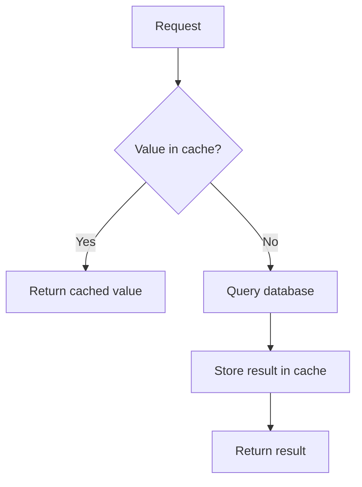

# Caching

## Failure

- Some reads repeatedly compute almost the same expensive answer. A profile request that calculates a two-million-follower count from raw rows can force the database to repeat that count thousands of times per hour. [`20:32`](https://www.youtube.com/watch?v=EaXHfuHRWwg&t=1232)

## Cache-aside flow

1. Check the cache for the requested answer. [`21:04`](https://www.youtube.com/watch?v=EaXHfuHRWwg&t=1264)
2. On a hit, return it without querying the database. [`21:42`](https://www.youtube.com/watch?v=EaXHfuHRWwg&t=1302)
3. On a miss, query the database, return the answer, and store it in the cache for later requests. [`21:42`](https://www.youtube.com/watch?v=EaXHfuHRWwg&t=1302)

## Why it is fast

- The cache keeps data in memory, avoiding the database's repeated work and disk access. Redis can provide this cache while also serving as the shared session store. [`21:42`](https://www.youtube.com/watch?v=EaXHfuHRWwg&t=1302) [`22:18`](https://www.youtube.com/watch?v=EaXHfuHRWwg&t=1338)

## Cost: stale values

- A cached copy becomes stale when the underlying database changes. The application needs an invalidation or expiration policy that limits how long the old answer remains visible. [`22:18`](https://www.youtube.com/watch?v=EaXHfuHRWwg&t=1338) [`22:47`](https://www.youtube.com/watch?v=EaXHfuHRWwg&t=1367)
- Caching trades correctness for speed. A follower count that is 30 seconds old is usually harmless, while a bank balance must remain current. [`23:17`](https://www.youtube.com/watch?v=EaXHfuHRWwg&t=1397) [`23:51`](https://www.youtube.com/watch?v=EaXHfuHRWwg&t=1431)
- Cache policy is a product decision. It depends on what users will accept, not just on whether an engineer or AI can implement the cache. [`23:51`](https://www.youtube.com/watch?v=EaXHfuHRWwg&t=1431) [`24:22`](https://www.youtube.com/watch?v=EaXHfuHRWwg&t=1462)
