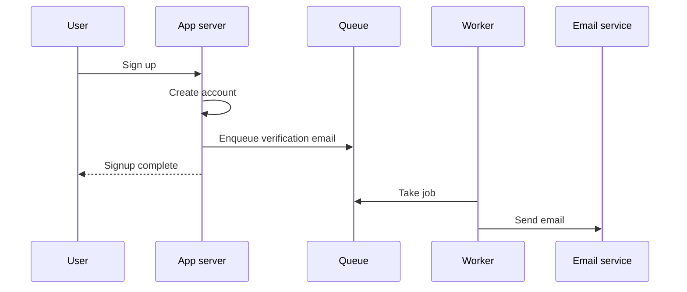

# Queues and background jobs

## Failure

- A signup request may create the account, send verification email, record analytics, and initialize data. Doing all of this before responding makes the user wait. [`25:10`](https://www.youtube.com/watch?v=EaXHfuHRWwg&t=1510) [`25:35`](https://www.youtube.com/watch?v=EaXHfuHRWwg&t=1535)
- Synchronous calls also couple signup reliability to an external email provider. If that provider is slow or down, signup becomes slow or fails. [`25:35`](https://www.youtube.com/watch?v=EaXHfuHRWwg&t=1535) [`26:07`](https://www.youtube.com/watch?v=EaXHfuHRWwg&t=1567)

## Fix

- Complete only the work required for the immediate response, such as creating the account. Record deferrable work as a job in a queue, then respond to the user. [`26:45`](https://www.youtube.com/watch?v=EaXHfuHRWwg&t=1605) [`27:16`](https://www.youtube.com/watch?v=EaXHfuHRWwg&t=1636)
- A separate worker consumes jobs and performs slow tasks such as verification emails, password resets, notifications, and receipts. [`27:16`](https://www.youtube.com/watch?v=EaXHfuHRWwg&t=1636) [`27:47`](https://www.youtube.com/watch?v=EaXHfuHRWwg&t=1667)
- BullMQ is one queue option that runs on Redis, letting the same technology support sessions, caching, and background jobs. [`28:13`](https://www.youtube.com/watch?v=EaXHfuHRWwg&t=1693)

## Benefits

- Signup can return immediately and no longer fails merely because the email provider is temporarily unavailable. The queued job waits until the provider recovers. [`28:42`](https://www.youtube.com/watch?v=EaXHfuHRWwg&t=1722)
- A short processing delay can be evidence of deliberate asynchronous design, as with delayed verification mail or a video marked "processing." [`26:07`](https://www.youtube.com/watch?v=EaXHfuHRWwg&t=1567) [`26:45`](https://www.youtube.com/watch?v=EaXHfuHRWwg&t=1605)

## Costs and reliability rules

- Completion semantics change. "Done" may mean the system promised to do the work, not that the work finished. [`29:11`](https://www.youtube.com/watch?v=EaXHfuHRWwg&t=1751)
- The queue and workers are additional infrastructure that must stay available. Jobs can fail, so workers need retries and a place to retain repeatedly failing jobs for human inspection. [`29:11`](https://www.youtube.com/watch?v=EaXHfuHRWwg&t=1751)
- Enqueuing without monitoring completion can silently lose important work. [`29:40`](https://www.youtube.com/watch?v=EaXHfuHRWwg&t=1780)
