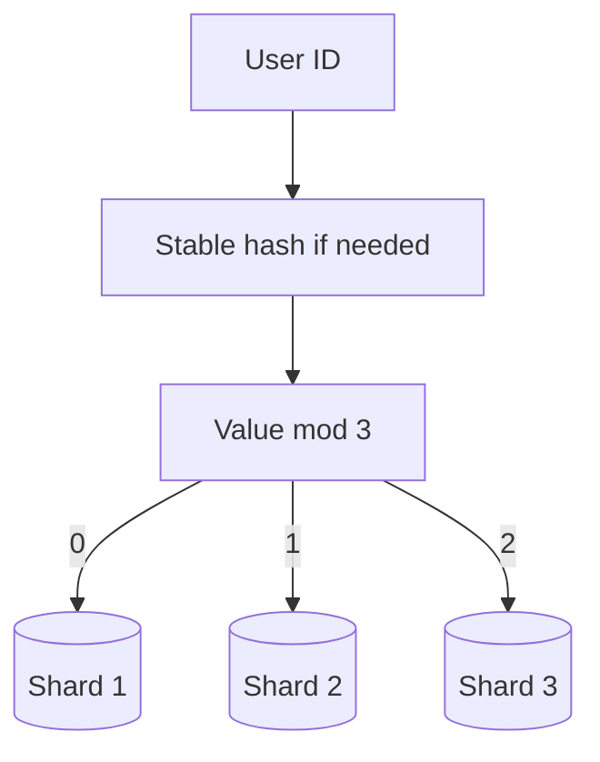

# Sharding

## Trigger

- Read replicas copy the entire database, so they assume the complete dataset fits on one machine. Sharding becomes relevant when the dataset itself is too large for any available machine. [`30:05`](https://www.youtube.com/watch?v=EaXHfuHRWwg&t=1805)

## Method

- Split records across databases so each one stores only part of the dataset. Each database is a shard. [`30:37`](https://www.youtube.com/watch?v=EaXHfuHRWwg&t=1837) [`32:20`](https://www.youtube.com/watch?v=EaXHfuHRWwg&t=1940)
- Choose a shard key available on every relevant record. For users, the user ID is a common choice. [`31:10`](https://www.youtube.com/watch?v=EaXHfuHRWwg&t=1870)
- A simple routing rule is `user_id mod shard_count`. With three shards, remainders 0, 1, and 2 map to shards 1, 2, and 3. String identifiers such as UUIDs can first pass through a stable hash that produces a number. [`31:41`](https://www.youtube.com/watch?v=EaXHfuHRWwg&t=1901) [`32:20`](https://www.youtube.com/watch?v=EaXHfuHRWwg&t=1940)
- The application applies the same rule for writes and reads. User 5 produces remainder 2 when divided by 3, so the app goes straight to shard 3 without searching the others. [`32:20`](https://www.youtube.com/watch?v=EaXHfuHRWwg&t=1940) [`32:53`](https://www.youtube.com/watch?v=EaXHfuHRWwg&t=1973)

## Cost: cross-shard work

- A query about one user can stay on one shard. A global count has to query every shard and combine the results. [`33:29`](https://www.youtube.com/watch?v=EaXHfuHRWwg&t=2009)
- Global counting, sorting, and searching become more expensive as shard count grows. These operations are cross-shard queries. [`34:01`](https://www.youtube.com/watch?v=EaXHfuHRWwg&t=2041)
- The shard key determines whether common queries stay local or fan out to every database. A poor key can make the sharded system slower than the original single database. [`34:24`](https://www.youtube.com/watch?v=EaXHfuHRWwg&t=2064)
- Reversing a sharded design requires a difficult data and application migration. Use sharding only when the data cannot fit another way. [`34:24`](https://www.youtube.com/watch?v=EaXHfuHRWwg&t=2064) [`34:57`](https://www.youtube.com/watch?v=EaXHfuHRWwg&t=2097)

## Scale example

- Notion moved from one database to a sharded architecture after exceeding 200 billion rows while keeping the product online. [`35:33`](https://www.youtube.com/watch?v=EaXHfuHRWwg&t=2133)
