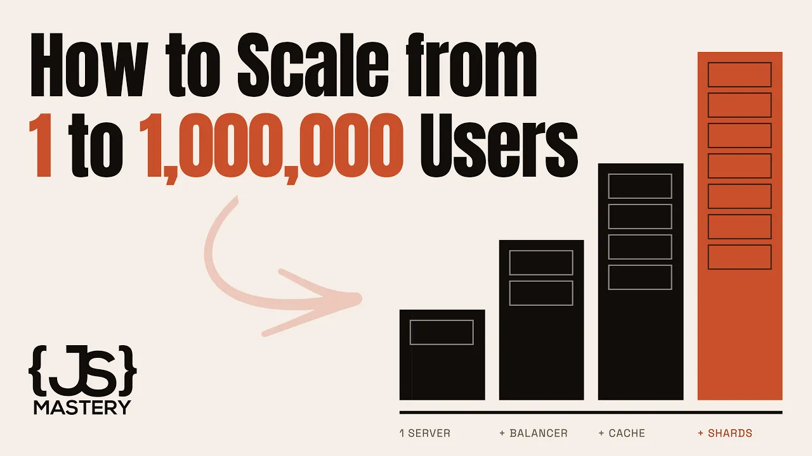
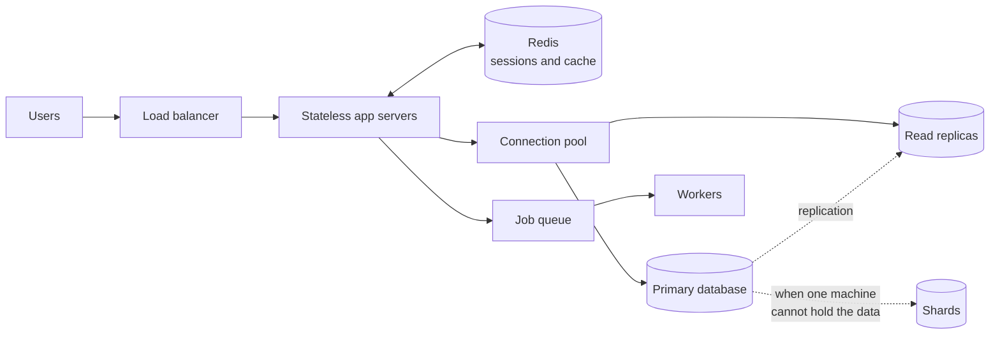

# How Senior Engineers Actually Think About System Design & Architecture | Full Course

This educational course grows a simple application one bottleneck at a time. It explains when to add load balancing, stateless sessions, connection pooling, read replicas, caching, background jobs, and database sharding. The recurring lesson is to adopt each tool only after a real constraint appears, with explicit attention to latency, correctness, reliability, and operating cost.

## Topics

1. [Introduction](01-introduction.md)
2. [Starting system](02-starting-system.md)
3. [Load balancing](03-load-balancing.md)
4. [Stateless servers](04-stateless-servers.md)
5. [Connection pooling and read replicas](05-connection-pooling-and-read-replicas.md)
6. [Caching](06-caching.md)
7. [Queues and background jobs](07-queues-and-background-jobs.md)
8. [Sharding](08-sharding.md)
9. [Closing](09-closing.md)

## Key takeaways

- One server and one database can already serve thousands of users. Complexity should follow measured pressure, not anticipation. [`1:40`](https://www.youtube.com/watch?v=EaXHfuHRWwg&t=100)
- A typical application can handle hundreds of requests per second, or millions per day, on a $20-per-month server. Vertical scaling is therefore usually the first move. [`4:06`](https://www.youtube.com/watch?v=EaXHfuHRWwg&t=246)
- Horizontal scaling requires interchangeable app instances. Moving session state to a shared store makes any server able to handle the next request, at the cost of an extra lookup and another dependency. [`10:00`](https://www.youtube.com/watch?v=EaXHfuHRWwg&t=600) [`11:39`](https://www.youtube.com/watch?v=EaXHfuHRWwg&t=699)
- Read replicas remove much of the database's read load, but replication lag makes some reads briefly stale. Systems should choose where that inconsistency is acceptable and route sensitive read-after-write paths to the primary. [`17:57`](https://www.youtube.com/watch?v=EaXHfuHRWwg&t=1077) [`19:02`](https://www.youtube.com/watch?v=EaXHfuHRWwg&t=1142)
- Caching deliberately trades correctness for speed. A follower count may tolerate 30 seconds of staleness, while a bank balance should not be cached this way. [`23:17`](https://www.youtube.com/watch?v=EaXHfuHRWwg&t=1397) [`23:51`](https://www.youtube.com/watch?v=EaXHfuHRWwg&t=1431)
- Queues shorten user-facing requests and isolate them from slow external services, but "done" may then mean "accepted for later work." Reliable systems retry failed jobs and retain repeatedly failing jobs for inspection. [`28:42`](https://www.youtube.com/watch?v=EaXHfuHRWwg&t=1722) [`29:11`](https://www.youtube.com/watch?v=EaXHfuHRWwg&t=1751)
- Sharding solves the case where the dataset no longer fits on one machine, but cross-shard queries and later migration make it the last tool to reach for. [`34:01`](https://www.youtube.com/watch?v=EaXHfuHRWwg&t=2041) [`34:57`](https://www.youtube.com/watch?v=EaXHfuHRWwg&t=2097)
- System-design skill is not naming boxes. It is choosing their order, knowing which ones the product needs, and accepting each tradeoff deliberately. [`36:22`](https://www.youtube.com/watch?v=EaXHfuHRWwg&t=2182) [`37:31`](https://www.youtube.com/watch?v=EaXHfuHRWwg&t=2251)
