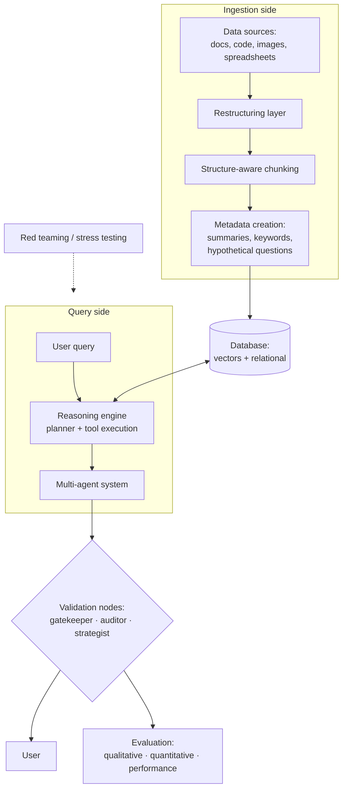

# 4. Production RAG Architecture — Full Overview

The complete picture, walked through side by side ([`4:03`](https://www.youtube.com/watch?v=4KiiKQ9RVvA&t=243) → [`5:53`](https://www.youtube.com/watch?v=4KiiKQ9RVvA&t=353)).

## Ingestion side (left)

- **Data sources** → **restructuring layer** → **structure-aware chunking** → **metadata creation** ([`4:21`](https://www.youtube.com/watch?v=4KiiKQ9RVvA&t=261)).
- Metadata per chunk: summaries, extracted keywords, and hypothetical questions the chunk might answer ([`4:46`](https://www.youtube.com/watch?v=4KiiKQ9RVvA&t=286)).
- It flows into a **database**, not just a vector store — production usually needs embeddings *and* relational data working together ([`4:46`](https://www.youtube.com/watch?v=4KiiKQ9RVvA&t=286)).

## Query side

- A user question does **not** go straight into vector search ([`5:07`](https://www.youtube.com/watch?v=4KiiKQ9RVvA&t=307)).
- A **reasoning engine with a planner** figures out what the query actually needs and executes the right tools ([`5:07`](https://www.youtube.com/watch?v=4KiiKQ9RVvA&t=307)).
- A **multi-agent system** lets different agents work on different parts of the problem ([`5:07`](https://www.youtube.com/watch?v=4KiiKQ9RVvA&t=307)).

## Validation (bottom)

- Three "human thought" validation nodes verify the process and catch problems before anything returns to the user: **gatekeeper**, **auditor**, **strategist** ([`5:27`](https://www.youtube.com/watch?v=4KiiKQ9RVvA&t=327)).

## Evaluation (right)

Not "did the user click thumbs up" — actual metrics ([`5:27`](https://www.youtube.com/watch?v=4KiiKQ9RVvA&t=327)):

- **Qualitative** — LLM judges.
- **Quantitative** — precision and recall.
- **Performance** — latency and cost.

## Stress testing (red section)

- Red teaming for **biased opinions, information evasion, prompt injection** ([`5:53`](https://www.youtube.com/watch?v=4KiiKQ9RVvA&t=353)).
- Rationale: you need to know how your system breaks before your users find out ([`6:01`](https://www.youtube.com/watch?v=4KiiKQ9RVvA&t=361)).
