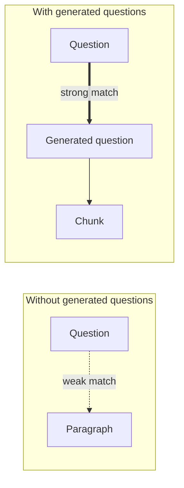

# 6. Metadata, Summaries & Question Generation

Each chunk stores more than text and embeddings ([`7:09`](https://www.youtube.com/watch?v=4KiiKQ9RVvA&t=429)).

## What you attach to every chunk

1. **A summary** of what the chunk contains ([`7:09`](https://www.youtube.com/watch?v=4KiiKQ9RVvA&t=429)).
2. **Extracted keywords** ([`7:09`](https://www.youtube.com/watch?v=4KiiKQ9RVvA&t=429)).
3. **Hypothetical questions** the chunk could answer ([`7:09`](https://www.youtube.com/watch?v=4KiiKQ9RVvA&t=429)).

## The question-generation trick — why it works

- A user query is a **question**. Your stored chunks are usually **paragraphs**. Matching across those two shapes is a mismatch ([`7:09`](https://www.youtube.com/watch?v=4KiiKQ9RVvA&t=429)).
- With pre-generated questions attached, you match **question to question**, which works much better than matching a question to a random paragraph ([`7:09`](https://www.youtube.com/watch?v=4KiiKQ9RVvA&t=429)).

