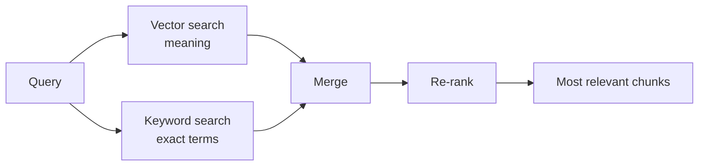

# 9. Hybrid Search (Semantic + Keyword)

## Why pure vector search isn't enough

Basic RAG embeds the query and finds the most similar chunks — which assumes the query is clear and well-formed. In reality ([`10:15`](https://www.youtube.com/watch?v=4KiiKQ9RVvA&t=615)):

- Users ask **vague** questions.
- Users use **different words** than what's in your documents.
- Sometimes one query needs information from **multiple places**.

## The hybrid approach

| Method | Strength |
|---|---|
| **Vector search** | Great for **meaning** / semantic similarity ([`10:33`](https://www.youtube.com/watch?v=4KiiKQ9RVvA&t=633)) |
| **Keyword search** | Catches **exact matches vectors miss**: product names, error codes, specific terms ([`10:33`](https://www.youtube.com/watch?v=4KiiKQ9RVvA&t=633)) |

- **Most production systems today use both**, then **re-rank** the combined results to surface the most relevant chunks ([`10:33`](https://www.youtube.com/watch?v=4KiiKQ9RVvA&t=633)).

## The remaining problem

- Even with good retrieval, you're left holding chunks of text — what you *do* with them is the next layer ([`10:33`](https://www.youtube.com/watch?v=4KiiKQ9RVvA&t=633), [`10:56`](https://www.youtube.com/watch?v=4KiiKQ9RVvA&t=656)).
