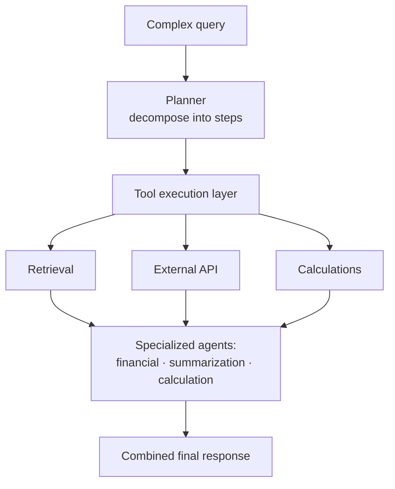

# 10. Reasoning Engine & Multi-Agent Systems (Agentic RAG)

## When stuffing chunks into a prompt stops working

- Basic RAG: retrieve chunks → stuff into prompt → ask the LLM. Fine for simple questions ([`10:56`](https://www.youtube.com/watch?v=4KiiKQ9RVvA&t=656)).
- The breaking example: *"Compare our Q3 performance in Europe versus Asia and suggest which region we should focus on next quarter"* ([`11:11`](https://www.youtube.com/watch?v=4KiiKQ9RVvA&t=671), [`11:15`](https://www.youtube.com/watch?v=4KiiKQ9RVvA&t=675)).

That single question is **not a single retrieval** — it needs ([`11:15`](https://www.youtube.com/watch?v=4KiiKQ9RVvA&t=675)):

- Q3 data for Europe
- Q3 data for Asia
- Historical trends
- Market forecasts
- …and then **reasoning across all of it** to produce a recommendation

## The reasoning engine

Instead of query → retrieval → generation ([`11:35`](https://www.youtube.com/watch?v=4KiiKQ9RVvA&t=695)):

1. **Planner** — breaks down what the query actually needs: what information is required, what steps to take, which tools to use. Produces a plan.
2. **Tool execution layer** — carries the plan out: multiple retrievals, calls to external APIs (e.g. market data), calculations ([`11:52`](https://www.youtube.com/watch?v=4KiiKQ9RVvA&t=712)).

## Multi-agent systems

- In advanced setups, **specialized agents**: one good at retrieving financial data, one at summarization, one at calculations ([`12:00`](https://www.youtube.com/watch?v=4KiiKQ9RVvA&t=720)).
- Each fetches information relevant to its part of the journey; outputs are combined into a final response ([`12:00`](https://www.youtube.com/watch?v=4KiiKQ9RVvA&t=720)).
- **This is what "agentic RAG" means**: the system isn't just retrieving and generating — it's reasoning, planning, and coordinating multiple steps ([`12:00`](https://www.youtube.com/watch?v=4KiiKQ9RVvA&t=720), [`12:25`](https://www.youtube.com/watch?v=4KiiKQ9RVvA&t=745)).

## The tradeoff

- **More complexity means more chances for things to go wrong** ([`12:25`](https://www.youtube.com/watch?v=4KiiKQ9RVvA&t=745)):
  - An agent retrieves the wrong information.
  - The planner misunderstands the query.
  - The final response sounds confident but is completely off.
- Which is exactly why the [validation layer](11-validation-layer.md) exists ([`12:25`](https://www.youtube.com/watch?v=4KiiKQ9RVvA&t=745)).
