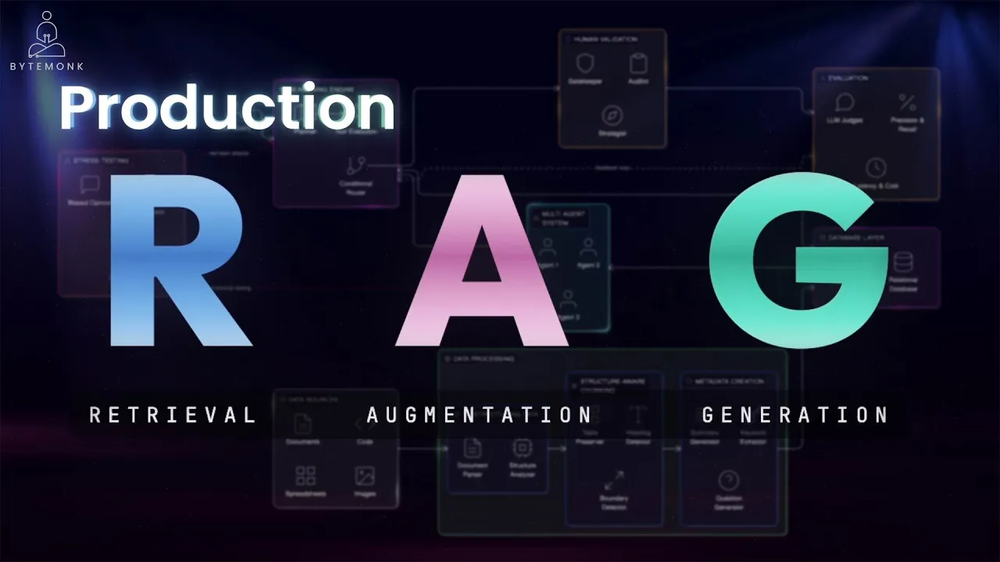
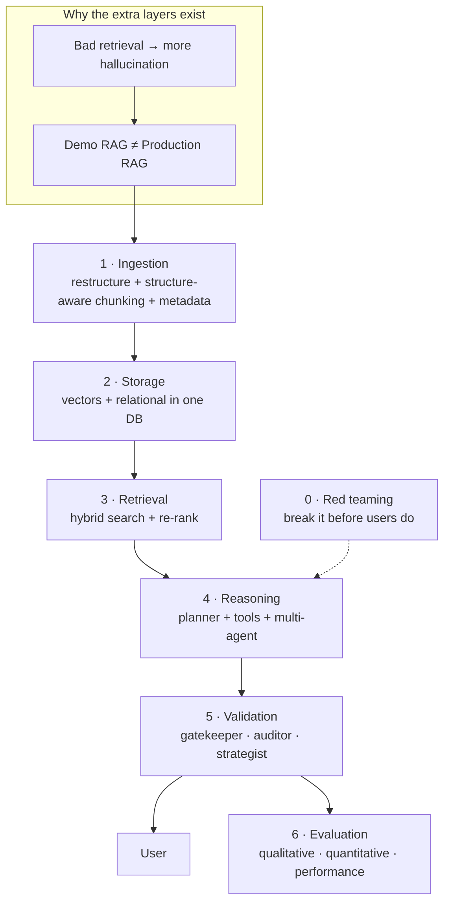

# How to Build a Scalable RAG System for AI Apps (Full Architecture)

*ByteMonk · 15:52 · [Watch on YouTube](https://www.youtube.com/watch?v=4KiiKQ9RVvA)*

## Summary

An architecture walkthrough of what a **production-grade RAG system** looks like, versus the four-step demo version (chunk → embed → retrieve → generate) found in most tutorials. The video starts from a counterintuitive premise — bad retrieval makes an LLM hallucinate *more* than no retrieval at all — and uses it to justify each additional layer: structure-aware ingestion, metadata and hypothetical-question generation, a database that holds vectors *and* relational data, hybrid semantic+keyword retrieval, a planner-driven reasoning engine with specialized agents, a three-node validation layer, evaluation metrics, and red teaming. It includes a sponsored segment on Neon (serverless Postgres + pgvector).

## Topics

1. [What Is RAG and Why It Exists](01-what-is-rag.md)
2. [Why Bad Retrieval Causes Hallucinations](02-bad-retrieval-and-hallucinations.md)
3. [Demo RAG vs Production RAG](03-demo-vs-production-rag.md)
4. [Production RAG Architecture — Full Overview](04-production-architecture-overview.md)
5. [Data Ingestion & Smart Chunking](05-data-ingestion-and-chunking.md)
6. [Metadata, Summaries & Question Generation](06-metadata-summaries-questions.md)
7. [Why You Need Vector + Relational Databases](07-vector-plus-relational-databases.md)
8. [PostgreSQL + pgvector in Production](08-postgres-pgvector-and-neon.md)
9. [Hybrid Search (Semantic + Keyword)](09-hybrid-search.md)
10. [Reasoning Engine & Multi-Agent Systems](10-reasoning-engine-multi-agent.md)
11. [Validation Layer — Stopping Hallucinations](11-validation-layer.md)
12. [Evaluation Metrics](12-evaluation-metrics.md)
13. [Red Teaming & Stress Testing](13-red-teaming-and-stress-testing.md)

Source: [transcript.md](transcript.md)

## Key takeaways

- **Bad retrieval is worse than no retrieval.** A cited Google Research study found that when retrieval is off, the LLM hallucinates *more* than if it had been given no context at all ([`0:37`](https://www.youtube.com/watch?v=4KiiKQ9RVvA&t=37)).
- **Context makes an LLM more confident, not more honest.** It does not say "I don't know" when the context is weak — it fills gaps with plausible-sounding invented content, producing a confidently wrong system ([`3:26`](https://www.youtube.com/watch?v=4KiiKQ9RVvA&t=206)).
- **Retrieval can "succeed" and still be wrong in three distinct ways**: stale document versions, chunks split mid-criteria, and tables destroyed during text extraction ([`2:46`](https://www.youtube.com/watch?v=4KiiKQ9RVvA&t=166)).
- **Chunk size converges to 256–512 tokens with overlap**, but the video's stated conclusion is that the exact number matters less than respecting document structure ([`6:45`](https://www.youtube.com/watch?v=4KiiKQ9RVvA&t=405)).
- **Ingestion quality is a hard ceiling**: if data is poorly structured going in, nothing downstream can fix it ([`7:39`](https://www.youtube.com/watch?v=4KiiKQ9RVvA&t=459)).
- **Generating hypothetical questions per chunk turns retrieval into question-to-question matching**, which the video states works much better than matching a question against a random paragraph ([`7:09`](https://www.youtube.com/watch?v=4KiiKQ9RVvA&t=429)).
- **A vector store alone can't do production retrieval** — filtering by date/department/type and joining chunks to parent documents are relational operations, hence Postgres + pgvector as one system instead of two ([`8:10`](https://www.youtube.com/watch?v=4KiiKQ9RVvA&t=490), [`8:30`](https://www.youtube.com/watch?v=4KiiKQ9RVvA&t=510)).
- **Database branching lets you A/B a new chunking strategy or embedding model against a full copy of the knowledge base without touching production** — "Git for your database" ([`9:42`](https://www.youtube.com/watch?v=4KiiKQ9RVvA&t=582), [`10:07`](https://www.youtube.com/watch?v=4KiiKQ9RVvA&t=607)).
- **Market data point (sponsored segment):** Neon was acquired by Databricks for ~$1 billion, with Databricks citing that **over 80% of databases created on Neon are provisioned by AI agents, not humans** ([`9:06`](https://www.youtube.com/watch?v=4KiiKQ9RVvA&t=546), [`9:23`](https://www.youtube.com/watch?v=4KiiKQ9RVvA&t=563)).
- **Most production systems now run hybrid search plus re-ranking** — vectors for meaning, keywords for exact matches like product names and error codes ([`10:33`](https://www.youtube.com/watch?v=4KiiKQ9RVvA&t=633)).
- **Multi-part analytical queries are not a single retrieval.** A "compare Q3 Europe vs Asia and recommend" question requires a planner, a tool-execution layer, and reasoning across several sources — this is what "agentic RAG" means ([`11:15`](https://www.youtube.com/watch?v=4KiiKQ9RVvA&t=675), [`12:00`](https://www.youtube.com/watch?v=4KiiKQ9RVvA&t=720)).
- **Added reasoning complexity adds new failure modes**, which is why a conditional router runs every response past a gatekeeper (does it answer?), an auditor (is it grounded?), and a strategist (does it make sense?) before the user sees it ([`12:25`](https://www.youtube.com/watch?v=4KiiKQ9RVvA&t=745), [`12:49`](https://www.youtube.com/watch?v=4KiiKQ9RVvA&t=769)).
- **Evaluation splits into three measurable tracks** — LLM judges for faithfulness/relevance/depth, retrieval precision and recall, and latency/token cost. Without them you're flying blind while users quietly get bad answers ([`13:42`](https://www.youtube.com/watch?v=4KiiKQ9RVvA&t=822), [`14:05`](https://www.youtube.com/watch?v=4KiiKQ9RVvA&t=845)).
- **Red teaming is framed as non-optional** for any system touching real users or business decisions, testing three specific vectors: prompt injection, information evasion, and biased/harmful outputs ([`14:22`](https://www.youtube.com/watch?v=4KiiKQ9RVvA&t=862), [`14:55`](https://www.youtube.com/watch?v=4KiiKQ9RVvA&t=895)).
