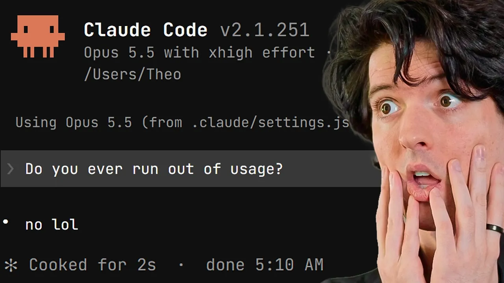
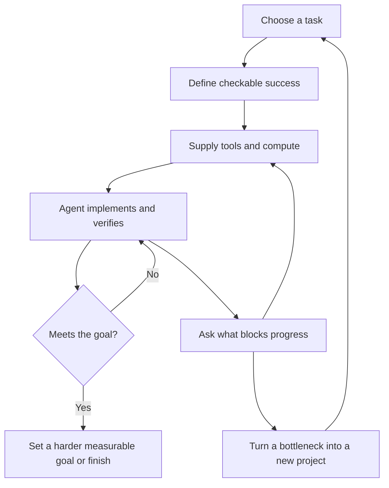

# How To Give Claude Unlimited Usage

Theo explains how he keeps coding agents working for days or weeks through verifiable goals, automated feedback, and expandable compute. Skate 3 Bench, TS Rust, and Lust illustrate both the results and the costs of that approach. This is an opinion-led technical walkthrough with case studies, rather than a reproducible setup tutorial. He explicitly discourages copying the workflow. [`1:48`](https://www.youtube.com/watch?v=NBCM_ZoWZo8&t=108)

Video: [Theo - t3․gg on YouTube](https://www.youtube.com/watch?v=NBCM_ZoWZo8), 38:47. Local source: [complete transcript](transcript.md). Measurements and prices below are reports from the video, not independently verified benchmarks or current offers.

## Topic breakdown

1. [Scope, spending, and agent tools](01-scope-and-agent-tools.md), 0:00–4:15.
2. [Skate 3 Bench: a playable game built by agents](02-skate-3-bench.md), 4:15–8:28.
3. [Hill climbing, verifiable rewards, and TS Rust](03-hill-climbing-and-ts-rust.md), 8:28–14:03.
4. [Screenshot judges and the limits of visual feedback](04-screenshot-judges.md), 14:03–17:52.
5. [Choosing tasks, verification, and resources](05-task-and-verification-design.md), 17:52–22:28.
6. [Compute bottlenecks and Blacksmith offloading](06-compute-and-blacksmith.md), 22:28–26:25.
7. [Boat sandboxes, snapshots, and parallel validation](07-boat-sandboxes.md), 26:25–32:01.
8. [Managing agents by removing blockers](08-managing-agent-blockers.md), 32:01–34:35.
9. [Lust, recursive optimization, and closing cautions](09-lust-and-recursive-optimization.md), 34:35–38:47.

## The recurring loop

The workflow combines an agent's implementation/verification loop with a human's repeated effort to remove resource bottlenecks. [`21:09`](https://www.youtube.com/watch?v=NBCM_ZoWZo8&t=1269) [`32:54`](https://www.youtube.com/watch?v=NBCM_ZoWZo8&t=1974)

## Key takeaways

- Clear reference outputs made TS Rust tractable: match a pinned TypeScript version first, then pursue a 2× speed target while keeping validation passing. Theo reports the agent reached that target. [`12:40`](https://www.youtube.com/watch?v=NBCM_ZoWZo8&t=760) [`13:09`](https://www.youtube.com/watch?v=NBCM_ZoWZo8&t=789) [`13:37`](https://www.youtube.com/watch?v=NBCM_ZoWZo8&t=817)
- Skate 3 Bench ran for four days with 25 human prompts and produced a playable browser game. Its reported inference equivalent was nearly $5,000; visual judges helped iteration but did not eliminate gameplay defects. [`5:09`](https://www.youtube.com/watch?v=NBCM_ZoWZo8&t=309) [`6:39`](https://www.youtube.com/watch?v=NBCM_ZoWZo8&t=399) [`7:06`](https://www.youtube.com/watch?v=NBCM_ZoWZo8&t=426) [`16:06`](https://www.youtube.com/watch?v=NBCM_ZoWZo8&t=966)
- Subscription usage and API-equivalent costs are different figures. Theo estimates TS Rust at roughly $38,000–$40,000 in API-equivalent usage versus $500–$800 of subscriptions, with over $2,000 in separate Blacksmith compute. [`19:08`](https://www.youtube.com/watch?v=NBCM_ZoWZo8&t=1148) [`22:28`](https://www.youtube.com/watch?v=NBCM_ZoWZo8&t=1348) [`24:14`](https://www.youtube.com/watch?v=NBCM_ZoWZo8&t=1454)
- Offloading TS Rust checks to Blacksmith reduced reported compute waiting per run from upwards of 12 hours to 1.2 hours, though individual builds still took 20–40 minutes. [`25:05`](https://www.youtube.com/watch?v=NBCM_ZoWZo8&t=1505) [`25:30`](https://www.youtube.com/watch?v=NBCM_ZoWZo8&t=1530)
- Boat reduced a reported Lust validation gate from 70 minutes to 353 seconds, about six minutes; Theo says daily code throughput nearly tripled. [`30:11`](https://www.youtube.com/watch?v=NBCM_ZoWZo8&t=1811)
- Lust reportedly reduced one TS Rust build from 17 minutes to 12 seconds, but barely supported that project and was not expected to work for other applications. [`34:35`](https://www.youtube.com/watch?v=NBCM_ZoWZo8&t=2075)
- The ongoing human task is to ask what blocks the agents and improve their environment. Removing compute limits also increases subscription consumption. [`32:54`](https://www.youtube.com/watch?v=NBCM_ZoWZo8&t=1974) [`33:47`](https://www.youtube.com/watch?v=NBCM_ZoWZo8&t=2027)
