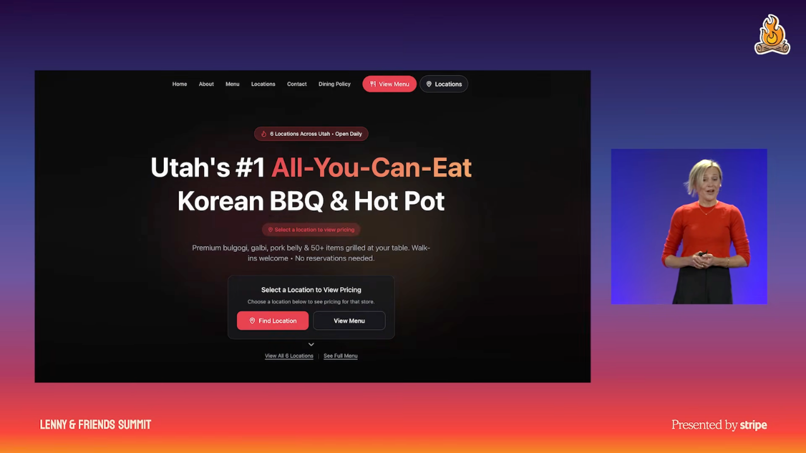
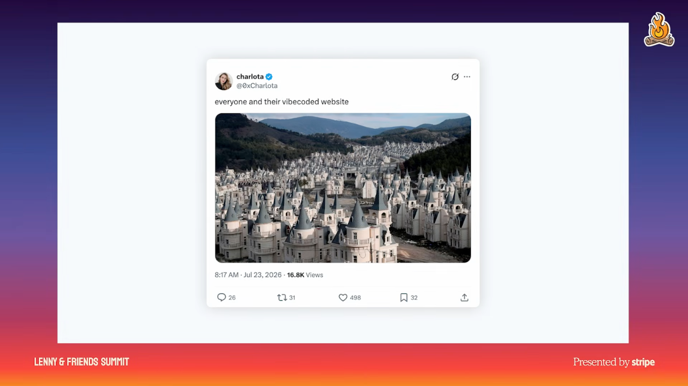

# 1. The AI building boom and three quality risks

## The historical analogy

- Dill compares today's AI building boom with postwar construction. Modernism began with a deliberate point of view, but rapid repetition stripped its forms of their original intent and fit to context. [`0:06`](https://www.youtube.com/watch?v=GLvFTMtw4Jk&t=6) [`0:36`](https://www.youtube.com/watch?v=GLvFTMtw4Jk&t=36)
- Her warning is about copying appearances without considering purpose, users, surroundings, or brand. She argues that AI creates a similar risk as small teams gain much greater building capacity, describing teams of three doing work that previously required 30. This is an illustrative claim, not a reported benchmark. [`1:34`](https://www.youtube.com/watch?v=GLvFTMtw4Jk&t=94) [`2:00`](https://www.youtube.com/watch?v=GLvFTMtw4Jk&t=120)

## Three watch points

1. **Generic answers.** Dill argues that LLMs favor probable, familiar patterns over ideas specific to a brand or user. Her example is a Korean barbecue website whose appearance suggests software rather than a restaurant. [`2:17`](https://www.youtube.com/watch?v=GLvFTMtw4Jk&t=137) [`2:44`](https://www.youtube.com/watch?v=GLvFTMtw4Jk&t=164)
2. **The temptation of done.** Fast generation makes an interface feel finished before anyone establishes whether it solves the problem or differentiates the product. Rounded corners and shadows can disguise that gap. Her 90-second microwave burrito illustrates accepting poor quality because delivery was fast. [`3:04`](https://www.youtube.com/watch?v=GLvFTMtw4Jk&t=184) [`3:31`](https://www.youtube.com/watch?v=GLvFTMtw4Jk&t=211)
3. **Disposable work.** Cheap, quick production can weaken accountability for decisions, maintenance, and the long-term product. [`3:56`](https://www.youtube.com/watch?v=GLvFTMtw4Jk&t=236)

*Figure 1. A Korean barbecue site uses visual patterns associated with software websites. Dill uses it to show how polished defaults can miss a business's character and context.* [`2:44`](https://www.youtube.com/watch?v=GLvFTMtw4Jk&t=164)

## What care looks like

- Dill calls the combined failure mode "zombie UI": monotonous, vacant, or uncared-for interfaces made from patterns poorly suited to their context. [`4:26`](https://www.youtube.com/watch?v=GLvFTMtw4Jk&t=266)

*Figure 2. Repeated buildings in Turkey illustrate Dill's warning about generic construction. She compares this repetition with software that lacks a distinct purpose or owner.* [`3:56`](https://www.youtube.com/watch?v=GLvFTMtw4Jk&t=236)

- Care can appear in small details: an animated bot adds personality; a calendar tab displays the actual date; Link's agent wallet anticipates purchasing problems and includes troubleshooting for an agent user. The lesson is to make details reflect the user's situation. [`4:26`](https://www.youtube.com/watch?v=GLvFTMtw4Jk&t=266) [`4:56`](https://www.youtube.com/watch?v=GLvFTMtw4Jk&t=296)
