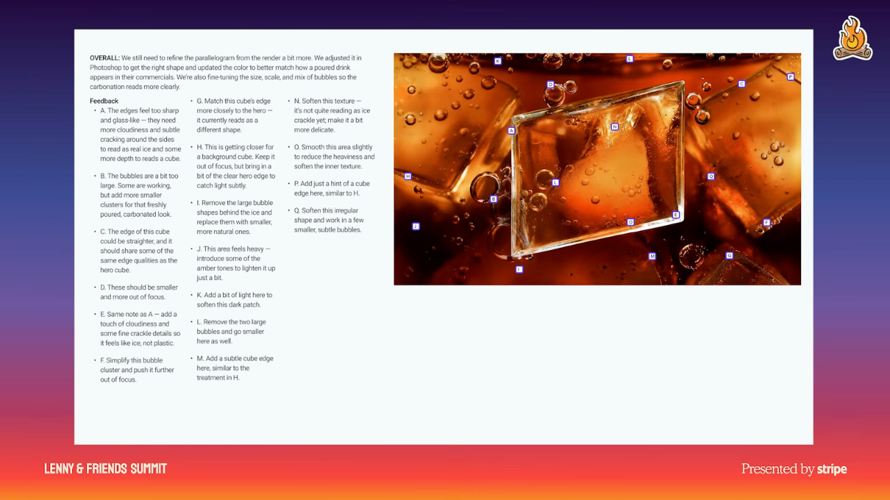

# 2. Define a point of view and a shared quality bar

## Define what good means

- Establish who the brand wants to be to users and what those users care about. Dill argues that leaving this undefined allows AI to supply a generic, backward-looking point of view. [`5:27`](https://www.youtube.com/watch?v=GLvFTMtw4Jk&t=327) [`5:49`](https://www.youtube.com/watch?v=GLvFTMtw4Jk&t=349)
- Make that point of view explicit as building spreads across more contributors and ownership becomes diffuse. Stripe's example is optimism, expressed through colors, writing, and products supporting entrepreneurs. [`6:08`](https://www.youtube.com/watch?v=GLvFTMtw4Jk&t=368) [`6:32`](https://www.youtube.com/watch?v=GLvFTMtw4Jk&t=392)

## Keep the standard tied to the output

- A Stripe ad combined the brand's parallelogram with customer visuals. A cross-functional partner wanted to ship quickly and asked what quality standard should apply to AI-made work. Dill's response: users care whether the output is good, so production method should not lower the bar. [`6:52`](https://www.youtube.com/watch?v=GLvFTMtw4Jk&t=412) [`7:12`](https://www.youtube.com/watch?v=GLvFTMtw4Jk&t=432)
- The critique produced 17 improvements, including changes to frost, edges, and bubbles. Stripe subsequently used "Pepsi bubbling" as a verb for meticulous craft. [`7:42`](https://www.youtube.com/watch?v=GLvFTMtw4Jk&t=462)
- Dill's target is to go one level deeper than what the customer can see. She presents this as a practical craft standard rather than a demand for perfection. [`8:02`](https://www.youtube.com/watch?v=GLvFTMtw4Jk&t=482)

*Figure 3. The ad critique makes the quality bar concrete: 17 changes to bubbles, ice, edges, and texture. AI production did not exempt the image from detailed review.* [`7:42`](https://www.youtube.com/watch?v=GLvFTMtw4Jk&t=462)

## Develop the judgment behind the standard

- Practice noticing what users need and want beyond what they explicitly say. Study what makes products good, great, or mediocre, and draw on analogous situations in art and science to develop taste. That judgment supplies the standards the organization will later scale. [`8:23`](https://www.youtube.com/watch?v=GLvFTMtw4Jk&t=503)
