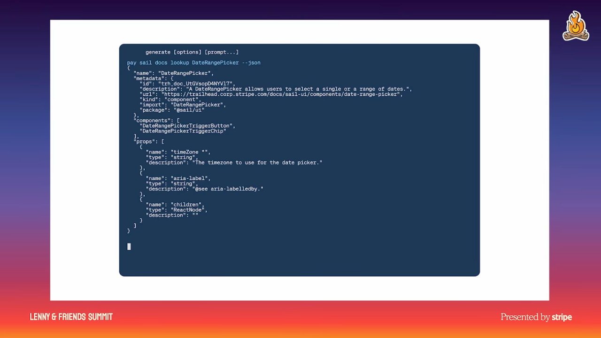
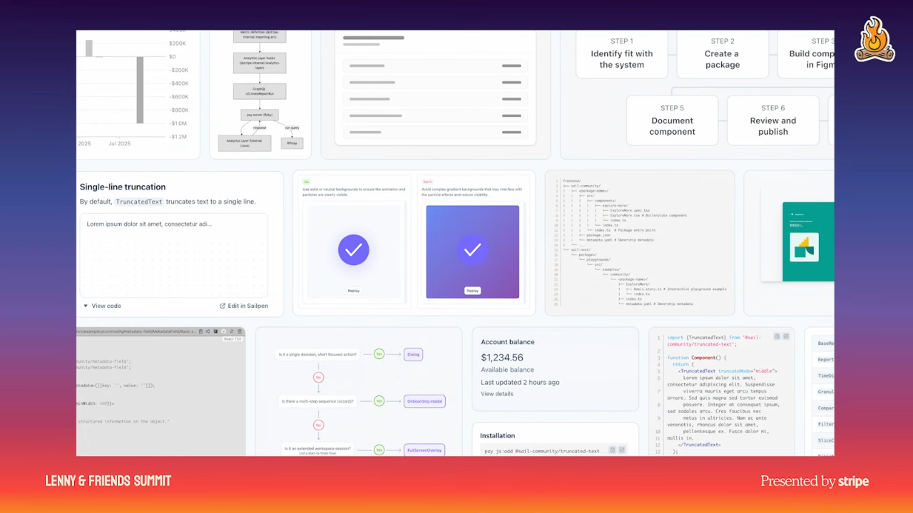

# 3. Encode intent into design systems and tools

## Design the system that makes decisions

- Interfaces increasingly emerge without a designer present: agents find and fix problems unattended, and generative UI appears in real time. Standards must therefore explain decisions that designers previously filled in from shared understanding. [`9:06`](https://www.youtube.com/watch?v=GLvFTMtw4Jk&t=546) [`9:26`](https://www.youtube.com/watch?v=GLvFTMtw4Jk&t=566)
- Dill shifts the object of design from individual screens to the system that produces them. Her distinction: older systems scaled consistency; newer systems must scale intent. [`9:56`](https://www.youtube.com/watch?v=GLvFTMtw4Jk&t=596) [`10:45`](https://www.youtube.com/watch?v=GLvFTMtw4Jk&t=645)
- Her printing analogy describes Gutenberg's 290 characters, including width variants, abbreviations, and ligatures. Those options supported justified text without distracting white-space gaps. The design lesson is to make production systems extensible and opinionated enough to preserve craft. [`9:56`](https://www.youtube.com/watch?v=GLvFTMtw4Jk&t=596) [`10:25`](https://www.youtube.com/watch?v=GLvFTMtw4Jk&t=625)

## Stripe's progression

1. **Initial approach:** an MCP that understood design documentation. Dill says it lacked specificity; three people could enter the same prompt and receive three different results. [`11:09`](https://www.youtube.com/watch?v=GLvFTMtw4Jk&t=669)
2. **Revised approach:** a CLI built on Stripe's design system, used where builders work. It consumes documentation at the relevant time and place to avoid context rot and better constrain AI behavior. [`11:27`](https://www.youtube.com/watch?v=GLvFTMtw4Jk&t=687)
3. **Broader design knowledge:** full templates and flows alongside components and atomic parts. These express how the product should behave and how its pieces fit together, making the system more opinionated. [`11:45`](https://www.youtube.com/watch?v=GLvFTMtw4Jk&t=705)

*Figure 4. Stripe's CLI brings design documentation into the building workflow. The displayed lookup returns structured information about a date-range picker.* [`11:27`](https://www.youtube.com/watch?v=GLvFTMtw4Jk&t=687)

*Figure 5. The design system provides guidance beyond individual components. Templates and flows describe how product behavior and complete experiences fit together.* [`11:45`](https://www.youtube.com/watch?v=GLvFTMtw4Jk&t=705)

## Result and limit

- Stripe's aim is nearly instantaneous movement from prompt to production. Dill says embedding standards into production tools supports a more coherent product, while acknowledging that the team is still working through problems. The talk provides no quantified CLI evaluation. [`10:45`](https://www.youtube.com/watch?v=GLvFTMtw4Jk&t=645) [`11:45`](https://www.youtube.com/watch?v=GLvFTMtw4Jk&t=705)
- Rule compliance is a baseline. Dill invokes Christopher Alexander's warning that a system can satisfy every rule and still feel dead, motivating a separate editorial quality check. [`12:10`](https://www.youtube.com/watch?v=GLvFTMtw4Jk&t=730)
