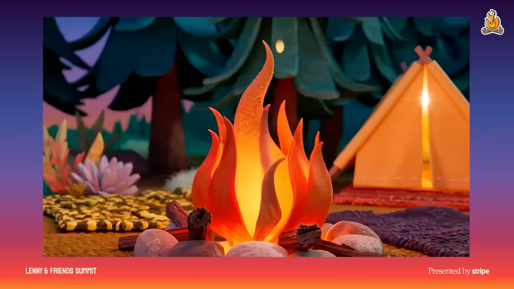

# 4. Edit the whole experience beyond done

## Why editing becomes more important

- Traditional development filtered ideas through staffing limits and repeated review. AI allows many more ideas to become working artifacts, making it possible to react to actual products instead of debating hypothetical ones. Dill contrasts staffing one of 20 ideas with building 20 ideas in a week as an illustration of this shift. [`12:10`](https://www.youtube.com/watch?v=GLvFTMtw4Jk&t=730) [`12:45`](https://www.youtube.com/watch?v=GLvFTMtw4Jk&t=765)
- More filtering must now happen after building, when rejecting work is harder. Assign someone the editorial responsibility of evaluating the complete experience and questioning whether its parts form a whole. [`13:06`](https://www.youtube.com/watch?v=GLvFTMtw4Jk&t=786) [`13:23`](https://www.youtube.com/watch?v=GLvFTMtw4Jk&t=803)

## Evaluate as a user

- Experience the product as a user would. Ask whether it solves the problem, matches the user's way of thinking, and remains coherent across the journey. Attractive isolated screens can still produce a disconnected experience. [`13:23`](https://www.youtube.com/watch?v=GLvFTMtw4Jk&t=803) [`13:45`](https://www.youtube.com/watch?v=GLvFTMtw4Jk&t=825)
- Editing includes developing unfinished work, as well as accepting or rejecting it. Dill draws on Nabeel Qureshi's discussion of art to emphasize unexpected details, deeper meaning, and recurring themes that make a whole. [`14:06`](https://www.youtube.com/watch?v=GLvFTMtw4Jk&t=846)
- Dill identifies meaningful detail as an AI weakness. Arbitrary choices, such as a cup whose color could change without consequence, convey that the details do not matter. The editor takes accountability for every decision, down to pixels. [`14:33`](https://www.youtube.com/watch?v=GLvFTMtw4Jk&t=873) [`14:56`](https://www.youtube.com/watch?v=GLvFTMtw4Jk&t=896)

## Example: 56 animation iterations

1. Stefan and the event design team started with a 3D scene and used AI to help animate it. [`14:56`](https://www.youtube.com/watch?v=GLvFTMtw4Jk&t=896)
2. The first version had appealing motion but felt wrong under close inspection: movement was awkward and the view showed too little of the scene. [`15:24`](https://www.youtube.com/watch?v=GLvFTMtw4Jk&t=924)
3. After 56 iterations, Dill judged the animation more realistic and lively. AI enabled a more complex scene and more viewpoints, while repeated human scrutiny improved the result. This is a qualitative example of exploration and editing, not a speed benchmark. [`15:46`](https://www.youtube.com/watch?v=GLvFTMtw4Jk&t=946)

*Figure 6. A still from the opening animation discussed in the 56-iteration example. Human review refined motion and realism; follow the image link to see the animation itself.* [`15:46`](https://www.youtube.com/watch?v=GLvFTMtw4Jk&t=946)
