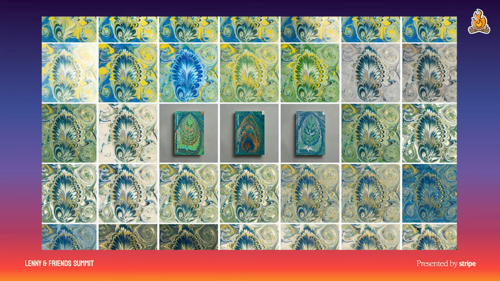

# 5. Use AI for creative exploration and artistry

## Expand what gets made

- Dill argues that widespread building makes differentiation more important. She treats today's chats, charts, and CLIs as starting points for exploring better interactions. [`16:26`](https://www.youtube.com/watch?v=GLvFTMtw4Jk&t=986)
- Explore interfaces that respond dynamically and use new capabilities such as talking to computers. Her analogies are multi-touch enabling new gestures and synthesizers enabling new sounds. [`17:05`](https://www.youtube.com/watch?v=GLvFTMtw4Jk&t=1025) [`17:34`](https://www.youtube.com/watch?v=GLvFTMtw4Jk&t=1054)
- Stripe's Built to Grow cover began with work by a human marbler. AI then helped fine-tune colors and lines, extending the creative team's judgment through detailed adjustment. [`18:01`](https://www.youtube.com/watch?v=GLvFTMtw4Jk&t=1081)

*Figure 7. Marbling variations and Built to Grow cover mockups show the creative range of the project. Dill describes starting with a human marbler's work and using AI to refine colors and lines.* [`18:01`](https://www.youtube.com/watch?v=GLvFTMtw4Jk&t=1081)

## Make AI a stronger creative partner

1. Give specific inputs: brand beliefs, definitions of good, user priorities, and source material that informs your standards. A request for a restaurant website alone leaves too much unspecified. [`18:35`](https://www.youtube.com/watch?v=GLvFTMtw4Jk&t=1115)
2. Push outputs beyond the first acceptable version. Ask AI to approach the work differently and use adversarial agents for critique while retaining your own responsibility to improve it. [`19:04`](https://www.youtube.com/watch?v=GLvFTMtw4Jk&t=1144)
3. Give teams room to explore unusual ideas. Dill urges leaders to "protect the strange" and spend some of AI's lower creation costs on distinctive work that improves the status quo. [`19:32`](https://www.youtube.com/watch?v=GLvFTMtw4Jk&t=1172)

## The final quality test

- Faster production of existing work captures only part of AI's value. Dill's ambition is to raise what teams can achieve through an intentional point of view, system, quality bar, and creative ambition. [`20:00`](https://www.youtube.com/watch?v=GLvFTMtw4Jk&t=1200) [`20:19`](https://www.youtube.com/watch?v=GLvFTMtw4Jk&t=1219)
- She closes with John Ruskin's appreciation of Gothic architecture: distinct buildings and individually crafted details made the maker's care visible. This contrasts with the generic repetition in her opening analogy. [`20:19`](https://www.youtube.com/watch?v=GLvFTMtw4Jk&t=1219) [`20:53`](https://www.youtube.com/watch?v=GLvFTMtw4Jk&t=1253)
- Users value solved problems, anticipated needs, thoughtful details, and recognizable brand character. Dill argues that the speed or tools used to make an animation matter less to users than those results. [`20:53`](https://www.youtube.com/watch?v=GLvFTMtw4Jk&t=1253) [`21:16`](https://www.youtube.com/watch?v=GLvFTMtw4Jk&t=1276)
