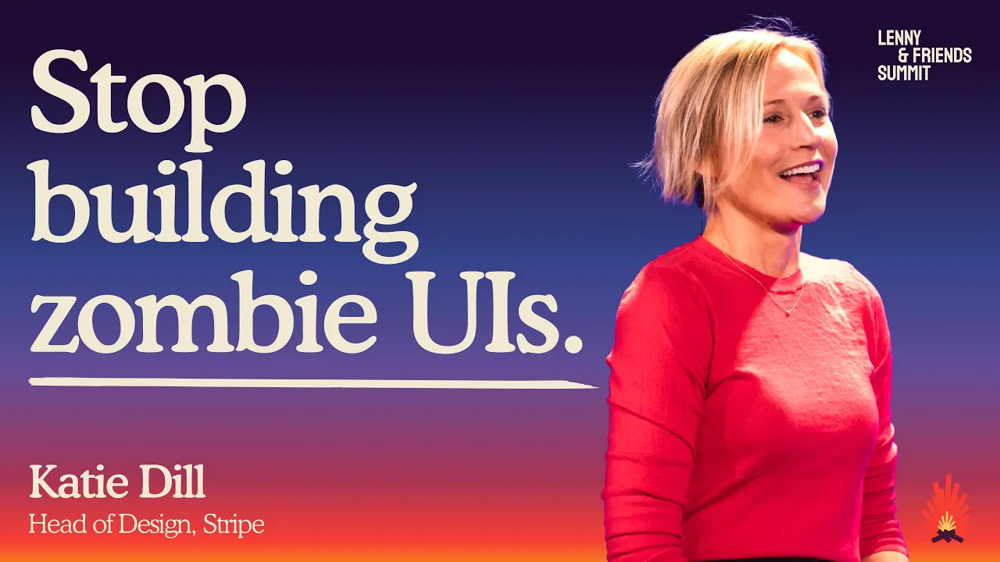

# How to scale intent, quality, and artistry with Al | Katie Dill (Stripe)

In this conference talk, Stripe's Katie Dill argues that AI's speed can produce generic, prematurely finished software. She proposes four ways to preserve care and originality: define a point of view, encode it into production tools, evaluate complete user experiences, and invest in creative exploration. Stripe's design tooling and creative projects illustrate the approach.

## Topic breakdown

1. [The AI building boom and three quality risks](./01-ai-building-boom-and-quality-risks.md) · 0:06–5:27
2. [Define a point of view and a shared quality bar](./02-point-of-view-and-quality-standards.md) · 5:27–9:06
3. [Encode intent into design systems and tools](./03-encode-intent-into-tools.md) · 9:06–12:10
4. [Edit the whole experience beyond done](./04-edit-beyond-done.md) · 12:10–16:26
5. [Use AI for creative exploration and artistry](./05-creativity-and-artistry.md) · 16:26–21:48

The [verbatim transcript](./transcript.md) is included for reference. Seven numbered figures accompany the topic notes, with explanatory captions below each image. Click an image to open the exact captured moment in the video.

## Key takeaways

- Dill identifies three risks of AI building: generic answers, polished output that feels finished too early, and disposable work without long-term ownership. [`2:17`](https://www.youtube.com/watch?v=GLvFTMtw4Jk&t=137) [`2:44`](https://www.youtube.com/watch?v=GLvFTMtw4Jk&t=164) [`3:56`](https://www.youtube.com/watch?v=GLvFTMtw4Jk&t=236)
- Quality should depend on the result users experience, regardless of whether AI made it. One Stripe ad critique ended with 17 specific improvements. [`7:12`](https://www.youtube.com/watch?v=GLvFTMtw4Jk&t=432) [`7:42`](https://www.youtube.com/watch?v=GLvFTMtw4Jk&t=462)
- Stripe's initial documentation-aware MCP produced inconsistent results. Its subsequent design-system CLI supplies documentation during building and includes full templates and flows to guide product behavior. [`11:09`](https://www.youtube.com/watch?v=GLvFTMtw4Jk&t=669) [`11:27`](https://www.youtube.com/watch?v=GLvFTMtw4Jk&t=687) [`11:45`](https://www.youtube.com/watch?v=GLvFTMtw4Jk&t=705)
- Faster building shifts quality filtering toward post-build editing. Someone must judge whether the complete journey solves the user's problem and feels coherent. [`13:06`](https://www.youtube.com/watch?v=GLvFTMtw4Jk&t=786) [`13:23`](https://www.youtube.com/watch?v=GLvFTMtw4Jk&t=803) [`13:45`](https://www.youtube.com/watch?v=GLvFTMtw4Jk&t=825)
- The event's AI-assisted opening animation took 56 iterations. Dill credits AI with allowing a more complex scene and more viewpoints while human scrutiny improved the result. [`15:46`](https://www.youtube.com/watch?v=GLvFTMtw4Jk&t=946)
- Leaders should spend some of AI's production savings on exploration. Dill's final quality test is solving user problems with thoughtful details and brand character. [`19:32`](https://www.youtube.com/watch?v=GLvFTMtw4Jk&t=1172) [`21:16`](https://www.youtube.com/watch?v=GLvFTMtw4Jk&t=1276)
